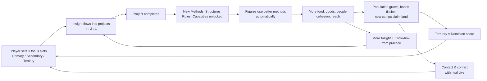

# 01 — Game Structure

> Working title: **CivSim** (in-fiction name for the player's people: *the Folk*).
> Status: MVP design draft v0.1. Nothing here is implemented.

---

## 1. Vision in one paragraph

CivSim is a **mostly hands-off civilization simulation** that runs from the **Paleolithic to post-modern times**: from the first knapped stone to the global information network. Each player is the *curiosity* of a small prehistoric band. The player never commands individual people. Instead, they decide **what their people try to learn next**: three research projects at a time, ranked Primary, Secondary and Tertiary. Everything else plays out on a living world map, where hundreds of small stylized figures forage, knap stone, raise huts, follow herds, split into new camps, trade, quarrel and expand. They act with whatever their civilization knows *right now*. Rival peoples, controlled by other players or AI, do the same. Over a match the starting stone tools grow into a sprawling web of hundreds of projects, and each one gives the figures a better way to do something they already do. The match is won by **owning the most land** and **learning the most, the soonest and the most efficiently**.

## 2. Design pillars

| # | Pillar | What it means in practice |
|---|--------|---------------------------|
| P1 | **Gardener, not general** | The player shapes conditions, not actions. No unit selection, no build menus, no move orders. If a feature needs micro-management, it is cut or automated. |
| P2 | **Every figure is someone** | The little people on the map are real simulation agents with needs, skills, families and jobs. Their visible behaviour *is* the game state, not a decoration over it. |
| P3 | **Knowledge is the lever** | Research is the main decision. Every project must change what figures *can do* or *how well they do it*, and the change must be visible on the map. |
| P4 | **The map is the scoreboard** | Territory is visible, contested and earned through population, cohesion and presence. You can read who is winning from a zoomed-out view. |
| P5 | **Sprawl of knowledge** | The research web starts tiny (7 starter projects) and grows into 509 projects across 33 lineages, plus 10 era Keystones. Discovery of the web is itself a pleasure. |
| P6 | **Grounded wonder** | Real technological history provides the backbone; stylized presentation provides the charm. |
| P7 | **Worthy rivals** | The first release is **one player vs. AI**, so the AI *is* the opposition and must be **smart**: it plans, reads the map and the player, adapts, times its research and its wars, and wins fairly. Difficulty comes from better thinking, never from hidden cheats. See [14-ai-opponents.md](14-ai-opponents.md). |

## 3. Setting and tone: "Grounded, stylized realism"

**Decision:** the world is **realistic in mechanics and fantastical only in presentation**.

- **The world** is procedurally generated and Earth-like, not real Earth: continents, climates, biomes, rivers, ore deposits and migrating herds that follow plausible rules. This keeps matches varied and avoids "Rome always starts in Italy" balance problems.
- **The technology** follows real human history from Oldowan pebble tools through the electric and atomic age. Projects carry real names (Levallois cores, cuneiform, the lateen sail, the Bessemer process) because real history is a richer, more surprising design source than invented fantasy tech. It also teaches without trying.
- **There is no magic.** Belief, myth and ritual are a full research lineage, but they work the way they did historically: as *social technology*. They raise cohesion, help groups grow larger, steady morale through famine, and justify claims to land. A people with strong myths really can hold more territory; the effect simply isn't supernatural.
- **The fantastical layer** is in tone. The look is a toy-like diorama with soft colors and readable silhouettes. Generated **Legends** are notable individuals the simulation surfaces (the first potter, a famous wayfinder, a chief who founded three villages), and a storybook **Chronicle** narrates what happened.

Rationale: total realism makes a dry spreadsheet, and total fantasy loses the "march of history" fantasy, which is the hook. The middle path keeps the hook and lets the art be friendly.

## 4. The player's role: "the Spark"

The player is not a king or a god. They are **the Spark**, the collective drive to understand and improve. Diegetically, research choices are the questions the elders ask around the fire. This framing explains why the player cannot order a particular person to chop a particular tree, and why the people sometimes do surprising things.

## 5. What the player decides

The design deliberately keeps the decision surface small.

### 5.1 Research Focus (core: about 80% of player agency)
- Three **focus slots**: **Primary**, **Secondary** and **Tertiary**.
- Each slot holds one research project. The civilization's research output (*Insight*) is split between them in a **4 : 2 : 1** ratio (about 57%, 29% and 14%). So, for equal costs, Primary finishes fastest, then Secondary, then Tertiary.
- Each slot can have an optional **queue**. When a slot finishes, by default the remaining projects **cascade up** (Secondary → Primary, Tertiary → Secondary), and the head of the queue fills Tertiary.
- If all queues are empty, the **Council of Elders** (auto-pick) fills the slot, guided by the player's **Leaning** (§5.2). The game never stalls waiting for the player.
- Full rules are in [02-research-structure.md](02-research-structure.md).

### 5.2 Leaning (persistent, optional)
- Three sliders, one per research theme (Craft, Kin, Reach), that weight the Council's auto-picks. A player who wants to be truly hands-off sets Leaning once and watches.

### 5.3 Beacons (spatial nudge, unlocked by research)
- The player can place up to *N* Beacons on the map: *"Go there."* A Beacon biases scouts, migrating bands, settlers and expansion toward that spot. The first Beacon is unlocked by **Songlines** (ART lineage). Later research raises *N* and strengthens the bias.
- A Beacon is a suggestion, not an order. Figures still weigh danger, distance and needs.

### 5.4 Posture (strategic nudge, unlocked by research)
- One civilization-wide stance: **Expand / Prosper / Fortify / Raid**. It shifts how the AI planners allocate labor (settlers vs. builders vs. guards vs. raiders).
- Unlocked by **Chieftainship** (GOV lineage). Before that, the band behaves on instinct (balanced).

### 5.5 What the player does **not** control
Individual people; job assignment; building placement; the routine of founding settlements and fighting. These all come from the simulation and its planners, which use the knowledge the player chose to research. The exceptions are the deliberate, rare calls of §5.6 and the politics orders (gift, barter, raid, war, peace, alliance; [18 §7](18-view-layer.md#7-player-commands)), which the same planners carry out under their own rules.

### 5.6 Decrees (Bronze age on, unlocked by KEY-3)
- From the Bronze age the player holds a little **Mandate** (1–4 points, regained every few years; more from Kingship, Law and Writing) and spends it on **Decrees**: *found a village there*, *send an expedition there*, *open that mine*, *raise the levy against that town*, *build the walls now* (corvée), *offer a tin compact*. Each one names a place or a moment and is executed by the planners, who may refuse it with a reason.
- About five to eight Decrees an era: decisions of *where* and *when* that the playtest asked for, without unit control. Rival AIs earn and spend Mandate the same way. Full rules: [22 §4](22-bronze-age.md#4-agency-mandate-and-decrees).

> **Attention cadence target:** a meaningful decision roughly every 1–3 minutes of real time, plus plenty of spare attention for watching. It should be fine to alt-tab for five minutes without losing.

## 6. Match structure

| Phase | Description |
|-------|-------------|
| **Lobby** | 2–8 civilizations, human or AI. Choose map size, world type (Pangaea, Continents, Archipelago) and **pace** (Quick / Standard / Epic). Every match covers the **whole arc, E0 → E9**; pace only scales the length of a season (§6 Time scale); research costs are the same at every pace. Shorter "Chapter" matches (e.g. E0–E4 only, or a later-era start) are post-MVP modes. |
| **World generation** | Seeded and deterministic. Every start gets a fair minimum (freshwater, forage, stone, game within *r* tiles); see [05-simulation-structure.md](05-simulation-structure.md). |
| **Dawn** | Each civilization starts as one band of **12 people** with no projects completed. Seven starter projects are available, and their neighbors are Glimpsed. |
| **Eras** | Each civilization advances through eras on its own by completing that era's **Keystone** project. |
| **End** | A **Dominion victory** (early end), an **Apex victory** (first to complete *Planetary Network* in the post-modern era), or the time limit, at which point **Legacy** is scored. |

### Time scale
- The simulation calendar is **abstract**: *"Year 37 of the Folk"*, not 37 BCE. Eras carry historical names, but calendar time is compressed, because a match would otherwise need 2 million years.
- At 1× speed and Standard pace: **1 season = 15 s**, **1 year = 60 s**.
- **Pace scales the calendar, not research costs.** A season lasts **7.5 s at Quick, 15 s at Standard and 26 s at Epic**, and costs are ×1 at every pace. Population runs on the calendar, so scaling only costs can't shorten a match: Quick at costs ×0.5 still ran 148 min against a 90 min target ([07-balance-findings.md](07-balance-findings.md) F7). Scaling the season plays the same match faster or slower.
- Match length for the full E0 → E9 arc: **Quick ≈ 90 min**, **Standard ≈ 3 h** (about 180 years), **Epic ≈ 5 h**. The balance model's tuned run gives 86 / 171.5 / 297 min. Single-player games autosave and can be resumed. Early eras are short and late eras long, because there is much more to do and watch late.
- Single-player has 0.5×, 1×, 2× and 4× speeds plus pause. Multiplayer runs at 1× (Quick pace by default) and has a limited pause budget per player.
- People age one year per in-game year: adulthood at 14, elderhood at 45. Lifespan is a function of Medicine research. Generational turnover happens within one match, so Legends can be born, rise and die while you watch.

## 7. Victory and scoring

### 7.1 Legacy (the score)
Legacy accumulates throughout the match:

| Component | How it's earned | Approx. weight in a typical game |
|-----------|-----------------|------|
| **Dominion** | Every in-game year, gain points equal to your share (%) of the **claimed** habitable land (your owned weight ÷ habitable weight owned by anyone, Free Folk included). Land is a running integral, so holding land early and long matters. Scoring on *claimed* rather than *all* habitable land spreads Dominion evenly across the match instead of 81% in E7–E9 ([07b](07b-territory-findings.md) T8). Its weight against Mastery is re-tuned so Dominion stays ~50%. | ~50% |
| **Mastery** | Points for every completed project, scaled by its era. | ~30% |
| **Firsts** | Bonus Legacy for being the **first** civilization in the world to complete a project. Bigger bonuses go to Keystones and Wonders. | ~15% |
| **Wonders** | Physically built great works (megaliths, ziggurats, lighthouses, cathedrals …). | ~5% |

"Complete their projects in the most optimal way possible" is rewarded through **Firsts** (speed), **Mastery** (breadth) and the **efficiency** that research gives your simulation, which feeds back into Dominion. Mastery and Firsts are counted in **Legacy units per era** (Mastery `2 × (era + 1)` per project, a First `3 × (era + 1)`, ×4 for Keystones and Wonders), so the split holds in every era ([22 §3.3](22-bronze-age.md#33-legacy-units-per-era)).

### 7.2 Dominion victory (early end)
Hold **≥ 50% of all habitable land *and* at least twice the runner-up's share, for 5 consecutive years**. A warning is broadcast to all players when someone crosses 40%.

**This is a conquest victory, by design (decision locked).** Peaceful expansion tops out around 25–30% of the world with four civilizations, so 50% means taking a whole neighbour plus about four settlements of another civilization, earliest around minute 120 (late Industry era) ([07b](07b-territory-findings.md) §9) ([07b](07b-territory-findings.md) T2). The 2× clause stops a narrow peaceful 51/46 split from winning a 2-player match. The AI must therefore be capable of planning and winning wars of conquest, and of seeing one coming ([14](14-ai-opponents.md)).

### 7.3 Apex victory
Be the first to complete the final Keystone, **KEY-10 Planetary Network**, from the post-modern Information era (E9). It has to be physically built as a constellation of uplink sites across your territory, which ties it back to Dominion, and rivals can sabotage it. The Apex ends the match and adds a large Legacy bonus. The final ranking is still by Legacy, so a dominant civilization that loses the race can still win on score.

## 8. Eras

| Era | Name | Real-world anchor | Keystone that **enters** this era | Representation scale (1 figure =) |
|-----|------|-------------------|-------------------------------------|---------------|
| E0 | **Dawn** | Lower/Middle Paleolithic | — (start) | 1 person |
| E1 | **Hunters** | Upper Paleolithic (~50–12 ka) | KEY-1 *Symbolic Mind* | 1 person |
| E2 | **Roots** | Neolithic | KEY-2 *Sedentism* | 1 person |
| E3 | **Bronze** | Chalcolithic & Bronze Age | KEY-3 *Age of Metal* | 1 person |
| E4 | **Iron** | Iron Age & Classical antiquity | KEY-4 *Iron & Law* | 2 people |
| E5 | **Faith & Fief** | Medieval | KEY-5 *Feudal Order* | 5 people |
| E6 | **Discovery** | Renaissance & early modern | KEY-6 *Printing Revolution* | 25 people |
| E7 | **Industry** | Industrial Revolution | KEY-7 *Industrial Revolution* | 100 people |
| E8 | **Modern** | Electric, motor & atomic age (~1880–1970) | KEY-8 *Electrification* | 250 people |
| E9 | **Information** | **Post-modern**: digital, global, post-industrial (~1970–present) | KEY-9 *Digital Revolution* | 500 people |
| — | (Apex) | — | KEY-10 *Planetary Network* (victory) | — |

Representation scale keeps the number of rendered figures per civilization roughly **≤ 600**, while the underlying population can reach the hundreds of thousands (the balance model peaks around 175,000 people in E9). The scale stays 1:1 through the Bronze Age, so every figure is literally someone (P2) until E4, and from E3 on about 300–500 figures are on screen at each era end ([07](07-balance-findings.md) F6).

**What "post-modern" means on the map:** in E9 figures become commuters, coders, logisticians and caretakers. Many jobs are done by *machines the figures supervise* (automated farms, container ports, robotic factories), so the visible work shifts from muscle to flows: traffic, data-link glows between cities, container ships and satellites crossing the map. Information-era themes include post-industrial service economies, global supply chains, mass media, environmental limits (pollution, climate, sustainability) and cultural globalization (soft power, which projects claim influence without settlement). These become the final strategic layer. When a civilization crosses an era, its figures briefly "gather" in a short animation and the map re-flows at the new scale.

## 9. The core loop

**Secondary loop (learning by doing):** whatever the people actually *do* builds up **Know-how** in the related lineage, which discounts future projects there. A coastal civilization that fishes constantly will find seafaring projects cheap. Geography shapes the research path, and research shapes how people use geography.

## 10. The three research themes (summary)

| Theme | Icon / color | Domain | **Purpose in the game** (what it buys you) |
|-------|--------------|--------|-----------------|
| **CRAFT** | hammer / amber | Tools, materials, building, machines, energy | **Output efficiency.** How much each pair of hands produces: gather rates, craft and build speed, tool tiers, structures, energy. *Craft turns people into production.* |
| **KIN** | hearth / green | Food, health, family, society, belief, art, learning | **People & cohesion.** How many people you can sustain, how healthy and fertile they are, how large a group can hold together before it splits, and how much Insight they generate. *Kin turns food into people and people into a society.* |
| **REACH** | compass / blue | Movement, seafaring, trade, writing, number, claims, defense, war, diplomacy, science | **Territory & contact.** How far your people travel, how strongly they claim and hold land, how they deal with rivals (trade, treaty or war), and how they push the frontier of knowledge. *Reach turns society into dominion.* |

Each theme has **11 lineages** (33 in total). Projects regularly require prerequisites from *other* themes, so a single-theme rush stalls. The details are in [02-research-structure.md](02-research-structure.md) and the catalog files.

**Why these three:** they map onto the three resources the scoring cares about. Craft makes **stuff**, Kin makes **people**, Reach makes **land and contact**. A healthy civilization needs all three, but *ratio* and *timing* are the strategic expression. A Craft-heavy civilization out-produces its neighbors on a small footprint. A Kin-heavy one booms in population and fissions across the map. A Reach-heavy one spreads thin and fast, trades, and contests borders.

## 11. Opponents

- **The first release is player vs. AI** (1 human + 3 AI civilizations). Online multiplayer comes later; the deterministic lockstep architecture is kept because it also gives replays and a fast AI-vs-AI test harness.
- Other civilizations follow **identical rules**. A human player differs from an AI only in who sets the three focus slots, Leaning, Beacons and Posture.
- The **AI Spark** is a *planner*, not a weighted dice roll. It values projects by simulating their payoff on its own economy, plans keystone routes several projects ahead, models the player (what they research, where they expand, how strong they are), races for contested frontier land, and decides when war, alliance or a defensive turtle wins. Personality archetypes (*Builder, Grower, Wanderer, Warlord, Sage*) shape style, never competence.
- Because figures act autonomously for everyone, the AI and the human use the *same* simulation brain below the research level. The smart-AI work goes into the *strategic* layers: the AI Spark, the Civ Mind, and their war and diplomacy decisions. The full design is in [14-ai-opponents.md](14-ai-opponents.md).

## 12. Balance safeguards (anti-snowball and comeback)

| Mechanism | Effect |
|-----------|--------|
| **Diffusion** | A project is 10% cheaper for each contacted civilization that already knows it (max −50%). Laggards catch up through contact. |
| **Fission** | Groups that exceed their social cap split, so expansion is natural for everyone and not a reward reserved for the leader. |
| **Overreach** | Cohesion drops with territory spread and distance from the core. Large empires must research Kin and Reach institutions to hold together, or regions break away and become *Free Folk*: neutral or new AI civilizations. |
| **Density disease** | Dense, poorly sanitized settlements suffer outbreaks (MED lineage mitigates them). |
| **Firsts are one-time** | The leader gets the bonus, but followers get diffusion discounts. |

## 13. UX surfaces (non-binding sketch)

> The concept design for all of these is in [08-ui-and-world-display.md](08-ui-and-world-display.md).

1. **World view.** A pannable, zoomable diorama map with territory tint, figures, herds, structures and weather.
2. **Focus bar.** Three slots always visible at the bottom of the screen, each with a progress ring and an ETA.
3. **Research web.** A zoomable graph of all 33 lineages that shows known, available, slotted and locked projects, and their links across themes.
4. **Chronicle.** A storybook feed of notable events ("Ama of the River Folk fired the first clay pot").
5. **Overlays.** Territory and claim strength, resources, food security, cohesion, Know-how heat, and efficiency. Efficiency shows which jobs run on which methods, so a new project's impact is visible on the map.
6. **Follow cam.** Click any figure to follow them and read their life (needs, job, family, skills).
7. **Moments.** A brief picture-in-picture highlight when a project completes: the first figure performs the new action, with a sparkle. It never takes over the camera unless Director mode is on.
8. **Director and lean-back modes.** An auto-camera that tours interesting events, and a HUD-light watching mode. A "While you were away" digest appears when the player returns after alt-tabbing.

## 14. Scope: MVP vs. full game

| Area | **MVP** | Full game |
|------|---------|-----------|
| Eras playable | **All ten, E0–E9 (Dawn → Information)**, plus the Apex | Same, plus "Chapter" modes (partial-arc matches, later-era starts) |
| Research projects playable | The full catalog (509 projects + 10 Keystones). E0–E4 get bespoke "Moments" and sprites; E5–E9 use generic visual treatments where needed | All bespoke |
| Civs per match | 4 (1 human + 3 AI) | 2–8, online multiplayer |
| Player levers | Focus slots, queues, Leaning, Beacons, Posture, politics orders; from E3 Mandate and Decrees, Compacts and Embargo ([22](22-bronze-age.md)) | + Era Charters, negotiated treaties |
| Map | Continents type, sized ~4,000 tiles per civilization (160 × 100 for 4); starts in **neighbour pairs ~25 tiles apart** so your first rival appears in E1–E2 ([07b](07b-territory-findings.md) T1, T7) | Multiple types; 2–8 player sizes |
| Victory | Legacy, Dominion, Apex | Same |
| Multiplayer | Local AI only; deterministic sim built for lockstep from day one | Online lockstep multiplayer |

The MVP is built **era by era** (vertical slice E0–E2 first). The release definition is the *complete arc*, because the march from stone to silicon is the product's identity. See [06-next-steps.md](06-next-steps.md).

The full rationale and roadmap are in [06-next-steps.md](06-next-steps.md).
