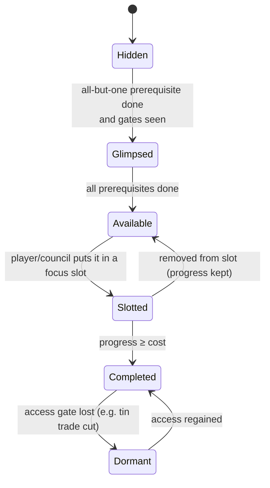

# 02 — Structure of the Research System

> This document defines **how research works**: the anatomy of a project, the focus-slot math, costs, prerequisites, learning by doing, adoption on the map, and era progression.
> The **actual projects** are in [03-research-catalog.md](03-research-catalog.md) and its three theme files. Their **paths** are mapped in [04-research-paths.md](04-research-paths.md).
> All numbers are **provisional**. The Insight, EraBase, breadth and Know-how constants below are the first balance-model pass ([07-balance-findings.md](07-balance-findings.md)); later tuning is tracked in [06-next-steps.md](06-next-steps.md).

---

## 1. Goals of the research system

1. **One decision, big consequences.** Choosing three projects should be the most interesting thing the player does.
2. **Visible payoff.** Every project changes something you can *see* figures doing differently.
3. **Sprawl.** 7 starter projects are available at the dawn of a match. By the Iron Age more than 250 are known or in view, and the full catalog is **509 projects + 10 Keystones across 33 lineages**.
4. **Geography matters.** What your people encounter and practice shapes what is cheap or even possible.
5. **No dead ends, no single optimal path.** Every lineage stays useful across the whole match, and the three themes cross-require each other.

## 2. Hierarchy

```
Theme (3)  ─┬─ CRAFT ─┬─ Lineage (11)  e.g. STN Stoneworking
            │         │      └─ Project (~10–15 per lineage)  e.g. STN-03 Prepared Cores
            ├─ KIN   ─┤
            └─ REACH ─┘
Keystones (KEY-1 … KEY-10) sit outside lineages and gate eras.
```

- A **Theme** is a broad domain with a strategic purpose (Craft = output, Kin = people, Reach = land and contact).
- A **Lineage** is a coherent line of development (e.g. *Metallurgy*). Its projects mostly chain inside the lineage but branch into and draw from others.
- A **Project** is a single research item. When completed it applies one or more **Effects**.

## 3. Anatomy of a project

Every project in the catalog is defined by these fields (the catalog tables show a compressed subset):

| Field | Description | Example (STN-04 Hafting) |
|-------|-------------|---------|
| `id` | `LIN-NN`, a lineage code plus a sequence number | `STN-04` |
| `name` | Historical or descriptive name | Hafting |
| `theme` | CRAFT / KIN / REACH | CRAFT |
| `lineage` | Three-letter lineage code | STN |
| `era` | E0–E9; the minimum era the civilization must be in | E0 |
| `type` | D / M / S / R / I / W / K (see §4) | M |
| `requires` | **All-of** list of project ids | `STN-03, FIB-01` |
| `requiresAny` | **One-of** list (optional), written `(A \| B)` in the catalog | — |
| `gates` | Exposure or environment conditions (see §6) | — |
| `cost` | Derived from era and type (see §8); a manual override is allowed | 20 × 1.0 |
| `effects` | List of effect primitives (see §11) | UnlockMethod(Chop: Hafted Axe), Modifier(Hunt.Kill, +40%) |
| `practice` | Which activities generate Know-how for this lineage | knapping, chopping |
| `flavor` | One-line Chronicle text | "Stone married to wood; the spear was born." |
| `anchor` | Historical reference (for writers, not shown in game) | ~300 ka, Middle Paleolithic |

## 4. Project types

| Code | Type | What it unlocks | Visible on map as… | Cost mult. |
|------|------|-----------------|--------------------|-----------|
| **D** | **Discovery** | A *new* action, resource interaction or good (e.g. *Fishing*, *Clay Gathering*) | Figures start doing something new | ×1.0 |
| **M** | **Method** | A *better way* to do an existing action: an efficiency rung on a method ladder (§12) | Same job, faster or with better output; new tool sprites | ×1.0 |
| **S** | **Structure** | A building or improvement the settlement planner may build | New building appears | ×1.2 |
| **R** | **Role** | A specialist job (Shaman, Potter, Smith, Scribe…) | Figures with distinct outfits | ×0.8 |
| **I** | **Institution** | A social or political capacity: group cap, governance, law, player levers | Settlement tier changes, banners, gatherings | ×1.5 |
| **W** | **Wonder** | A unique great work that must be **built** after research. Only one per civ; several civs may build their own. | Huge landmark under construction | ×2.0 (+ build) |
| **K** | **Keystone** | Era transition (§13) | Era celebration; figure scale re-flow | ×2.5 |

**Catalog v0.1 mix:** 50% M, 20% I, 16% D, 12% S, 1% R, 1% W, plus 10 K. Methods dominate because "doing the same things with greater efficiency" is the core fantasy. Most **roles** (Smith, Scribe, Priest, Governor…) are granted *inside* Discovery, Structure and Institution projects rather than as standalone Role projects. That keeps the web from filling with "hire a specialist" nodes.

## 5. Prerequisites

- **Hard prerequisites (`requires`)**: every listed project must be complete.
- **Soft prerequisites (`requiresAny`)**: at least one listed project must be complete. These model alternative historical routes, e.g. *Bronze Working* needs Tin **or** Arsenic access.
- **Era requirement**: a project of era *E* can only be researched by a civilization that has reached era *E* (i.e. completed KEY-*E*). This is implicit and not listed in `requires`.
- **Cross-theme rule** (authoring rule): from E1 on, at least **35% of projects** in each lineage must have a prerequisite from another theme. This is what weaves the three themes together.
- **No cycles.** Validated by tooling.

## 6. Gates (the world shapes research)

Gates are conditions about the **simulation state**, not the tech tree. **Only `[Seen]` gates block research.** All other gates block *use*.

| Gate | Blocks… | Meaning | Example |
|------|---------|---------|---------|
| `[Seen: X]` | **Research** (the project stays **Hidden**) | **Exposure gate.** Satisfied when **any** of these happens: (a) one of your figures *sees* resource or creature X; (b) X arrives in your stores through **trade**; (c) a **contacted** civilization has already completed the project (knowledge diffuses). | `[Seen: Native copper]` for MET-01; `[Seen: Wild horses]` for HUS-07 |
| `[Has: X]` | **Use** (methods stay **Dormant**) | **Access gate.** X is inside your territory *or* flows in through trade. You can research the project anywhere, but it does nothing without X. | `[Has: Tin]` for MET-05 |
| `[Near: X]` | **Use** (structures can only be built there) | **Environment gate.** Structures and methods work only in settlements adjacent to terrain X. Research is allowed anywhere, so a river-less civilization can still pass *through* Irrigation toward Urbanism; it just can't irrigate. | `[Near: River]` for Water Wheel; `[Near: Coast]` for whaling |
| `[Climate: X]` | Nothing (soft) | Cost discount (×0.7) and full effect only in climate band X. | `[Climate: Cold]` for Snowshoes & Skis |

Gates are why two civilizations on the same map develop differently, and why exploration (Reach) and trade unlock the other two themes.

### 6.1 Keystone-critical gates and world-generation guarantees
The catalog validator ([06-next-steps.md](06-next-steps.md) §4) checks which `[Seen]` gates sit on the only path to a Keystone. As of catalog v0.1 they are:

| Gate | Blocks if never satisfied | Guarantee |
|------|---------------------------|-----------|
| Seen: Clay | KEY-3 (and ~375 projects) | **Start guarantee:** within 20 tiles of every start |
| Seen: Native copper | KEY-3 (~309) | **Start guarantee:** an outcrop within 20 tiles |
| Seen: Wolves | KEY-4 (~297) | **Start guarantee:** wolves are a common predator in all non-desert biomes |
| Seen: Wild goats or sheep | KEY-4 (~293) | **Start guarantee:** a small wild herd species (goat, sheep, or camelid in the Americas-like biome set) within 25 tiles |
| Seen: Gold or Silver | KEY-5 (~191) | **Continental guarantee:** at least one deposit on every continent with a start (often contested) |
| Seen: Coal | KEY-7 (~132) | **Continental guarantee** |
| Seen: Oil seep | KEY-10 (~50) | **Continental guarantee** (shallow or offshore) |

All other `[Seen]` gates (salt, silk moths, wild horses, camels or llamas) gate optional branches, so geography makes them luxuries, not locks. Continental guarantees are deliberately **few and contestable**: Coal and Oil fields become flashpoints, which is good for the "occupy the map" competition.

## 7. Project states



- **Hidden**: not shown in the research web at all, which keeps the early web small.
  - *UI exception (Dawn and Hunters only, `RevealPathThroughEra` in `Game.ResearchWeb.cs`):* the required path to the current age's turning point is shown by name as locked steps ("Not in reach yet — needs X"), so the goal of the age can be planned. This is display only: the sim still treats those projects as Hidden, they cannot be started or queued, and everything off the path (including any-of alternatives and free picks) stays hidden.
- **Glimpsed**: shown as a silhouette with its name and a "?" icon, plus the missing prerequisite. Glimpsing builds anticipation and makes the web *sprawl* outward as you play.
- **Available**, **Slotted**, **Completed**: as named.
- **Dormant**: completed, but a needed input is unavailable; its methods fall back to the previous rung.
- **Progress is never lost.** A project removed from a slot keeps its progress (no decay in the MVP). Swapping freely is fine because Insight is the scarce resource, not progress.

## 8. Insight and cost

### 8.1 Insight production (per in-game year)

```
Insight/yr = Commons + Roles + Structures
  Commons    = 4.8 × (adult population) ^ 0.85 × LearningMult
  Roles      = Σ specialist output (Elder 8, Shaman 12, Priest 16, Scribe 24, Scholar 48, Researcher 120 … per figure-equivalent)
  Structures = flat outputs (Monastery +16 each, Library +X, University +Y, Observatory +Z …)
  LearningMult = product of LRN-lineage modifiers (starts at 1.0)
```

- **Scale:** the starting band of 12 (8 adults, 2 elders) makes about 40 Insight per year, enough to finish E0 in 7–9 minutes. v0.1 used a coefficient of 0.6 and role outputs one-eighth of these, which made E0 take ~58 minutes. Every output was scaled ×8 together, so the commons-vs-specialist ratios are unchanged ([07](07-balance-findings.md) F1).
- **Live calibration (M4).** The whole formula (Commons, roles and structures together) is multiplied by `InsightCalibration` = **1.6** in `content/constants/balance.yaml`. With exact ages the first children reach adulthood only at minute 14, so the live adult stock through E1 trails the balance model's smoothed one by 30–40%, and the 7.5 / 17.5 / 29 minute Keystone targets needed the factor ([07c §7a](07c-e0-e2-checks.md#7a-c5-in-the-live-sim-m4-2026-10-19)). It is the same kind of change as the ×8 above. E3+ EraBase has since changed under the cadence follow-up; validate the new E2+ timing in a fresh live acceptance run ([07c §10.1](07c-e0-e2-checks.md#101-roots-and-bronze-still-finish-too-quickly-2026-10-24)).
- The sublinear population exponent (0.85) keeps huge empires from researching at absurd speed. Specialists and institutions are how large civilizations stay ahead. The balance model found that lowering the exponent changes little ([07](07-balance-findings.md) F3), so it stays at 0.85.
- Children contribute nothing. Elders contribute double Commons (wisdom), which makes keeping elders alive (MED, FOD) a research strategy.

### 8.2 The slot split

| Slot | Share | Note |
|------|-------|------|
| Primary | 4/7 ≈ 57% | |
| Secondary | 2/7 ≈ 29% | |
| Tertiary | 1/7 ≈ 14% | |

- If a slot is **empty**, its share is redistributed proportionally to the occupied slots. The player is never punished for having fewer than three available projects, which can happen in the first minutes.
- **Cascade**: when a project completes, the projects below it slide up one slot, and the queue head (or, after its grace period, the Council) fills the Tertiary slot ([08 §7](08-ui-and-world-display.md#7-focus-bar)). A slot is never refilled in place: a long chain would otherwise sit in the 1/7 slot for minutes.
- **Overflow**: Insight that exceeds a project's remaining cost carries into the project that cascades into that slot.
- **Focus bonus** (optional; tune in playtest): if all three slotted projects share a theme, +10% total Insight ("deep focus"). If they span all three themes, Know-how gain is +10% ("broad curiosity"). This is a light flavor choice and is *off* by default in the MVP.

### 8.3 Cost formula

```
Cost = EraBase[era] × TypeMult[type] × DiffusionMult × EraLagMult × GateMult
```

| Era | E0 | E1 | E2 | E3 | E4 | E5 | E6 | E7 | E8 | E9 |
|-----|----|----|----|----|----|----|----|----|----|----|
| **EraBase** | 22 | 50 | **150** | **400** | **1,200** | **6,000** | **32,000** | **280,000** | **1,700,000** | **9,000,000** |

*The WS-H fit ([09 §11.1](09-population-and-health.md#111-re-fit)) is historical. The current cadence for E2–E9 is the follow-up in [07c §10.1](07c-e0-e2-checks.md#101-roots-and-bronze-still-finish-too-quickly-2026-10-24); those longer-era projections still need fresh live acceptance runs.*

The original EraBase fit was done era by era to the pacing targets below ([07](07-balance-findings.md) F2), not as a flat ratio. v0.1's flat ×2.5 per era (20 · 50 · 125 · … · 75,000) ran the early eras 4–7× too long and the late eras 1.4–2× too short, because Insight compounds faster than ×2.5 once population growth and the late LRN multipliers stack. The current curve deliberately exceeds several earlier per-era windows to slow project cadence, especially from Roots onward. Re-fit with `balance/tools/fit.py` whenever the Insight multipliers or demography change.

- **DiffusionMult** = 1 − 0.10 × (number of *contacted* civs that know it), with a floor of 0.5.
- **EraLagMult** = 0.7 ^ (current era − project era). Backfilling old projects is cheap, so neglecting a lineage is recoverable.
- **GateMult**: climate and other soft gates (e.g. 0.7).
- **Know-how** is applied as *progress*, not as a cost reduction (§9).

**Pacing target (Standard pace, 1×):**

| Era | Target real-time duration | Projects a typical civ completes in era | Visible projects at era end |
|-----|---------------------------|------------------------------------------|-----------------------------|
| E0 | 7–9 min | 13–16 | 34 |
| E1 | 9–11 min | 14–17 | 93 |
| E2 | 11–13 min | 20–23 | 145 |
| E3 | 12–14 min | 22–25 | 210 |
| E4 | 14–16 min | 21–24 | 266 |
| E5 | 16–18 min | 16–19 | 315 |
| E6 | 18–20 min | 14–17 | 356 |
| E7 | 22–24 min | 14–17 | 399 |
| E8 | 26–28 min | 18–21 | 459 |
| E9 | 28–32 min | 17–20 (+ Apex) | 509 |

"Visible" means projects of eras up to the current one (not all of them Glimpsed yet). Catalog sizes per era are in [03-research-catalog.md](03-research-catalog.md).

The original target was ≈ 3 hours for the full arc at Standard (Quick ≈ 90 min). The progressive cadence model runs 195 min Standard (Quick 97.5, Epic 338; [07c §10](07c-e0-e2-checks.md#10-progressive-research-cadence-follow-up-2026-10-24)). Pace changes the season length, not these costs ([01](01-game-structure.md) §6). The added cost grows in later eras so their projects take longer to complete.

So a civilization completes roughly **30–40% of each era's projects** (each era offers 34–65) before moving on. That is the source of meaningful choice and divergent civilizations. The EraLag discount makes backfilling attractive later.

## 9. Know-how (learning by doing)

- Every lineage has a **Know-how pool**.
- Figures generate Know-how while performing **practice activities** mapped to lineages (for example: knapping → STN; hunting → HNT; carrying goods on long trips → TRN; any trade transaction → TRD; burying the dead → BEL; telling stories at the fire → ART and COM).
- Rate: a practising figure generates Know-how equal to **35% of its own Commons Insight** while it practises, scaled by its skill in the activity and split across the lineages of what it practises. Tuned so Know-how stays at roughly 13–20% of research progress in every era, and so a lineage the civilization practises heavily discounts roughly 25–40% of its next project. (v0.1's flat 0.05 per figure-equivalent per season grew only with headcount, so its share fell from 18% in E0 to 2% in E9: [07](07-balance-findings.md) F4.)
- **Application:** while a project of that lineage is *slotted* (any slot), Know-how drains into its progress at up to **100% of the slot's Insight rate**, until Know-how has covered **at most 50%** of the project's cost.
- **Why:** this ties the simulation to research, makes geography express itself in the tech path, and rewards keeping the *same* lineage slotted. The player gets a visible "your people are practised at this" signal: the project glows in the web.

## 10. Adoption: how a completed project reaches the map

When a project completes, its effects do **not** apply to all figures at once.

1. **Innovator moment.** One figure, usually the one with the highest relevant skill, performs the new action first. A picture-in-picture "Moment" shows it (see [08 §10](08-ui-and-world-display.md#10-notifications-and-highlights)), and the Chronicle names them.
2. **Spread.** Each new *Method* is a **skill** that spreads person to person. Every season, each figure who knows it teaches it to nearby co-workers with probability `p_teach` (base 0.25; LRN projects raise it). Structures and roles unlock when the settlement planner decides to build or assign them.
3. **Saturation.** Typical full adoption in one settlement takes 2–4 seasons. Across a sprawling civilization it takes longer, with distant camps lagging. Roads, writing and schools speed it up.

**Why:** adoption gives research a **visible ripple across the map**, makes compact or well-connected civilizations adopt faster (a real trade-off against sprawl), and creates natural "power curves" that are less spiky than instant global buffs.

## 11. Effect primitives

The catalog's "Effect" column uses these primitives (abbreviated in the tables):

| Primitive | Meaning | Catalog shorthand |
|-----------|---------|-------------------|
| `UnlockAction(a)` | Figures may now perform a new action | **+Action:** Fish |
| `UnlockMethod(action, method)` | New rung on an action's method ladder (§12) | **Method:** Chop ▸ Hafted Axe |
| `UnlockStructure(s)` | Settlement planner may build *s* | **Build:** Granary |
| `UnlockRole(r)` | Specialist job | **Role:** Shaman |
| `UnlockGood(g)` | New item type (tool, food, trade good) | **Good:** Pottery |
| `Modifier(stat, value, scope)` | Percentage or flat change to a stat | `+25% forage yield` |
| `RaiseCap(cap, value)` | Raises a capacity (group cap, storage, housing, claim radius…) | **Cap:** group 50→150 |
| `UnlockLever(l)` | Player-facing lever (Beacon, Posture …) | **Lever:** Beacon ×1 |
| `Reveal(x)` | Map knowledge: shows resource type x in sight range, or reveals terrain | **Reveal:** ores within 6 |
| `EnableDiplo(d)` | New diplomatic interaction | **Diplo:** Trade pact |
| `EraAdvance` | Keystones only | — |

## 12. Method ladders: "greater and greater efficiency"

Every core **action** in the simulation has a **ladder** of methods. Research adds rungs, and figures always use the **best rung they know** and have the inputs and tools for. This is the backbone of the progression fantasy.

**Example: the *Chop Wood* ladder**

| Rung | Method | Project | Rate mult. | Notes |
|------|--------|---------|-----------|-------|
| 0 | Break & gather deadwood | start | 1.0 | Only fallen wood |
| 1 | Pebble chopper | STN-01 | 1.5 | Can fell saplings |
| 2 | Hand axe | STN-02 | 2.0 | Can fell small trees |
| 3 | Hafted stone axe | STN-04 | 3.0 | |
| 4 | Polished stone axe | STN-07 | 4.0 | Forest clearing becomes practical |
| 5 | Copper axe | MET-03 | 4.5 | Needs copper |
| 6 | Bronze axe | MET-04 or MET-05 | 6.0 | Needs arsenic or tin access |
| 7 | Iron axe | MET-09 | 8.0 | Cheap metal for everyone |
| 8 | Frame and crosscut saw | WOD-08 | 11 | |
| 9 | Water-powered sawmill | WOD-09 | 20 | Structure; output at the mill |
| 10 | Steam sawmill | WOD-11 | 40 | |
| 11 | Chainsaw | WOD-13 | 80 | |
| 12 | Mechanized harvester | WOD-14 | 160 | Sustainable-yield rules apply |

Every action ladder (forage, hunt, fish, farm, herd, chop, quarry, mine, smelt, craft, build, haul, cook/preserve, heal, teach, trade, travel, claim, fight, defend) is defined the same way. The full action list is in [05-simulation-structure.md](05-simulation-structure.md) §6. **Target efficiency growth: about ×1.5–2 per era on core actions.** The catalog marks each method rung with ▸.

## 13. Keystones and eras

- Each era transition is a **Keystone** project (`KEY-1` … `KEY-9`), plus `KEY-10`, the Apex, which ends the match.
- A Keystone requires: (a) **4 named projects** that together span **all three themes**, and (b) **Era breadth**, meaning at least *N* completed projects of the current era.
- *N* is set to the era's **critical path** (the minimum in-era prerequisites of the named projects, computed by the validator) **plus 3–4 discretionary projects**. Every civilization therefore makes real choices in every era, beyond the forced march. Critical paths are listed in [04-research-paths.md](04-research-paths.md) §2. The balance model ([07](07-balance-findings.md) F9) confirmed these N values, with one change: E3 drops from 22 to 21. E0 has only 2 free picks (11 of its 13 are forced), which is accepted for the onboarding era.

| Keystone | Enters | Breadth N | Named prerequisites (summary; exact list in catalog) |
|----------|--------|-----------|-------------------------------------------------------|
| KEY-1 Symbolic Mind | E1 | 13 of E0 | Spoken Language, Fire Making, Hafting, Kin Bonds |
| KEY-2 Sedentism | E2 | 14 of E1 | Wild Cereal Harvest, Storage Pits, Pit House, Seasonal Round |
| KEY-3 Age of Metal | E3 | 20 of E2 | Copper Smelting, Chiefdom, Exchange Networks, Tally Tokens |
| KEY-4 Iron & Law | E4 | 21 of E3 | Bloomery Iron, Writing, Code of Law, Market Towns |
| KEY-5 Feudal Order | E5 | 21 of E4 | Heavy Plough, Feudal Contract, Organized Faith, Castle Building |
| KEY-6 Printing Revolution | E6 | 16 of E5 | Movable Type, Double-Entry Bookkeeping, Magnetic Compass, Universities |
| KEY-7 Industrial Revolution | E7 | 14 of E6 | Steam Engine, Factory System, Joint-Stock Company, Scientific Method |
| KEY-8 Electrification | E8 | 14 of E7 | Electric Generator, Telegraph, Railways, Germ Theory |
| KEY-9 Digital Revolution | E9 | 18 of E8 | Transistor, Electronic Computer, Mass Education, Global Trade Order |
| KEY-10 Planetary Network (Apex) | victory | 17 of E9 | Internet, Satellite Constellation, Sustainable Grid, Global Governance Forum (must be **built** as uplink sites) |

**Era effects:** entering a new era (a) unlocks visibility of that era's projects (the web grows), (b) changes representation scale, (c) grants a one-time **Era Boon** (MVP: +1 Beacon or +5% Insight, chosen automatically by Leaning), and (d) awards Legacy plus Firsts if applicable.

## 14. Firsts and diffusion

- **Firsts:** the first civilization in the world to complete a project earns Legacy (era base × 0.5; ×3 for Keystones and Wonders) and a permanent **Pioneer** tag on that project: +10% to its modifiers for that civilization only. Firsts are announced to all players: "The River Folk were first to sail."
- **Diffusion:** see §8.3. A civilization learns about a project's *existence* (it moves from Hidden to Glimpsed) when a contacted civilization completes it, even if the normal prerequisites for glimpsing aren't met. Contact therefore also expands your visible web.

## 15. The Council of Elders (auto-pick)

Used when slots and queues are empty, and by AI civilizations as their base brain.

**Score of an available project:**
```
Score = Leaning[theme]
      × (1 + Urgency)          # famine → food lineages; raids → DEF/WAR; disease → MED; cohesion crisis → BEL/GOV/SOC
      × (1 + Opportunity)      # Know-how stored; resources newly seen; diffusion discount
      × KeystoneProgress       # boost for any project in the next keystone's closure
      / Cost
```
**KeystoneProgress** applies to the next keystone's *whole closure*: every project its four named prerequisites need, transitively, including backfills from earlier eras. Boosting only the four named projects leaves the Council blind to the backfills a closure forces. KEY-3 needs 25 projects from E0–E1 that KEY-2 didn't, and KEY-10 needs 52 ([07](07-balance-findings.md) F8).
The top three scores fill Primary, Secondary and Tertiary. Urgency signals come from the simulation (food-security index, recent deaths by cause, border tension, cohesion level). Tie-breaks are deterministic (by id), for lockstep safety. The scorer also returns each suggestion's **dominant factor** (e.g. "famine risk", "keystone path", "rivals know it"), which the UI shows as a reason tag ([08 §8.6](08-ui-and-world-display.md#86-hub-emphasis-and-suggestions)).

**As built (M4).** `KeystoneProgress` is 3 plus the length of the chain still ahead of the project inside the closure, so the critical path leads; a keystone that has become Available adds +20. When the closure is finished and the era's breadth `N` is still short, any project of the current era counts ×2 (earlier-era backfills do not count toward breadth). `Opportunity` is stored Know-how, the discount a contacted rival's knowledge gives, and **Insight gain** (roles, Commons mods, SOC-03 sharing, weighted ×16), so a band that can get wiser does so early. `Urgency` is 2 × the matching signal (famine → FOR HNT FOD AGR HUS SEA; threat → DEF WAR DIP; disease → MED; cohesion → BEL GOV SOC ART). An **AI** civilization keeps its best-scoring work in Primary and pulls a ready keystone straight into it; the **player's** slots are never reordered, and the player's Council waits one season (150 ticks) before filling an empty slot. A queued project is taken at once.

## 16. Catalog notation

- `ID` uses `LIN-NN`. Keystones use `KEY-N`.
- **Era**: E0–E9. **Type**: D/M/S/R/I/W/K.
- **Requires**: comma-separated ids = all-of; `(A | B)` = any-of; `[Seen: …]`, `[Has: …]`, `[Near: …]` = gates.
- **Effect** shorthand: `▸ Action: Method` = method rung; `+Action` = new action; `Build:` = structure; `Role:`; `Cap:`; `Lever:`; `Reveal:`; `Diplo:`; `Good:`; plus percentage modifiers.
- Every project in the catalog is in MVP scope (the MVP spans E0–E9). E0–E4 projects get bespoke visual Moments in the MVP; E5–E9 may ship with generic ones.

## 17. Authoring checklist (for every new project)

1. Does it **change what figures do** or **how well** they do it, in a way visible on the map?
2. Is it on an **action ladder** (Method), or does it unlock something new (Discovery, Structure, Role)?
3. Does it have at least one **cross-theme** link, in either direction?
4. Are there **gates** that let geography express itself?
5. Is there **practice** that feeds its lineage's Know-how?
6. Is it historically grounded, with an anchor recorded, and does it have a one-line flavor?
7. Does it avoid being a pure "+X% to everything"? Global multipliers are reserved for Keystones and Institutions.
