# 04 — Research Paths

> Maps of how the 509 projects connect: the keystone spine, the weave between themes, full maps of the first three eras, keystone-critical maps for every later era, the method ladders across eras, and example strategic paths.
> Every diagram here is **generated from the catalog tables** by the validator and then pasted in. When the catalog changes, regenerate them; see [06-next-steps.md](06-next-steps.md) §4.

**Legend:** amber = Craft · green = Kin · blue = Reach · dark hexagon = Keystone. Solid arrow = required; dotted arrow = one-of alternative. **◂** = also requires a project from an earlier era (not drawn).

---

## 1. The keystone spine (the shape of a whole match)

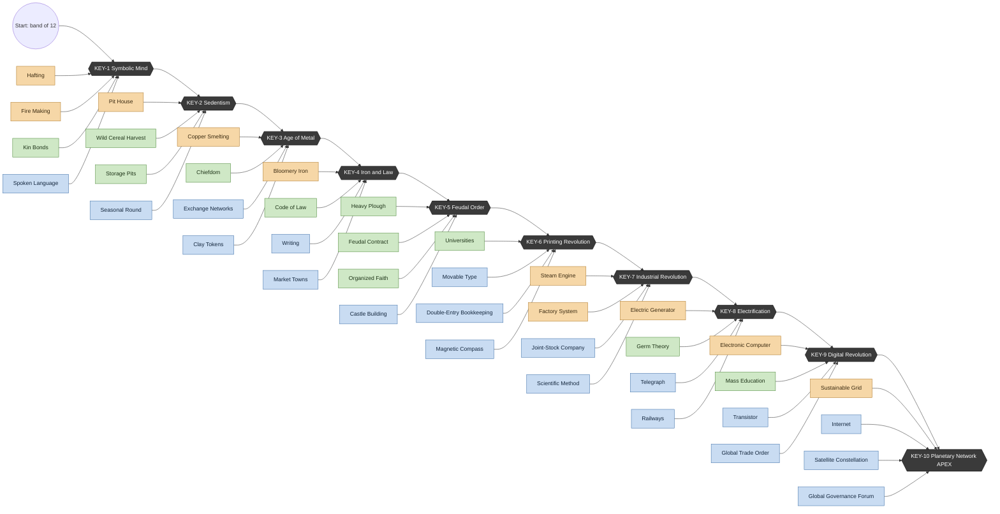

## 2. Critical paths and breadth

"Closure" is every project that *must* be completed to unlock the keystone (choosing the cheaper side of each one-of). "In-era" is the part of that closure inside the current era. **Breadth N** is the number of current-era projects the keystone demands, so **N − in-era** is the number of free choices each era guarantees.

| Keystone | Transition | Closure (all eras) | In-era critical | Breadth N | Free picks |
|----------|------------|-------------------:|----------------:|----------:|-----------:|
| KEY-1 Symbolic Mind | E0 → E1 | 11 | 11 | 13 | 2 |
| KEY-2 Sedentism | E1 → E2 | 28 | 11 | 14 | 3 |
| KEY-3 Age of Metal | E2 → E3 | 70 | 17 | 20 | 3 |
| KEY-4 Iron & Law | E3 → E4 | 108 | 18 | 21 | 3 |
| KEY-5 Feudal Order | E4 → E5 | 153 | 17 | 21 | 4 |
| KEY-6 Printing Revolution | E5 → E6 | 174 | 12 | 16 | 4 |
| KEY-7 Industrial Revolution | E6 → E7 | 210 | 10 | 14 | 4 |
| KEY-8 Electrification | E7 → E8 | 227 | 10 | 14 | 4 |
| KEY-9 Digital Revolution | E8 → E9 | 278 | 14 | 18 | 4 |
| KEY-10 Planetary Network | E9 → Apex | 338 | 13 | 17 | 4 |

**Balance pass ([07](07-balance-findings.md) F9):** KEY-4's breadth N drops from 22 to 21, so E3 completions land inside the 22–25 band in [02 §8.3](02-research-structure.md#83-cost-formula). The balance model's catalog parser finds shorter paths than this table from KEY-4 on: KEY-4's in-era path is 16 rather than 18 (5 free picks rather than 3), and every closure from KEY-4 to KEY-10 comes out 3–4 smaller (e.g. 104 rather than 108). The offset probably comes from a different pick on one any-of. The catalog validator (WS-M) should settle the tie-break rule; until then this table keeps the hand-derived paths.

Of the 509 projects, **338** are on the Apex closure; the other **171 are entirely optional**. They are pure strategy and geography: wonders, warfare beyond the basics, luxury goods, most of the medicine and culture lines.

## 3. The weave: how the themes feed each other

Prerequisite edges by theme (row = provider → column = consumer):

| from ↓ / to → | Craft | Kin | Reach |
|---|---:|---:|---:|
| **Craft** | 274 | 52 | 66 |
| **Kin** | 26 | 206 | 41 |
| **Reach** | 38 | 55 | 238 |

About **28%** of all prerequisite links cross themes. **Craft is the biggest exporter** (tools and materials enable everything), **Reach is the biggest importer of Craft**, and Kin and Reach feed each other almost symmetrically (society needs communication; claims need cohesion).

### 3.1 Lineage bridges
Which lineages each lineage *draws from* (its inputs) and *feeds* (its outputs), counting cross-lineage prerequisite links:

| Lineage | Theme | Draws from | Feeds |
|---------|-------|------------|-------|
| STN | Craft | FIB, HNT, FOR, MEC, BEL, MIN, MET, SOC, FIR | FIR×3, WOD×3, HNT×3, FIB×2, BLD×2, MIN×2, FOR×2, AGR×2, ART×2, MET, CHM, TRN, DEF |
| FIR | Craft | STN×3, WOD×2, CHM×2, FOR, CER, FIB, MIN, TRN, SOC, NRG, INQ | CER×4, CHM×4, MET×3, FOD×3, STN, FIB, MIN, AGR, COM |
| WOD | Craft | STN×3, MET×3, NRG×3, ART, FOR, MEC, FOD, NUM, CHM, INQ | SEA×4, HNT×3, FIR×2, BLD×2, MEC×2, FOR×2, DEF×2, WAR |
| FIB | Craft | CHM×3, MEC×3, STN×2, HUS×2, TRD×2, FOR, FIR, AGR, SOC, NRG | MEC×3, BLD×2, HNT×2, TRN×2, SEA×2, COM×2, STN, FIR, NRG, CHM, FOR, HUS, MED |
| CER | Craft | FIR×4, MEC×2, CHM×2, INQ×2, ART, FOD, TRD, NRG, COM | INQ×3, MET×2, MEC×2, FIR, BLD, CHM, HUS, FOD, MED, ART, COM, NUM |
| BLD | Craft | WOD×2, FIB×2, STN×2, NUM×2, CHM×2, MET×2, NRG×2, SOC, BEL, CER, TRD, INQ | MED×2, TRN×2, SEA×2, NRG, CHM, FOD, SOC, BEL, ART, TER, DEF |
| MIN | Craft | CHM×3, STN×2, NRG×2, INQ×2, MET, SOC, FIR, FOD, MEC, NUM, WAY | NRG×3, CHM×2, STN, FIR, FOD, DEF, INQ |
| MET | Craft | INQ×5, FIR×3, NRG×3, CER×2, TRD×2, STN, ART, CHM | WAR×4, WOD×3, NRG×3, TRN×3, BLD×2, STN, MIN, MEC, FOR, AGR, FOD, MED, SEA, TRD, COM, DEF |
| MEC | Craft | NUM×4, FIB×3, WOD×2, NRG×2, CER×2, SOC, MET, INQ | NRG×4, FIB×3, CER×2, AGR×2, WAY×2, TRN×2, COM×2, DEF×2, WAR×2, STN, WOD, MIN, MED, SOC, ART, LRN, TRD, NUM, INQ |
| NRG | Craft | MEC×4, INQ×4, MIN×3, MET×3, HUS×2, FIB, BLD | TRN×4, WOD×3, MET×3, AGR×3, BLD×2, MIN×2, MEC×2, COM×2, FIR, FIB, CER, CHM, FOD, ART, SEA, WAR, INQ |
| CHM | Craft | FIR×4, INQ×4, MIN×2, STN, FIB, FOD, CER, BLD, NRG, AGR | FIB×3, MIN×3, INQ×3, FIR×2, CER×2, BLD×2, WOD, MET, AGR, MED, ART, WAR |
| FOR | Kin | WOD×2, STN×2, INQ×2, FIB, WAY, AGR, MET, COM, SEA | AGR×3, STN, FIR, WOD, FIB, FOD, MED, WAY, INQ |
| HNT | Kin | WOD×3, STN×3, SEA×3, FIB×2, INQ×2, COM, GOV | WAR×2, STN, HUS, INQ |
| AGR | Kin | FOR×3, NRG×3, STN×2, HUS×2, MEC×2, FIR, NUM, MET, TER, CHM, WAY, INQ | HUS×3, FIB, CHM, FOR, FOD, SOC |
| HUS | Kin | AGR×3, HNT, WAY, CER, FIB, TER, MED, FOD, INQ | TRN×3, FIB×2, NRG×2, AGR×2, TRD, WAR |
| FOD | Kin | FIR×3, FOR, CER, AGR, BLD, MIN, GOV, SEA, MET, NRG, TRN, TRD | WOD, CER, MIN, CHM, HUS, SOC, GOV |
| MED | Kin | COM×2, SOC×2, BLD×2, LRN×2, FOR, FIB, MET, BEL, GOV, CER, CHM, INQ, MEC | HUS, BEL |
| SOC | Kin | GOV×3, TRD×3, COM×2, BEL, FOD, BLD, AGR, MEC | GOV×4, BEL×3, MED×2, ART×2, LRN×2, TRD×2, TER×2, DIP×2, STN, FIR, FIB, BLD, MIN, MEC, WAR |
| GOV | Kin | SOC×4, COM×4, LRN×3, FOD, NUM, WAR, BEL, TRD | DIP×4, SOC×3, TER×3, LRN×2, WAR×2, HNT, FOD, MED, BEL, TRN, TRD, NUM |
| BEL | Kin | SOC×3, ART×2, COM×2, MED, BLD, GOV, TRD, LRN, TRN, INQ, DIP | LRN×2, STN, BLD, MED, SOC, GOV, ART, NUM, TER, DIP, INQ |
| ART | Kin | COM×4, SOC×2, STN×2, CHM, WAY, BLD, BEL, TRD, CER, NRG, MEC | COM×3, BEL×2, WOD, CER, MET, LRN, WAY, TRD |
| LRN | Kin | COM×5, SOC×2, BEL×2, GOV×2, ART, INQ, MEC, NUM | GOV×3, MED×2, BEL, WAY, NUM, INQ |
| WAY | Reach | INQ×4, NUM×4, MEC×2, FOR, ART, COM, LRN, TRN | TER×3, SEA×2, MIN, FOR, AGR, HUS, ART, TRD, DEF, WAR, INQ |
| TRN | Reach | NRG×4, HUS×3, MET×3, FIB×2, MEC×2, BLD×2, STN, GOV, SEA | WAR×3, TRD×2, FIR, FOD, BEL, WAY, COM, TER |
| SEA | Reach | WOD×4, FIB×2, WAY×2, BLD×2, WAR×2, NRG, MET, TRD | HNT×3, TRD×2, TER×2, FOR, FOD, TRN, DEF |
| TRD | Reach | COM×3, SOC×2, TRN×2, SEA×2, NUM×2, ART, WAY, MET, HUS, MEC, GOV, DIP | SOC×3, FIB×2, MET×2, CER, BLD, FOD, GOV, BEL, ART, SEA, NUM |
| COM | Reach | ART×3, FIB×2, MEC×2, INQ×2, NRG×2, FIR, NUM, TRN, MET, CER | LRN×5, DIP×5, GOV×4, ART×4, TRD×3, NUM×3, MED×2, SOC×2, BEL×2, DEF×2, CER, FOR, HNT, WAY, TER, INQ |
| NUM | Reach | COM×3, INQ, CER, TRD, BEL, LRN, GOV, MEC | MEC×4, WAY×4, INQ×4, BLD×2, TRD×2, WOD, MIN, AGR, GOV, LRN, COM, DEF |
| TER | Reach | WAY×3, GOV×3, SOC×2, SEA×2, BEL, BLD, TRN, DIP, COM | AGR, HUS, DEF |
| DEF | Reach | WOD×2, COM×2, MEC×2, WAR×2, MIN, STN, TER, BLD, NUM, SEA, MET, WAY | — |
| WAR | Reach | MET×4, TRN×3, HNT×2, GOV×2, MEC×2, WOD, SOC, HUS, CHM, NRG, INQ, WAY, DIP | SEA×2, DEF×2, DIP×2, GOV |
| DIP | Reach | COM×5, GOV×4, SOC×2, WAR×2, BEL, INQ | BEL, TRD, TER, WAR |
| INQ | Reach | NUM×4, CER×3, CHM×3, HNT, COM, MIN, BEL, MEC, LRN, NRG, WAY, FOR | MET×5, NRG×4, CHM×4, WAY×4, CER×2, MIN×2, FOR×2, HNT×2, COM×2, FIR, WOD, BLD, MEC, AGR, HUS, MED, BEL, LRN, NUM, WAR, DIP |

## 4. Era maps (vertical-slice eras, every project)

### 4.1 E0 — Dawn (34 projects)
Seven starters (no prerequisites) radiate into tools, fire, food and social bonds. KEY-1 needs 4 named projects, 11 critical in total, and 13 for breadth.

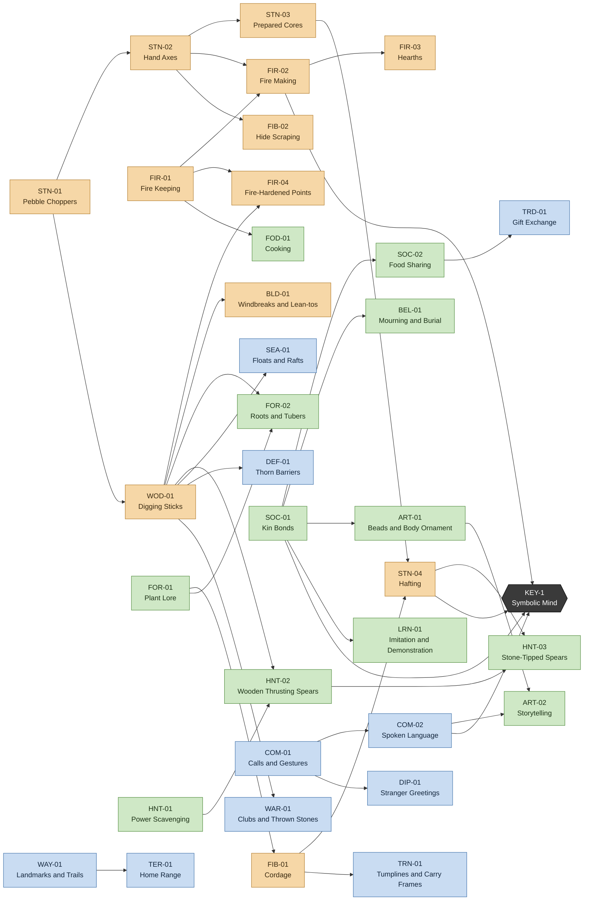

### 4.2 E1 — Hunters (59 projects)
The Upper Paleolithic explosion: projectile weapons, needles and tailored clothing, art, shamans, dogs, fishing, storage. Kin dominates this era (25 of 59).

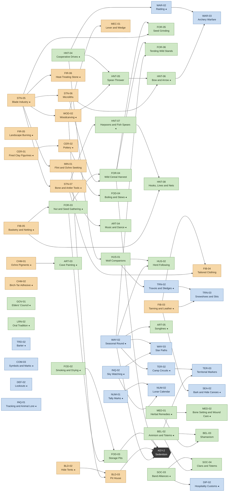

### 4.3 E2 — Roots (52 projects)
The Neolithic: cultivation, herding, villages, pottery storage, polished stone, the first metal, chiefdoms and exchange networks.

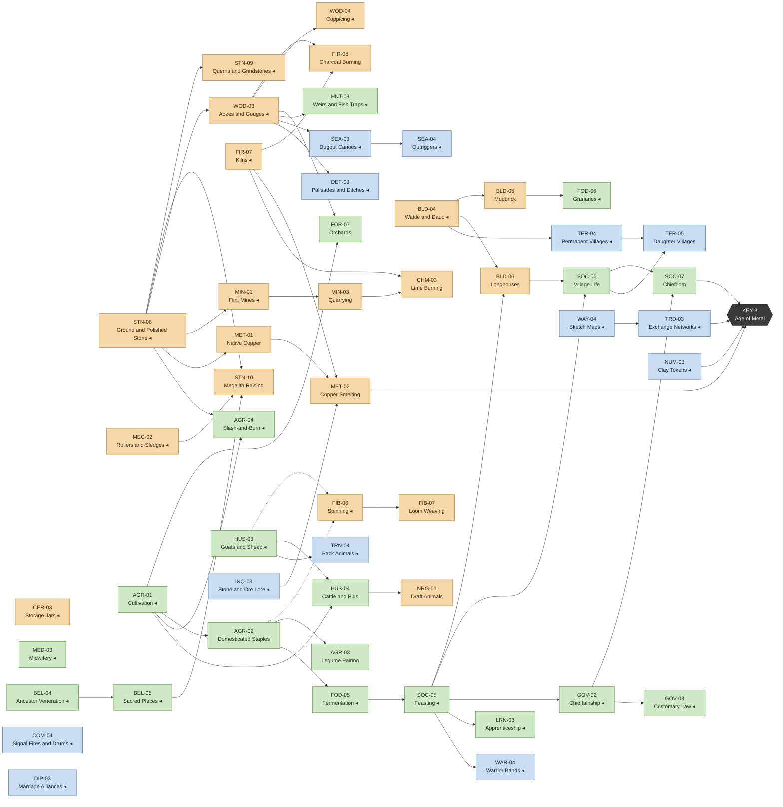

## 5. Keystone-critical maps for later eras
Only the in-era projects on each keystone's critical path are drawn. Everything else in that era is a free pick.

### 5.1 E3 Bronze → KEY-4 Iron & Law
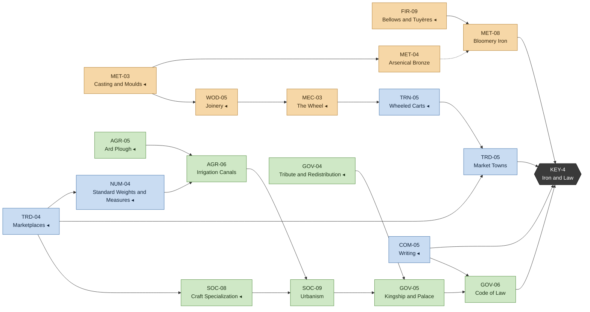

### 5.2 E4 Iron → KEY-5 Feudal Order
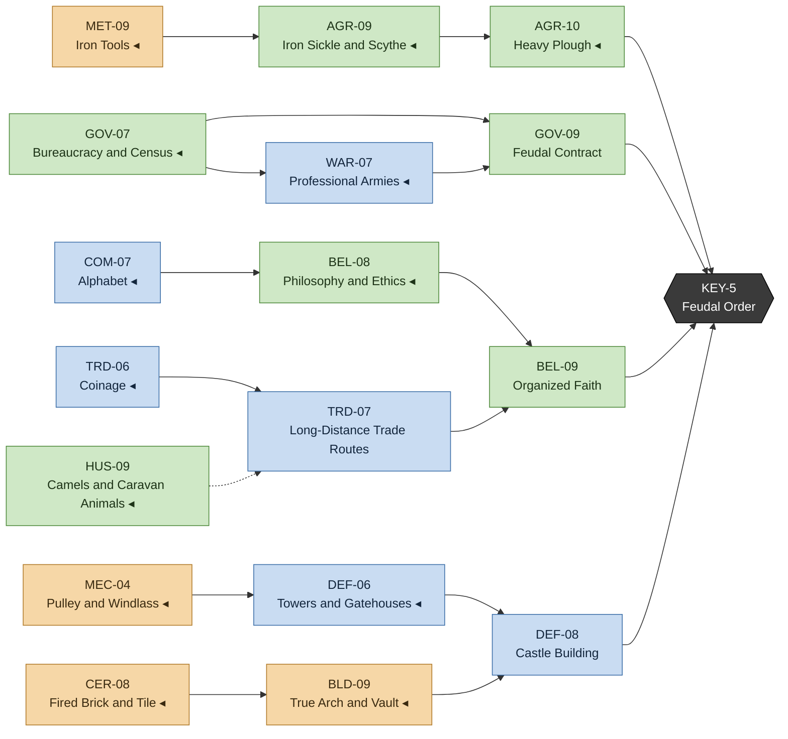

### 5.3 E5 Faith & Fief → KEY-6 Printing Revolution
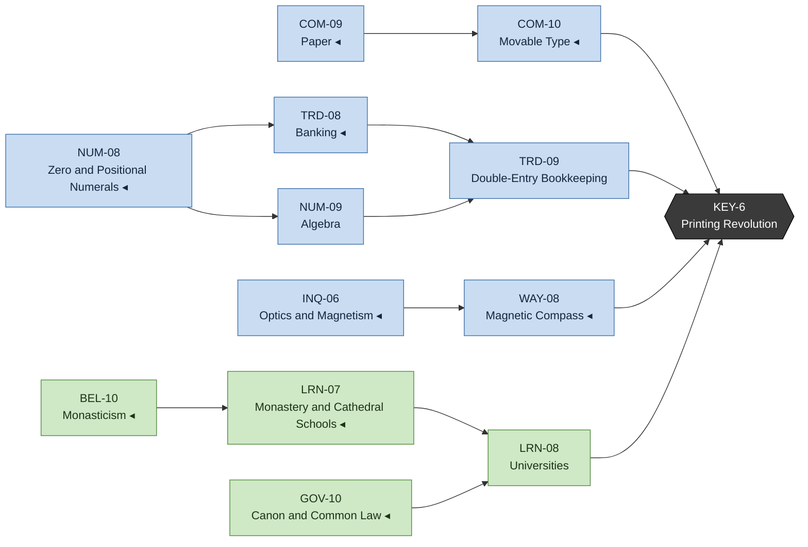

### 5.4 E6 Discovery → KEY-7 Industrial Revolution
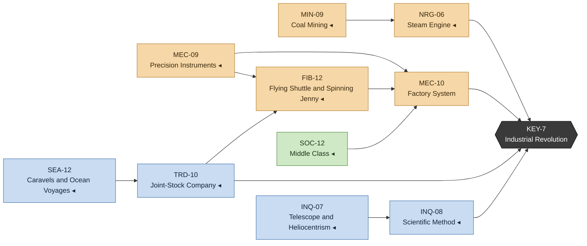

### 5.5 E7 Industry → KEY-8 Electrification
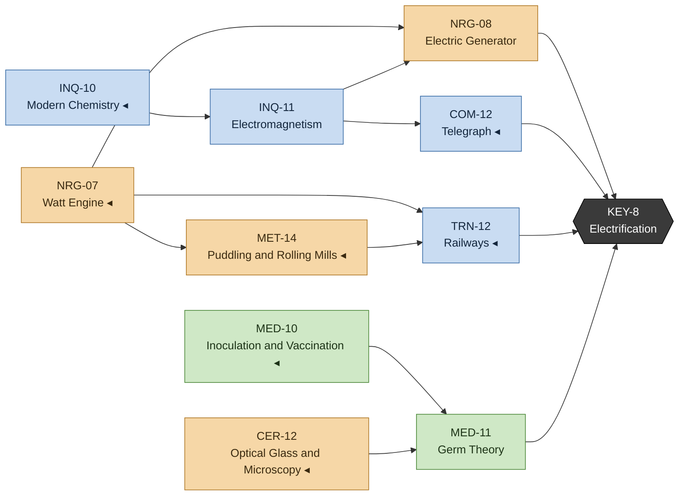

### 5.6 E8 Modern → KEY-9 Digital Revolution
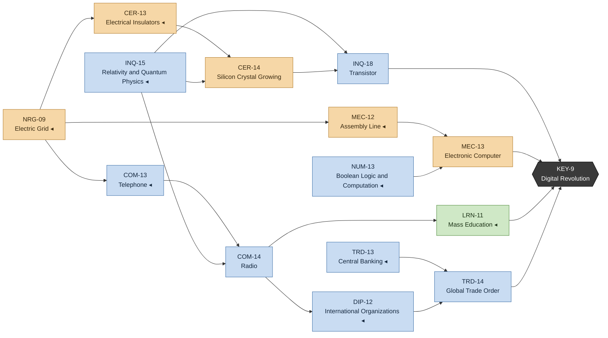

### 5.7 E9 Information → KEY-10 Planetary Network (Apex)
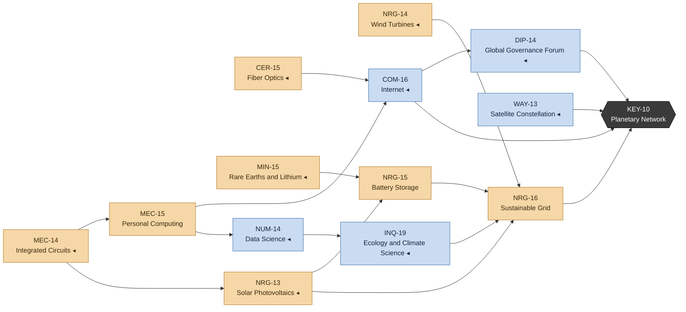

(KEY-3's critical path is fully visible in the E2 map in §4.3.)

## 6. Method ladders across the eras: "greater and greater efficiency"

Each row is a core action family. Each cell is the best method a civilization *could* have in that era if it invested in the lineage. This table is the efficiency fantasy in one view.

| Action | E0 Dawn | E1 Hunters | E2 Roots | E3 Bronze | E4 Iron | E5 Faith & Fief | E6 Discovery | E7 Industry | E8 Modern | E9 Information |
|---|---|---|---|---|---|---|---|---|---|---|
| **Chop wood** | Chopper → hand axe → hafted axe | Blade tools | Polished axe | Copper / bronze axe | Iron axe, crosscut saw | Water sawmill | (coal replaces wood fuel) | Steam sawmill | Chainsaw, plywood | Harvester, sustainable yield |
| **Gather / farm** | Plant lore, tubers | Wild-cereal sickles, stand tending | Cultivation, staples, legumes | Ard, irrigation, manuring | Iron scythe, heavy plough, terraces | Three-field rotation | Four-course rotation, Columbian Exchange | Seed drill, reaper | Tractors, fertilizer, Green Revolution | Precision farming, GM crops |
| **Hunt / fish** | Scavenging, spears | Drives, atlatl, bow, nets | Weirs | Seal & whale hunting | — | Game reserves | Deep-sea fleets | Steam trawlers | Aquaculture | Sustainable fisheries |
| **Herd** | — | Dogs, herd following | Goats, sheep, cattle, pigs | Dairy, wool, horses, nomadism | Camels | Selective breeding | Fodder crops | Veterinary science | Feedlots, cold chain | Animal genetics |
| **Store / preserve** | Cooking | Smoking, pits, pots | Fermentation, granaries | Salting, bakeries | Public grain supply | — | Sugar | Canning | Refrigeration, processing | Cold-chain logistics |
| **Build** | Lean-to | Tent, pit house | Wattle, mudbrick, longhouse | Post-and-lintel, masonry | Arch, aqueduct, concrete | Gothic, master masons | Renaissance planning | Reinforced concrete | Steel-frame skyscrapers | Green & smart buildings |
| **Mine / smelt** | — | Flint & ochre seeking | Flint mines, quarry, copper | Shaft mining, bronze, bloomery iron | Iron tools, steel, drainage | Crucible steel, blast furnace | Coal, coke, blasting | Puddling, Bessemer, dynamite | Aluminium, oil, open pit, arc furnace | Rare earths, recycling, remote sensing |
| **Power** | Muscle | Muscle (+ dog travois) | Draft oxen | Yoke | Water wheel | Windmill, horse collar | Steam engine | Watt engine, generator | Grid, combustion engine, hydro, fission | Solar, wind, batteries, sustainable grid |
| **Haul / travel** | Tumpline, rafts | Travois, skis, canoes | Pack animals, dugouts | Carts, riding, sail | Roads, bridges, harbors | Stirrup, keels, lateen | Turnpikes, canals, caravels | Railways, steamships | Trucks, highways, aviation, steel hulls | Containers, high-speed rail, EVs |
| **Make (craft)** | Knapping | Blades, carving, sewing | Polished stone, spinning, weaving | Wheel, potter's wheel, lathe | Gears, screws, crane, glassblowing | Crank & cam, clocks, treadle loom | Precision instruments, factory system | Machine tools, power loom | Assembly line, computers | ICs, robotics |
| **Generate Insight** | Imitation | Oral tradition, shamans | Apprenticeship | Scribes, writing | Academies, Great Library | Universities, monasteries | Printing, learned societies, scientific method | Public schooling | Mass education, R&D labs | Internet, open knowledge, AI-assisted research |
| **Claim land** | Home range | Camp circuits, markers | Villages, daughter villages | Boundary stones, city-states | Provinces, frontier colonies, castles | Manors | Overseas colonies, star forts | Cadastre | Suburbs, broadcast soft power | Megacities, global pop culture |
| **Communicate** | Calls, language | Symbols | Signal fires | Writing, papyrus | Alphabet, courier relays | Paper, movable type | Newspapers | Telegraph | Telephone, radio, TV | Internet, mobile, social media |

## 7. Example strategic paths (openings)

Each opening below is **validated**: every project appears after its prerequisites, eras are respected, and keystone breadth is met. Slot notation: the first three projects are the opening Primary / Secondary / Tertiary.

### 7.1 The Grower (Kin-leaning)
*Goal:* population and fission. Bands split early and spread across the land. Sedentism comes early, fed by cereals and storage.
- **Opening slots:** P = FOR-01 Plant Lore, S = SOC-01 Kin Bonds, T = FIR-01 Fire Keeping
- **Up to KEY-1 (19 projects):** FOR-01 Plant Lore → SOC-01 Kin Bonds → FIR-01 Fire Keeping → FOD-01 Cooking → SOC-02 Food Sharing → STN-01 Pebble Choppers → WOD-01 Digging Sticks → FOR-02 Roots & Tubers → FIB-01 Cordage → COM-01 Calls & Gestures → COM-02 Spoken Language → ART-01 Beads & Body Ornament → ART-02 Storytelling → STN-02 Hand Axes → FIR-02 Fire Making → FIR-03 Hearths → STN-03 Prepared Cores → STN-04 Hafting → WAY-01 Landmarks & Trails → **KEY-1**
- **KEY-1 → KEY-2 (19 projects, including cheap E0 backfills):** SOC-03 Band Alliances → WAY-02 Seasonal Round → FIB-05 Basketry & Netting → FOR-03 Nut & Seed Gathering → STN-05 Blade Industry → FOD-02 Smoking & Drying → STN-06 Microliths → FOR-04 Wild Cereal Harvest → FOD-03 Storage Pits → MED-01 Herbal Remedies → FOR-05 Seed Grinding → FOR-06 Tending Wild Stands → FIB-02 Hide Scraping → BLD-01 Windbreaks & Lean-tos → WOD-02 Woodcarving → BLD-02 Hide Tents → BLD-03 Pit House → LRN-01 Imitation & Demonstration → LRN-02 Oral Tradition → **KEY-2**
- *Result:* Sedentism at 39 completions, with medicine, oral tradition and alliances already in place. Weak tools and no defenses: vulnerable to a Warlord neighbor.

### 7.2 The Builder (Craft-leaning)
*Goal:* tool tiers and fire mastery first. A small, highly efficient band whose every action runs on the best method.
- **Opening slots:** P = STN-01 Pebble Choppers, S = FIR-01 Fire Keeping, T = FOR-01 Plant Lore
- **Up to KEY-1 (16 projects):** STN-01 Pebble Choppers → FIR-01 Fire Keeping → FOR-01 Plant Lore → STN-02 Hand Axes → WOD-01 Digging Sticks → FIB-01 Cordage → FIR-02 Fire Making → STN-03 Prepared Cores → FIR-03 Hearths → FIR-04 Fire-Hardened Points → BLD-01 Windbreaks & Lean-tos → STN-04 Hafting → FIB-02 Hide Scraping → COM-01 Calls & Gestures → COM-02 Spoken Language → SOC-01 Kin Bonds → **KEY-1**
- **KEY-1 → KEY-2 (21 projects, including cheap E0 backfills):** STN-05 Blade Industry → FIR-06 Heat-Treating Stone → STN-06 Microliths → CHM-01 Ochre Pigments → CHM-02 Birch-Tar Adhesive → ART-01 Beads & Body Ornament → WOD-02 Woodcarving → MEC-01 Lever & Wedge → BLD-02 Hide Tents → BLD-03 Pit House → FIB-03 Tanning & Leather → FIB-05 Basketry & Netting → MIN-01 Flint & Ochre Seeking → FOR-02 Roots & Tubers → WAY-01 Landmarks & Trails → WAY-02 Seasonal Round → FOR-03 Nut & Seed Gathering → FOR-04 Wild Cereal Harvest → FOD-01 Cooking → FOD-02 Smoking & Drying → FOD-03 Storage Pits → **KEY-2**
- *Result:* Sedentism at 38 completions, with heat-treated blades, adhesives, levers, leather and mining reveals. Fastest route toward metal (Copper Smelting then needs Kilns and Ore Lore). Small population.

### 7.3 The Wanderer (Reach-leaning)
*Goal:* see, claim and meet first. Scouts, trails, territory and peaceful contact, with sedentism delayed in favor of a wide seasonal round.
- **Opening slots:** P = WAY-01 Landmarks & Trails, S = COM-01 Calls & Gestures, T = HNT-01 Power Scavenging
- **Up to KEY-1 (15 projects):** WAY-01 Landmarks & Trails → COM-01 Calls & Gestures → HNT-01 Power Scavenging → TER-01 Home Range → DIP-01 Stranger Greetings → COM-02 Spoken Language → STN-01 Pebble Choppers → FIR-01 Fire Keeping → FOR-01 Plant Lore → SOC-01 Kin Bonds → STN-02 Hand Axes → FIB-01 Cordage → FIR-02 Fire Making → STN-03 Prepared Cores → STN-04 Hafting → **KEY-1**
- **KEY-1 → KEY-2 (32 projects, including cheap E0 backfills):** WOD-01 Digging Sticks → FOR-02 Roots & Tubers → WAY-02 Seasonal Round → TER-02 Camp Circuits → INQ-02 Sky Watching → WAY-03 Star Paths → SEA-01 Floats & Rafts → HNT-02 Wooden Thrusting Spears → HNT-03 Stone-Tipped Spears → INQ-01 Tracking & Animal Lore → HNT-04 Cooperative Drives → HUS-01 Wolf Companions → TRN-01 Tumplines & Carry Frames → TRN-02 Travois & Sledges → SOC-02 Food Sharing → SOC-03 Band Alliances → DIP-02 Hospitality Customs → FIB-05 Basketry & Netting → FOR-03 Nut & Seed Gathering → STN-05 Blade Industry → STN-06 Microliths → FOR-04 Wild Cereal Harvest → FIR-03 Hearths → FOD-01 Cooking → FOD-02 Smoking & Drying → FOD-03 Storage Pits → FIB-02 Hide Scraping → BLD-01 Windbreaks & Lean-tos → BLD-02 Hide Tents → ART-01 Beads & Body Ornament → WOD-02 Woodcarving → BLD-03 Pit House → **KEY-2**
- *Result:* Sedentism arrives late (48 completions), but by then the Wanderer holds the widest claims, has dogs and travois, has met its neighbors peacefully, and has triggered exposure gates (herds, clay, copper) across a large area. That makes its Roots era unusually cheap and broad.

### 7.4 The Warlord (Reach/WAR-leaning, sketch)
Rush **WAR-01 → WAR-02 Raiding → WAR-03 Archery Warfare** in E1 (requires the hunting chain HNT-02…06), then **WAR-04 Warrior Bands** and **GOV-02 Chieftainship** (unlocks the *Raid* posture) in E2. Raid a Grower neighbor's granaries during their first winter of sedentism. Risky: Cohesion costs, and Hospitality-minded neighbors ally against you (DIP-03).

### 7.5 The Sage (LRN/INQ-leaning, sketch)
Prioritize **LRN-01 → LRN-02 Oral Tradition**, **BEL-03 Shamanism**, **INQ-02 Sky Watching → NUM-01/NUM-02** in E1. Keep elders alive (MED-01, FOD-04) for their double Insight. The Sage falls behind on land early but compounds Insight, then surges through E3–E6 via Scribes, Academies, the Great Library and Universities.

## 8. Forks, alternatives and geography-driven branches

| Fork | Options | What decides it |
|------|---------|-----------------|
| **Bronze** | MET-04 Arsenical **or** MET-05 Tin (one-of for Bloomery Iron, Lost-Wax, Bronze Arms) | Which ore you `[Has]` in territory or by trade. Tin bronze is better; tin is rare, so it makes a strategic trade good. |
| **Yarn** | FIB-06 needs HUS-03 Goats & Sheep **or** AGR-02 Staples (flax) | Herders spin wool; farmers spin flax |
| **Long-distance trade** | TRD-07 via HUS-09 Camels (caravan) **or** SEA-07 Harbors (maritime) | Desert and steppe civilizations go overland; coastal ones go by sea |
| **River vs. rain** | AGR-06 Irrigation and NRG-03 Water Wheel are `[Near: River]` | River civilizations get early intensive farming and mill power; others lean on Windmill (NRG-05) and rotation |
| **Cold vs. warm** | FIB-04 Tailored Clothing unlocks Cold bands; TRN-03 Skis is discounted there | Cold starts must sew early or stay boxed in |
| **Steppe** | HUS-07 Horse Taming (`[Seen: Wild horses]`) → riding, chariots, nomadism, cavalry, horse collar | Only if horses roam nearby; huge mobility and claim radius in grassland |
| **Coast** | HNT-07/08/10 fishing and whaling, SEA lineage | Coastal starts get protein and an early path to the sea |
| **Optional luxuries** | Silk (FIB-09), Salt (MIN-06), Sugar (FOD-10), Porcelain (CER-09), Gold (MET-07) | Gate-dependent luxuries drive trade routes and wars |
| **Late-game posture** | DEF-14 Deterrence vs. DIP-13 Arms Control vs. WAR-17 Precision Warfare / WAR-18 Peacekeeping | Whether the endgame race for the Apex is peaceful or contested |
