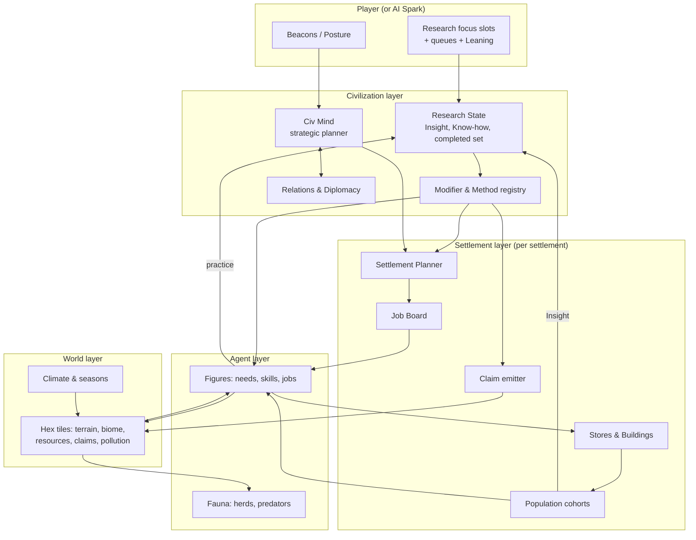
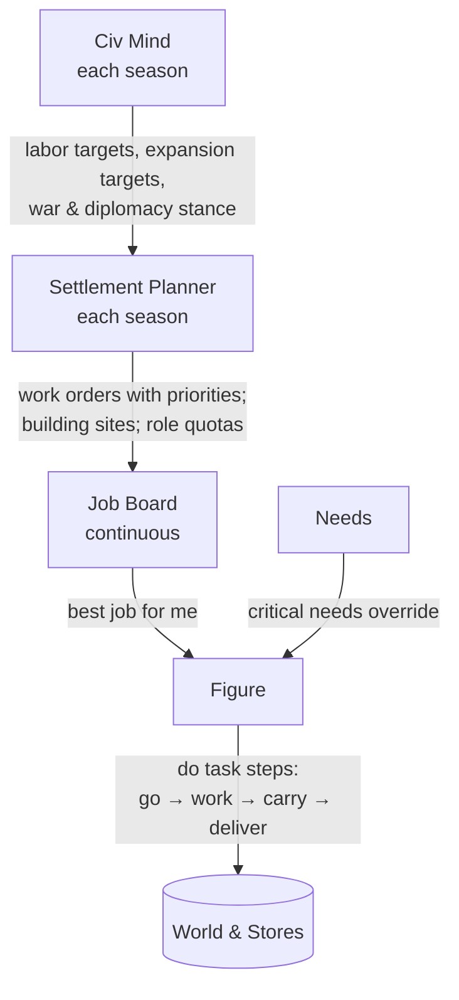
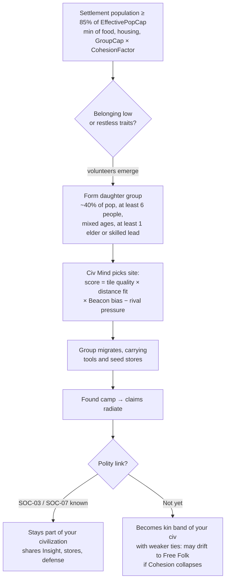

# 05 — Structure of the Simulation

> How the world runs once the player has chosen research: the map, the little people, how they decide what to do, how research becomes behavior, how populations grow and split into new territory, how civilizations meet and fight, and how the whole thing stays deterministic for multiplayer.
> Design only. Numbers are starting values for the balance model in [06-next-steps.md](06-next-steps.md).

---

## 1. Design goals and constraints

| # | Goal | Consequence for the design |
|---|------|----------------------------|
| S1 | **Legible**: watching the map tells you what's happening | Every important state has a visible proxy (figures' tools and outfits, structures, territory tint, flows). |
| S2 | **Autonomous**: no micro-management | Layered AI (Civ Mind → Settlement Planner → Job Board → Figure) runs every civilization, human or AI. |
| S3 | **Research-driven**: knowledge changes behavior | Actions resolve through **method ladders** (§7). Projects add rungs, modifiers, structures and roles, never ad-hoc special cases. |
| S4 | **Emergent expansion**: territory grows from people | Expansion comes from **fission** of over-cap groups (§9.4) plus claims (§11), not from a "found city" button. |
| S5 | **Deterministic**: multiplayer by lockstep | Fixed-point math, seeded RNG streams, deterministic iteration order (§18). |
| S6 | **Scales from 12 people to hundreds of thousands** | **Representation scale** (§5.2) and level-of-detail updates (§3.2) keep the rendered figure count at ≤ ~600 per civilization. |

## 2. Architecture overview



**One rule for everyone.** The Civ Mind, Settlement Planner and Figure behavior are identical for human and AI civilizations. A human only replaces the *AI Spark*, the research picker, and adds Beacons and Posture.

## 3. Time model

### 3.1 Clocks
- **Sim tick:** 10 ticks per second at 1× speed. All sim state advances only on ticks; rendering interpolates between them.
- **Calendar:** 150 ticks = 1 **season** (15 s at 1×); 4 seasons = 1 **year** (60 s). Seasons: Spring, Summer, Autumn, Winter. This is Standard pace. Match pace ([01 §6](01-game-structure.md#6-match-structure)) changes ticks per season (Quick 75, Epic 260), never the per-season economics ([07](07-balance-findings.md) F7).
- **Speeds:** 0.5×, 1×, 2×, 4× change ticks per second, never the tick logic. Paused = no ticks.

### 3.2 Update cadence (level of detail)

| System | Cadence | Notes |
|--------|---------|-------|
| Figure movement and work progress | every tick | Cheap: integrate position, advance a work timer |
| Figure decision (re-plan) | on task completion, or every 20 ticks staggered | Needs check; job pick |
| Fauna herds | every 5 ticks | Herds are group-agents, not individual animals |
| Job Board refresh | every 10 ticks per settlement (staggered) | |
| Settlement Planner | once per season, plus on events (fire, raid, famine) | |
| Civ Mind | once per season, plus on events (contact, war, era change) | |
| Claims and territory | once per 30 ticks (≈ 3 s) | Field recompute is incremental (dirty regions) |
| Demographics (births and deaths) | once per season | Cohort-based |
| Disease, cohesion, pollution | once per season | |
| Research (Insight split, Know-how drain) | every 10 ticks | Smooth progress rings |
| Adoption (method spread) | once per season | |

## 4. The world

### 4.1 Map
- **Hex grid.** MVP standard size: **160 × 100 hexes** (16,000 tiles) for 4 civilizations. A tile is roughly "a day's walk across" in E0 terms; scale is abstract.
- **Size per player count:** hold **~4,000 tiles (~1,600 land) per civilization**: 112 × 72 (2) · 140 × 86 (3) · 160 × 100 (4) · 196 × 122 (6) · 226 × 142 (8); 40% land; three continents from 6 players; even row count. At that density the map fills in early E7 at every player count ([07b](07b-territory-findings.md) T7). Maps for 6–8 players exceed the §19 tile budget, which is a WS-L concern.
- Figures move **continuously within and between tiles** for visual smoothness. Pathfinding works on the hex graph (§6.5).
- **World types:** Continents (MVP); post-MVP: Pangaea, Archipelago, Earth-like.

### 4.2 Tile data

| Field | Type | Notes |
|-------|------|-------|
| `elevation` | 0–255 | Ocean, coast, lowland, hill, mountain, peak |
| `biome` | enum | Ocean, Coast/Shallows, Ice, Tundra, Taiga, Temperate forest, Grassland/Steppe, Savanna, Desert, Tropical forest, Wetland, Mountain |
| `climateBand` | Cold / Temperate / Warm / Arid / Tropical | Drives seasons and Climate gates |
| `water` | flags | River edge, lake, freshwater spring, coast |
| `soil` | fertility 0–100 | Depletes under farming; restored by fallow, legumes, manure, fertilizer |
| `renewables` | stocks with regrowth | Forage plants, wood, fish, game presence (from herds) |
| `deposit` | type + amount + depth tier | Flint, stone, clay, salt, copper (native and ore), tin, arsenic, gold, silver, iron, coal, oil, bauxite, rare earths, saltpeter, sulfur |
| `claims` | per-civ claim strength | §11 |
| `owner` | civ id or none | Derived from claims with hysteresis |
| `presence` | per-civ decaying counter | Recent activity by that civ's figures |
| `pollution` | 0–100 | From E7 |
| `improvements` | list | Field, pasture, road, canal, terrace, mine, structure footprint |

### 4.3 Seasons and climate
- Each biome has seasonal curves for forage regrowth, game presence, fish runs, crop growth, cold stress and travel cost (snow, mud).
- **Winter is the core early-game pressure.** Forage falls, cold rises, and only stores and shelter keep people alive. This is what makes Storage Pits, Pit Houses and Tailored Clothing feel vital.
- Random-but-seeded **climate variance** gives good years, poor years, droughts and harsh winters, so famines happen and food security matters.

### 4.4 Fauna
- **Herds** (deer, bison, aurochs, horses, reindeer, goats or sheep, camels or llamas) are group-agents with a size, a migration route along seasonal grazing, and fear of hunters. Over-hunting shrinks them, and herds can go locally extinct.
- **Predators** (wolves, big cats, bears) roam and threaten lone figures and camps early. Wolves double as the exposure trigger for HUS-01.
- **Domestication** converts part of a wild herd into a settlement-owned herd that lives on pasture tiles.

### 4.5 World generation pipeline
1. Plates and continents → elevation → rivers (flow accumulation) → lakes.
2. Climate bands from latitude and elevation; rainfall from prevailing wind → biomes.
3. Soil fertility from biome, river proximity and floodplains.
4. Deposits by geology rules (ores in hills and mountains, coal in ancient lowland basins, oil in sedimentary basins and offshore, salt in arid lowlands and coasts).
5. Fauna herds seeded by biome.
6. **Start placement** scored for fairness, then the **guarantees** are enforced:
   - **Start guarantee (within 20–25 tiles):** freshwater, forage, game herd, flint/stone, **clay**, **native copper outcrop**, **wolves**, a **small wild herd species** (goats/sheep or camelids). See [02 §6.1](02-research-structure.md#61-keystone-critical-gates-and-world-generation-guarantees).
   - **Continental guarantee:** each continent with a start has at least one **gold or silver**, **coal** and **oil** deposit, and at least one tin source per two starts. Arsenic copper is more common, so bronze is always possible.
7. **Start placement:** starts come in **neighbour pairs, nearest rival ~25 walking tiles (22–28)**; other starts ≥ 60 tiles away or across water. One rival appears in late E1–E2 and the wider world in E4–E7 ([07b](07b-territory-findings.md) T1).
8. **Fairness pass:** compare start scores and tweak local resources until within ±5%, **then simulate expansion** on the start set and require simulated E7 land shares within ±15% of each other. Equal local resources aren't equal land: the frontier race decides shares ([07b](07b-territory-findings.md) T9). Full spec: [12-world-generation.md](12-world-generation.md).

## 5. People

### 5.1 The figure (agent) data model

| Group | Fields |
|-------|--------|
| Identity | id, name, civ, settlement, family (parents, partner, children), lineage tag |
| Life | age, sex, life stage (child, adult, elder), health 0–100, injuries, sickness state, pregnancy |
| Needs | hunger, warmth, rest, safety, belonging (each 0–100, decaying) |
| Skills | per action family: experience → level 0–10 (skill multiplier 0.8×–1.6×) |
| Knowledge | set of known **methods**. Adoption is per figure (§16.3); at scale > 1:1 it is a fraction |
| Work | current job, task step, carried goods, tool in hand (with durability) |
| Disposition | traits (2 of ~12: curious, brave, nurturing, restless, devout, greedy, …); mood |
| Story | notable deeds log, used for **Legends** |

### 5.2 Representation scale (one figure stands for N people)
- E0–E3: **1 figure = 1 person**. Every individual is simulated.
- From E4 the scale steps up at each era: 1:2, 1:5, 1:25, 1:100, 1:250, 1:500 (see [01 §8](01-game-structure.md#8-eras)). The steps follow the balance model's population curve, which keeps 295–511 figures on screen at every era end from E3 on and peaks around 175,000 people ([07](07-balance-findings.md) F6).
- **Population truth lives in settlement cohorts** (age-band × sex counts). Figures are *drawn from* cohorts to fill the visible count: `visibleFigures = ceil(cohortTotal / scale)`, capped by a performance budget.
- At scale > 1:1, a figure is a **household or work crew**. Its output is multiplied by the scale, so the economy is identical whether you see 1 figure or 50.
- On scale change, figures in the same household or job merge into one representative. That figure keeps the most notable identity, so Legends survive.

### 5.3 Life cycle
- **Child** (0–13): consumes food, no work, learns by following parents (skill seeds).
- **Adult** (14–44): full work, reproduction, can join fission groups.
- **Elder** (45+): reduced physical work, **double Commons Insight**, teaches (adoption bonus), and is the default Elder or Shaman.
- **Death** causes: old age (lifespan curve shifted by MED), starvation, cold exposure, injury (hunting, accidents, combat), disease, predators, childbirth. Each death lowers Cohesion slightly; burial practices (BEL-01) soften the loss.

### 5.4 Needs (drive behavior priority)

| Need | Satisfied by | When critical |
|------|-------------|---------------|
| Hunger | Eating from stores or forage | Drops work speed, then health |
| Warmth | Fire, shelter, clothing | Cold climates and winter; exposure damage |
| Rest | Sleeping in shelter (better) or open (worse) | Periodic, staggered across figures. Not tied to a global night: visual day/night is cosmetic ([08 §3.1](08-ui-and-world-display.md#31-light-day-and-night)) |
| Safety | Being near others, walls, fire; fleeing threats | Predators, raids |
| Belonging | Gatherings, feasts, rituals, storytelling | Low belonging lowers Cohesion and raises the urge to leave (fission volunteers) |

### 5.5 Legends
- The sim scores notable deeds: first to use a new method (the *innovator*), founding a settlement, surviving a famine as leader, winning a battle, teaching many, long life.
- High-scoring figures become **Legends**. They are named in the Chronicle, get a distinct look, and grant small local bonuses (+Cohesion, +skill spread) while alive. ART-06 makes those bonuses persist after death.

## 6. How figures decide what to do

### 6.1 The decision hierarchy



### 6.2 Civ Mind (strategic, per civilization)
Inputs: research state, food security index, Cohesion and Overreach, threats and contacts, Posture, Beacons.
Outputs:
- **Labor targets** (shares): food, building, crafting, hauling, defense, specialists, expansion.
- **Expansion targets:** preferred directions and sites for fissioning groups, scored by tile quality, distance, rival pressure and the **Beacon bias**.
- **Stance toward each contacted civilization:** peaceful, wary, trade-seeking, raid, war, or alliance (§12).
- **Posture** shifts the labor and stance weights:

| Posture | Effect on Civ Mind weights |
|---------|----------------------------|
| *Balanced* (default; the only option before GOV-02) | — |
| Expand | Fission threshold −20% before E3, −17% in E3 (07d B17); expansion weight ×2; settlers favor Beacons |
| Prosper | Craft and trade labor ×1.5; fission threshold +20% |
| Fortify | Defense structures and guards ×2; claim upkeep +; no raids |
| Raid | Warrior share ×2; raids on weak neighbors; diplomacy suffers |

### 6.3 Settlement Planner (operational, per settlement)
Every season it computes **deficits** and posts **work orders**:
1. **Food:** projected stores through next winter vs. consumption → forage, hunt, fish, farm, herd and preserve orders.
2. **Shelter:** housing capacity vs. population → build orders for the best known dwelling.
3. **Storage, tools, clothing:** stock targets → craft orders. Tools wear out and are replaced with the best known tier.
4. **Defense:** threat level → walls, watchers, warriors.
5. **Structures** unlocked by research → placement chosen by a site scorer (water, resources, centrality; NUM, WAY and GIS projects improve it).
6. **Roles:** quotas for specialists (Shaman, Smith, Scribe…), limited by role caps and training.

Work orders carry a **priority** (0–100) that decays as the deficit is met.

### 6.4 Figure behavior (utility AI)
On each decision point:
1. If any need is **critical**, satisfy it (eat, warm up, rest, flee).
2. Otherwise, score each open job: `Utility = Priority × SkillFit × (1 / (1 + distance/k)) × TraitBias × RoleMatch`. Pick the best, with deterministic tie-break by job id.
3. Execute the job as a **task script**: go to site → acquire tool or inputs → perform action (timed by the method rate) → carry output → deliver to store. Interrupts (threat, critical need) can pause the task.

### 6.5 Movement and pathfinding
- Hex-graph A* with a **hierarchical cache** (region graph). Common routes (home ↔ fields, home ↔ quarry) use cached **flow fields**.
- Terrain movement costs by biome and season; trails form on heavily walked tiles; roads, rail and motor ladders modify cost (TRN lineage).
- Water crossing requires the SEA lineage; boats are vehicles that figures crew.

## 7. Actions and method ladders

### 7.1 Action families

| Family | Example actions | Primary lineages |
|--------|-----------------|------------------|
| Forage | gather plants, dig roots, collect nuts | FOR, WOD |
| Hunt | ambush, drive, ranged hunt, marine hunt | HNT, STN, WAR |
| Fish | spear, net, weir, trawl, farm | HNT, SEA |
| Farm | clear, till, sow, tend, harvest, irrigate | AGR, STN, MET, NRG |
| Herd | tame, graze, milk, shear, breed | HUS |
| Chop | fell, saw, coppice | WOD, STN, MET |
| Quarry / Mine | quarry stone, mine ore/coal, drill oil | MIN, CHM |
| Smelt / Forge | smelt, cast, smith | MET, FIR |
| Craft | knap, carve, sew, spin, weave, pot, glass, machine | STN, FIB, CER, MEC |
| Build | shelter, house, wall, monument, infrastructure | BLD, STN, MEC |
| Haul / Travel | carry, pack, cart, rail, truck, ship | TRN, SEA |
| Cook / Preserve | cook, smoke, salt, ferment, store | FOD, FIR, CER |
| Heal | tend, set bones, surgery, vaccinate | MED |
| Teach / Study | demonstrate, tell stories, scribe, research | LRN, ART, COM |
| Worship / Celebrate | burial, ritual, feast, pilgrimage | BEL, ART, SOC |
| Trade | gift, barter, market, caravan | TRD |
| Scout / Claim | explore, mark, patrol, settle | WAY, TER |
| Defend / Fight | guard, raid, battle, siege | DEF, WAR |
| Govern | council, administer, judge | GOV |
| Generate power | (structures) mill, engine, plant | NRG |

### 7.2 Resolving a method
For an action, the figure uses the **highest rung** for which all of these hold:
1. the civilization has completed the project that adds the rung (and it's not **Dormant**);
2. the figure **knows** the method (adoption, §16.3);
3. the required **tool** is in hand or available in stores, and required **inputs** and **structures** exist;
4. `[Near]` and `[Has]` conditions are met at this settlement.

If any condition fails, the figure falls back to the next rung down. That makes research benefits **visible but conditional**: building the tool supply chain matters.

### 7.3 Output formula
```
Output per work-tick = BaseRate[action]
                     × MethodMult[rung]          # from the ladder (e.g. chop: 1 → 160)
                     × ToolQuality (0.5–1.2, wear)
                     × SkillMult (0.8–1.6)
                     × HealthMult (0.3–1.0)
                     × Π Modifiers (research, Legends, Posture, season, terrain)
                     × RepresentationScale
```
**Efficiency target:** about ×1.5–2 per era on core actions for a civilization investing in the relevant lineage (see the [04 §6](04-research-paths.md#6-method-ladders-across-the-eras-greater-and-greater-efficiency) ladder table).

## 8. Economy

### 8.1 Goods (MVP categories)

| Category | Examples | Notes |
|----------|----------|-------|
| Food: fresh | meat, fish, forage, grain, milk | Spoils by season unless preserved |
| Food: preserved | smoked, dried, salted, flour, cheese, canned | Low spoilage |
| Raw materials | wood, stone, flint, clay, hide, fiber, ore, coal, oil | |
| Processed materials | cord, leather, yarn, cloth, brick, lime, charcoal, metal (copper/bronze/iron/steel), glass, cement, plastics | |
| Tools | stone, copper, bronze, iron or steel tool kits; later machines | Durability; tier defines methods |
| Clothing | hides, tailored, cloth, wool | Warmth rating |
| Luxuries | beads, figurines, dyed cloth, silk, gold, porcelain, sugar, spirits | Cohesion and trade value |
| Arms | spears, bows, bronze/iron arms, guns… | Combat tier |
| Energy | (flows, not goods) muscle, animal, water, wind, steam, electric | Powered structures need supply |

### 8.2 Storage, spoilage, logistics
- Stores live in settlement structures (pits → jars → granaries → warehouses → cold storage). Capacity is a cap per building type.
- **Spoilage** per season by food type, reduced by FOD and CER methods.
- **Hauling:** goods move physically, carried by figures, animals and vehicles. Haul capacity (TRN) and roads determine how far a settlement can effectively work (its **work radius**).
- **Inter-settlement transfers:** the Civ Mind balances stores between your own settlements along known routes. GOV-04 Redistribution enables automatic famine relief.

### 8.3 Production chains (examples)
- **Bronze axe:** mine copper ore + mine tin (or trade) → charcoal → smelt (kiln, then bellows) → cast (mould) → tool kit → the Chop ladder rises to rung 6.
- **Bread:** cultivate → harvest (sickle) → thresh → grind (quern → water mill) → bake (oven) → +food value.
- **Railway:** coal + iron → coke smelting → puddled iron → rails; steam engines → locomotive; surveyed route → railway structure → Haul ×20.

## 9. Population dynamics

### 9.1 The three caps
`EffectivePopCap(settlement) = min(FoodCap, HousingCap, GroupCap × CohesionFactor)`

| Cap | Computed from |
|-----|---------------|
| **FoodCap** | Sustainable food income (rolling 4 seasons) + stores ÷ per-capita need |
| **HousingCap** | Σ dwelling capacity (BLD lineage); open sleeping allowed early, but with exposure risk |
| **GroupCap** | Social layer from SOC: 25 → 35 → 50 → 150 → 500 → 2,000 → 10,000 → effectively unbounded (E9) |

**Late growth is vertical, not wider.** The map holds ~1,600 land tiles per civilization, so from E5 on a civilization stops gaining settlements and grows its cities instead. E7–E9 per-settlement caps: food **4,000 / 9,600 / 19,200**, housing **6,400 / 16,000 / 32,000** (the densities of TER-13 and TER-15). The earlier territory-fit run gave an arc near 171.5 min with the map's real room ([07b](07b-territory-findings.md) T6); the balance pass reached 173.5 min with every era in its old target window ([07c §2](07c-e0-e2-checks.md#2-r6-in-the-balance-model)). The progressive cadence pass raises the current mean-field arc to 195 min and lengthens Roots and the later eras ([07c §10](07c-e0-e2-checks.md#10-progressive-research-cadence-follow-up-2026-10-24)).

### 9.2 Births
`BirthsPerSeason = FertileWomen × BaseFertility (0.13) × FoodSecurity × Health × (1 − Crowding) × Modifiers`. FOD-04 (weaning foods) and MED-03 (midwifery) raise it; the demographic transition (E8+) lowers it as development rises.

0.13 is a birth about every two years per woman, a deliberate game-time compression: at v0.1's 0.06 the starting band grew by one person a decade and first split at minute 77 ([07](07-balance-findings.md) F5). Demography is the biggest single driver of match pace (fertility ±15% moves the arc −8% / +11%), so it is locked before research effects are tuned.

### 9.3 Deaths
Seasonal hazards by cause: age (Gompertz-like curve shifted by MED), starvation (food < need), exposure (warmth < threshold), disease (§13), injury (job risk × MED), violence (§12), predators (E0–E2).

### 9.4 Fission: how civilizations expand



- **Trigger:** a settlement fissions at **85% of its EffectivePopCap** (§9.1), whichever cap binds, so food or housing pressure triggers it as well as group size. The daughter group is ~40% of the settlement and at least 6 people; below that the split waits. With these values the first fission comes at about minute 7 ([07](07-balance-findings.md) F5). The timing is a knife-edge (minute 6–13 across archetypes), so caps should rise project by project rather than per era, and a seasonal pressure trigger (late-winter food security) is a candidate for WS-H.
- **Before SOC-03 Band Alliances**, fissioned bands still belong to your civilization (the player's Spark), but with **low ties**: they share Insight at 50% and secede more easily.
- **Posture Expand** lowers the fission threshold. **Prosper** raises it, which grows bigger settlements.
- Fission is the main way the map fills. Its pace comes from Kin (growth, caps) and its direction from Reach (Beacons, claims, travel).

### 9.5 Settlement tiers

| Tier | Unlocked by | Typical pop (people) | Claim radius | Notes |
|------|-------------|---------------------|--------------|-------|
| Camp | start | ≤ 35 | 3 | Moves seasonally (WAY-02) |
| Hamlet | SOC-04 | ≤ 150 | 3 | Semi-permanent |
| Village | SOC-06 + TER-04 | ≤ 500 | 4 | Permanent; fields |
| Town | SOC-07 + TRD-05 | ≤ 2,000 | 5 | Market; specialists |
| City | SOC-09 | ≤ 10,000+ | 7 | Walls, temples, palace |
| Metropolis | BLD-15 / TER-13 | 100k+ | 9–10 | Suburbs |
| Megacity | TER-15 | millions | 11–12 | Smart city |

## 10. Cohesion and Overreach

### 10.1 Cohesion (0–100, per settlement, rolling up to a civilization average)
- **Sources:** shared rituals and feasts (BEL, SOC, ART), hearths and gathering structures, Legends, kin ties, prosperity (stores, goods), victories, law (GOV).
- **Drains:** deaths, famine, disease, overcrowding, inequality (SOC-08), losses in war, distance from the capital (Overreach), cultural diversity without tolerance projects (BEL-12, BEL-15), pollution (E7+).
- **Effects:** work speed ±15%; the **CohesionFactor** in GroupCap (0.6–1.2); fission volunteers; at very low levels, **secession**.

### 10.2 Overreach
`Overreach(settlement) = distance to capital (in travel-time) × (1 − Σ admin reductions)`. GOV, COM, TER and TRN lineages provide reductions (law, couriers, provinces, roads, telegraph, digital governance).
High Overreach drains Cohesion. If Cohesion < 15 for 2 years, the settlement **secedes** and becomes **Free Folk**:
- a neutral AI mini-civilization (MVP: passive, defends itself, trades). Others can re-absorb it peacefully (DIP-08, SOC-15) or by conquest.

## 11. Territory and Dominion

### 11.1 Claim field
Each civilization has a **claim strength** on each tile:
```
Claim(c, tile) = Σ_settlements  Emit(s) × Falloff(dist, radius(s))
               + Σ_camps        0.5 × Emit(band) × Falloff(dist, 2)      # WAY-02 seasonal camps (0.75 with TER-02)
               + Σ_structures   Emit(markers, castles, shrines, forts)
               + Presence(c, tile)                     # recent work, travel, patrol (decays per season); capped at 0.5 × T
               + SoftClaim(c, tile)                    # culture: ART-12+, BEL-09 missionaries
Emit(s) = sqrt(population_s) × CohesionFactor × Π claim modifiers (TER, BEL, DEF, GOV)
Falloff(d, r) = max(0, 1 − d / (r + 1))               # "claim radius r" means what it says
```
- **Presence never owns a tile on its own** (cap 0.5 × T). The home range (½ of scouting reach around each settlement) is drawn as a light hatch ([08 §4.1](08-ui-and-world-display.md#41-encodings)). That is what makes the early, sparse map feel lived-in ([07b](07b-territory-findings.md) T5).
- **Merged settlements keep claiming as suburbs.** A late-era merge never abandons land.
- **Seasonal camps (WAY-02):** each settlement founded in E1–E3 keeps 2 camps 1–3 tiles beyond its claim radius, each claiming radius 2 at 50% of its band's emission (75% with TER-02). They persist as satellite camps until bigger radii absorb them, so territory never shrinks at an era change. This roughly doubles early land: 187 tiles and 12.4–13.1% of the world claimed at the end of E2, instead of 118 and 8% ([07b §9.4](07b-territory-findings.md#94-seasonal-camps-as-claim-sources-adopted-2026-10-18)).

### 11.2 Ownership with hysteresis
- A tile's **owner** is the civilization with the highest claim, if (a) its claim ≥ threshold *T* (**0.7**) and (b) it leads the runner-up by ≥ 20%. At T = 0.7 a band of 10 owns its whole radius-3 disk from the first season, and a 6-person splinter owns only radius 2 ([07b](07b-territory-findings.md) T4).
- Ownership **flips** only after the challenger has led for a full season, so borders don't flicker.
- Tiles where no civilization meets the rule are **unclaimed** or **contested** (striped tint).
- Treaties (DIP-05) can fix a border line: claims across it don't count.

### 11.3 Dominion score
- **Habitable tiles** are land tiles excluding Ice and Peaks. Desert and Tundra count 0.5.
- Each year, Legacy += 100 × (owned habitable weight ÷ habitable weight **owned by anyone**, Free Folk included). See [01 §7](01-game-structure.md#7-victory-and-scoring).
- **Dominion victory:** ≥ 50% of **all** habitable weight **and** ≥ 2× the runner-up's share, for 5 consecutive years. With four players this needs conquest ([07b](07b-territory-findings.md) T2).

### 11.4 Beacons
A Beacon placed by the player adds a **bias field** (radius 10–20) to the Civ Mind's site scoring for fission groups and scouts. It also gives a small presence boost along the path. More Beacons and range come from ART-05, ART-07, ART-10, ART-14 and WAY-07.

## 12. Contact, diplomacy and conflict

### 12.1 Contact
- **Aware:** one of your figures sees a figure or structure of another civilization.
- **Contacted:** a meeting happens (figures within 2 tiles), or a trade, or a border touch.
- The **first-contact roll** (friendly, wary or hostile) depends on DIP-01, TRD-01, traits and Posture.
- Contact enables **diffusion** discounts and gate satisfaction (02 §6) and makes rival projects **Glimpsed**.

### 12.2 Relations
A per-pair score (−100 … +100) moved by: trade (+), gifts (+), shared alliances (+), border pressure (−), raids (−), claims on the same tiles (−), cultural affinity (+, ART and BEL). It decides which diplomatic actions the Civ Mind will propose or accept.

| Relation state | Requires | Effects |
|----------------|----------|---------|
| Wary | default | Occasional skirmishes at borders |
| Peaceful | Relations > 0 | No violence; trade possible (TRD-02) |
| Alliance | DIP-03; Relations > 40 | Shared diffusion and defense |
| Non-aggression / Border treaty | DIP-04 / DIP-05 | Fixed borders |
| Vassal / League | DIP-06 / DIP-07 | Dominion share; joint Wonders |
| Hostile → Raiding → War | Relations < −30; Raid posture; Civ Mind decision | §12.3 |

In the MVP all diplomacy is **automatic** (Civ Mind). Player-initiated diplomatic offers are post-MVP (01 §14).

### 12.3 Raids and war
- **Raid:** a warband travels to a rival settlement, steals stores, burns structures, and may kill or capture. Raiders retreat on morale break.
- **War:** sustained campaigns to **capture settlements**. A captured settlement flips owner. Part of its population is assimilated (with Cohesion penalties) and part flees to friendly settlements.
- **Combat resolution (abstracted, deterministic):** local engagements are resolved each 10 ticks between nearby opposing groups:
```
Strength(group) = Σ figures × CombatTier (WAR/MET) × Training × Morale × Terrain/Defense (DEF)
Casualties ∝ (enemy Strength)² / (own Strength)   # Lanchester square-law flavor
Morale breaks below 40% (raised by Legends, BEL, drill)
```
- **Costs of war:** deaths, Cohesion loss (×1.5 with WAR-14 firepower), Relations collapse with third parties, Legacy penalty for atrocities (BEL-14 era).
- **Nuclear weapons (WAR-16):** a modeled deterrent. Use triggers a global catastrophe (pollution spike, mass deaths, a Legacy penalty for the user) and is strongly discouraged by AI weights.

### 12.4 Trade routes
- **Internal:** your settlements exchange surpluses along routes (roads and rails speed them).
- **External:** when two civilizations are Peaceful and both have TRD-02, caravans or ships carry goods each way. Value comes from scarcity differences, and *both* sides gain. Routes carry diffusion and satisfy `[Seen]`/`[Has]` gates.

## 13. Health and disease
- **Density pressure** per settlement: `pressure = (pop / area) × (1 − sanitation) × (1 + contactInflow)`. Sanitation comes from MED, CHM-05 and BLD-10.
- **Outbreak roll** each season. Outbreaks run an SIR-lite model at settlement level; sick figures are visible (pale, resting). Epidemics spread along trade routes and contact; MED-08 Quarantine dampens the spread.
- **Novel disease shock:** first contact between long-isolated populations (e.g. across oceans after SEA-12) gives a one-time epidemic penalty to the less-exposed side. It's a historical dynamic, tuned to be survivable.

## 14. Environment and pollution (E7+)
- Activated by **KEY-7 Industrial Revolution**. Coal, oil and industry emit **pollution** to their tile and its neighbors (−health, −yields).
- Global **Climate Stress** accumulates from total emissions (all civilizations). In E8–E9 it raises the frequency of floods, droughts and storms.
- Mitigation: CHM-14, BLD-16, NRG-13…16, INQ-19, DIP-15. This creates the post-modern dilemma: grow dirty and fast, or invest in sustainability. Everyone shares the climate.

## 15. Events and the Chronicle
- **Emergent events** (produced by the sim, not scripted): famines, epidemics, raids, first contacts, foundations, secessions, Legends born and dead, Firsts, wonders completed.
- **Natural events** (seeded random, by biome): harsh winters, droughts, floods, wildfires, herd migrations, earthquakes (rare), volcanic winters (very rare).
- The **Chronicle** turns events into short storybook lines with names: *"In the 12th winter, Oru the Restless led nineteen of the Ash Valley Folk east toward the Beacon."*

## 16. The research ↔ simulation interface

### 16.1 Insight production
Computed every 10 ticks from population cohorts and roles ([02 §8.1](02-research-structure.md#81-insight-production-per-in-game-year)), then split 4 : 2 : 1 into the focus slots.

### 16.2 Know-how (practice → research)
Every completed work step emits a **practice event** `(civ, actionFamily, amount = workTime × scale × skill)`. A static table maps action families to lineages (e.g. Chop → WOD 70%, STN 30% until E2). The events accumulate into lineage Know-how pools ([02 §9](02-research-structure.md#9-know-how-learning-by-doing)).

### 16.3 Adoption (methods spreading across the map)
- On project completion: an **innovator** figure is chosen (highest skill in the action family, nearest the capital). The Moment camera may fire.
- Each season, each figure who knows the method teaches it to co-workers or household members within 3 tiles with probability `p_teach` (base 0.25; ×1.5 LRN-01; ×2 COM-02; roads, schools and the Internet raise it further). At scale > 1:1 this is computed on **fractions per settlement** (logistic spread).
- Structures and roles unlock immediately, but the Planner must still **build or assign** them.

### 16.4 Effect application
- A **modifier registry** keyed by `(stat, scope)` holds stacked effects from completed projects, Legends, Posture and events. Stacking is multiplicative across sources and additive within a source group.
- **Method registry:** per action family, the ordered ladder and the set of rungs unlocked for the civilization.
- **Gates:** an observer system watches figures' vision for `[Seen]` targets, trade inflows, and contacts' completed sets.

### 16.5 Visible feedback
Every effect type has a **visual hook**: tool sprites per tier; outfit per role; structure models; trail and road overlays; flows (caravans, ships, rails, data links); territory tint; pollution haze. See [08-ui-and-world-display.md](08-ui-and-world-display.md) for the full display design.

The UI needs the sim to expose: each job site's current **method rung** and, when a figure falls back to a lower rung, the **fallback reason** (missing tool, input, `[Has]` or `[Near]`); each settlement's **food forecast** to next winter; each tile's **top-3 claims**; and per-event **interest weights** for Director mode.

## 17. AI opponents (the AI Spark)
The full design is in **[14-ai-opponents.md](14-ai-opponents.md)**. In short:
- The first release is **1 player vs. 3 AI**, and the AI must be **smart** (D14, D15). The AI Spark is a **planner**: it values projects by running a fast forecast model of its own civilization, beam-searches research plans toward its next keystone, and models rivals (the player included) from what its figures see.
- A **Strategist** layer (shared by every civilization, the player's included) holds a grand plan (frontier race, prosper, defend, conquer, coalition vs. leader, Apex race) and makes raid, war, peace and alliance decisions by expected value.
- The **Council of Elders scorer** ([02 §15](02-research-structure.md#15-the-council-of-elders-auto-pick)) survives only as the search's prior and as the player's auto-pick.
- **Difficulty changes thinking (horizon, search width, opponent modeling), never information or resources.** No cheats at any level.
- AI quality is measured by an automated **harness** of AI-vs-AI and AI-vs-scripted-bot tournaments with acceptance targets and blunder detectors (14 §10).

## 18. Determinism, multiplayer, saves
*Implementation rules (Fix64, RNG streams, ordered collections, cross-platform checksums, saves and replays) are in [15 §5.6 and §6](15-architecture-decision.md#6-determinism-rules-binding-on-civsimsim).*

- **Lockstep:** each client simulates the full world. Only **commands** are networked: slot changes, queue edits, Leaning, Beacon placement, Posture, pause. Commands are scheduled for tick `t + delay`.
- **Determinism rules:** fixed-point arithmetic for all sim state (no floats); one seeded RNG stream per system per entity (`hash(matchSeed, system, entityId, tick)`); stable iteration orders; no wall-clock reads; render-only code never feeds back.
- **Desync detection:** state checksums every N ticks; on mismatch, resync from the host's snapshot.
- **Saves:** periodic snapshots plus the command log. This gives **replays and spectating for free**, which suits a watch-heavy game.
- **Drop-in AI:** a disconnected human is taken over by the AI Spark of their chosen archetype.

## 19. Performance budget (MVP target: mid-range PC, 4 civilizations)

| Item | Budget |
|------|--------|
| Rendered figures | ≤ 600 per civ (≤ 2,400 MVP; ≤ 4,800 at 8 civs) |
| Herds (group agents) | ≤ 300 |
| Tiles | 16,000 (MVP map) |
| Sim cost per tick | ≤ 4 ms at 1× (10 Hz), so 4× speed fits in a 16 ms frame on a worker thread |
| Pathfinding | amortized ≤ 1 ms/tick (flow-field cache) |
| Claim field | incremental; full recompute ≤ 20 ms (spread over ticks) |

## 20. Starting parameters (provisional)

| Parameter | Value |
|-----------|-------|
| Starting band | 12 (4 men, 4 women, 2 children, 2 elders), 1 camp, 1 season of stores |
| Base GroupCap | 25 |
| Base claim radius | 3 (camp); Village 4 from TER-04 |
| Base Insight per adult per year | 4.8 × pop^0.85 (Commons) |
| Base fertility per fertile woman per season | 0.13 |
| Fission trigger | ≥ 85% of EffectivePopCap; daughter group 40%, at least 6 people |
| Forage regrowth | per biome; Temperate forest summer 100%, winter 20% |
| p_teach base | 0.25 |
| Ownership threshold *T* / lead margin / falloff | 0.7 / 20% / max(0, 1 − d/(r+1)) |
| Secession | Cohesion < 15 for 2 years |
| Dominion victory | ≥ 50% habitable and ≥ 2× runner-up, for 5 years |
| Start spacing | Neighbour pairs ~25 tiles (22–28); others ≥ 60 or across water |
| Routine figure reach (scouts, forays) | ≥ 12 tiles by E2 (per era: 6 · 9 · 12 · 15 · 20 · 25 · 35 · 50 · 80 · 160) |
