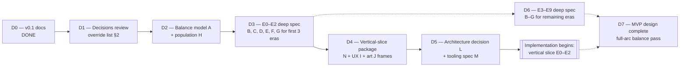

# 06 — Next Steps Toward a Complete MVP Design

> Where the design stands, what is still missing before the MVP design is "complete enough to build", the order to do it in, the risks, and the decisions you may want to override.
> Still **no implementation**. Every item here is a design deliverable: a document, spreadsheet, paper prototype, wireframe or decision record.

---

## 1. Where the design stands (v0.1)

| Area | Document | Status |
|------|----------|--------|
| Game structure: vision, pillars, setting, player levers, match flow, eras E0–E9, scoring | [01](01-game-structure.md) | ✅ Drafted |
| Research structure: project anatomy, slots (4:2:1), costs, gates, Know-how, adoption, keystones | [02](02-research-structure.md) | ✅ Drafted |
| Research catalog: 3 themes, 33 lineages, **509 projects + 10 keystones**, validated | [03](03-research-catalog.md), [03a](03a-research-craft.md), [03b](03b-research-kin.md), [03c](03c-research-reach.md) | ✅ Drafted (effects in prose and shorthand; numbers provisional) |
| Research paths: spine, critical paths, theme weave, era maps, ladders, validated openings | [04](04-research-paths.md) | ✅ Drafted |
| Simulation structure: world, agents, AI layers, economy, population and fission, territory, conflict, determinism | [05](05-simulation-structure.md) | ✅ Drafted |
| Balance numbers | [07](07-balance-findings.md), [07b](07b-territory-findings.md), [09](09-population-and-health.md), [balance/](balance/balance-model.xlsx) | ✅ Single-civ model tuned, 4-civ territory model done, population and health spec done; recommendations applied to 01, 02, 03b, 03c, 05, 08. ✅ 07b R6 adopted (arc 173.5 min, [07c](07c-e0-e2-checks.md)); ✅ territory model re-run on it ([07b §9](07b-territory-findings.md#9-re-run-on-the-live-trajectory-07c-follow-up-2026-10-18)); ✅ early map fixed with seasonal-camp claims ([07b §9.4](07b-territory-findings.md#94-seasonal-camps-as-claim-sources-adopted-2026-10-18)) |
| **E0–E2 build-ready spec** | [10](10-e0-e2-actions-and-goods.md), [11](11-e0-e2-project-specs.md), [12](12-world-generation.md), [13](13-contact-and-conflict.md) | ✅ Action ladders and goods; numeric effects for all 145 projects; world generation; contact, raids and capture rules |
| **Smart AI** | [14](14-ai-opponents.md) | ✅ Design: forecast-driven planner, opponent reading, war and diplomacy intelligence, difficulty without cheats, AI harness with acceptance targets |
| UX & world display (concept) | [08](08-ui-and-world-display.md) | ✅ Concept drafted (wireframes in ASCII; art not started) |
| Art, audio | — | ⏳ Not started |
| Technical architecture, catalog tooling, vertical slice | [15](15-architecture-decision.md), [16](16-catalog-format-and-tooling.md), [17](17-vertical-slice.md) | ✅ Drafted: Godot 4 (.NET) + C# deterministic sim library, YAML catalog and validator spec, slice scope with milestones M0–M9. 🔒 Confirmed 2026-10-18 (D17, D18) |

## 2. Decisions I made that you may want to override

These were made autonomously to keep momentum. Each one is cheap to change *now* and expensive later.

| # | Decision | Where | Alternative you might prefer |
|---|----------|-------|------------------------------|
| D1 | **Setting:** grounded, stylized realism; no magic; belief works through cohesion | 01 §3 | A light mythic layer (e.g. visible spirits as cosmetic) or full fantasy |
| D2 | **Three themes = Craft / Kin / Reach** (stuff / people / land and contact) | 01 §10 | Different splits (e.g. Material / Social / Knowledge) |
| D3 | **Slot ratio 4 : 2 : 1** | 02 §8.2 | 3 : 2 : 1 (gentler) or 6 : 3 : 1 (sharper focus) |
| D4 | **Whole arc in every match** (E0 → E9, ~3 h Standard, ~90 min Quick) | 01 §6 | Multi-session campaigns; shorter "Chapter" matches as the main mode |
| D5 | **Abstract calendar**; 1 year = 60 s at Standard pace (pace scales the season length: 30 s years at Quick, 104 s at Epic; research costs are the same at every pace, [07](07-balance-findings.md) F7); people age in real time | 01 §6 | Era-relative time (each era always ~X minutes) |
| D6 | **Expansion by fission only** (no "found a city" control) | 05 §9.4 | A player "Settle here" lever (stronger than a Beacon) |
| D7 | **Diplomacy fully automatic** in the MVP | 05 §12.2 | Player-proposed treaties and wars |
| D8 | **Representation scale** (1 figure = up to 500 people late) | 01 §8, 05 §5.2 | Fixed scale with population caps (smaller worlds) |
| D9 | **Hex map**, procedurally generated, Earth-like | 05 §4 | Real Earth map scenario |
| D10 | **Only `[Seen]` gates block research**; worldgen guarantees keystone-critical resources | 02 §6 | Harder geography (some civilizations truly cannot reach certain eras without trade or conquest) |
| D11 | **Lockstep multiplayer architecture from day one**, but the MVP ships vs. AI only | 01 §14, 05 §18 | Single-player only (simpler, but painful to retrofit) |
| D12 | **Pollution and climate system** from E7 as the post-modern dilemma | 05 §14 | Leave environmental systems out of the MVP |
| D13 | **Dominion victory = ≥ 50% of habitable land and ≥ 2× the runner-up, for 5 years; in practice a conquest victory** | 01 §7.2, [07b](07b-territory-findings.md) T2 | **🔒 Locked by you (2026-10-18).** |
| D14 | **First release is 1 player vs. 3 AI**; online multiplayer later, lockstep kept for replays and the AI harness | 01 §11, §14 | **🔒 Locked by you (2026-10-18).** |
| D15 | **The AI must be smart**: planning, opponent modeling and adaptive war and diplomacy, with no cheating at any difficulty; quality is measured by an AI-vs-AI and AI-vs-scripted-player harness | 01 P7, [14](14-ai-opponents.md) | **🔒 Locked by you (2026-10-18).** |
| D17 | **Engine and language:** Godot 4 (.NET) front end, C# deterministic simulation library, Fix64 fixed-point math, headless harness; built sim-first ([15](15-architecture-decision.md)) | 15 §4, §10 | **🔒 Locked by you (2026-10-18).** |
| D18 | **Visual style:** 2.5D diorama (3D scene, orthographic-leaning camera, billboard sprites), flat 2D as fallback | 15 §5.4 | **🔒 Locked by you (2026-10-18).** |
| D19 | **Final art source** (commission, asset pack, AI-assisted with curation, or minimal flat-shaded look) | [17 §6](17-vertical-slice.md#6-placeholders-and-the-art-question) | ⏳ **Open: needed before milestone M7c** |
| D16 | **WAY-02 seasonal camps claim land** (2 per E1–E3 settlement, radius 2, 50% of the band's strength; 75% with TER-02) | 05 §11.1, [07b §9.4](07b-territory-findings.md#94-seasonal-camps-as-claim-sources-adopted-2026-10-18) | **🔒 Locked by you (2026-10-18).** |

## 3. Remaining design workstreams

| WS | Workstream | Deliverable | Depends on | Size |
|----|-----------|-------------|-----------|------|
| **A** | **Balance model** | Spreadsheet model (or notebook) of a single civilization through E0–E9: population, food, Insight income, project costs, Know-how, pacing per era; plus a 4-civ territory model. Output: tuned `EraBase`, Insight formula, breadth N, era durations. **Part 1 (single civilization) done:** [07-balance-findings.md](07-balance-findings.md) and [balance/balance-model.xlsx](balance/balance-model.xlsx). **Part 2 (4-civ territory model) done:** [07b](07b-territory-findings.md). | 02, 05 | L |
| **B** | **Catalog numbers pass** | Convert every project's prose effect into explicit **effect primitives with numbers** (02 §11). Add flavor line and practice mapping. Spot-check historical anchors for E3–E9. | A (targets) | XL (509 rows) |
| **C** | **Method ladder specs** | For each of ~20 action families: rungs, rate multipliers, tool and input requirements, fallback rules. One table per family (Chop is the template in 02 §12). | B | L |
| **D** | **Goods & production chains** | Full goods list per era, recipes, storage and spoilage, trade values. | C | M |
| **E** | **AI behavior specs** | Civ Mind (labor targets, expansion scoring, stance logic), Settlement Planner (deficit → work-order rules), Figure utility weights, Council/AI Spark scoring and archetypes. | A, C, D | L |
| **F** | **Territory & conflict spec** | Claim field constants, hysteresis, Dominion weights; raid and war triggers; combat formula constants; capture and assimilation rules; Free Folk behavior. **Paper-prototype** on a printed hex map. | A | M |
| **G** | **World generation spec** | Algorithms (plates, rivers, climate, biomes, deposits, fauna), start scoring, guarantees, fairness pass. Target map sizes per player count. | 02 §6.1 | M |
| **H** | **Population & health spec** | Cohort model, fertility and mortality tables per era, disease model constants, fission parameters. | A | M |
| **I** | **UX & information design** | Turn the concept in [08](08-ui-and-world-display.md) into proper wireframes and clickable mockups: focus bar, research web (lanes × eras, Glimpse fog, lenses), HUD, overlays, Chronicle, follow cam, Moments, era transition, onboarding. Resolve [08 §15](08-ui-and-world-display.md#15-open-questions-for-ws-i--ws-j) open questions. | 01–05, 08 | L |
| **J** | **Art direction** | Style frames for 3 eras (E0, E4, E9) following [08 §2–§4](08-ui-and-world-display.md#2-how-figures-read). Figure readability at zoom levels Z0–Z2 and at representation scales. Tool and outfit silhouette language. Validate the Okabe–Ito civ palette and border patterns. | I, 08 | M |
| **K** | **Audio direction** | Ambient per era and biome; event stingers; Moment cues. | J | S |
| **L** | **Technical architecture decision record** | Engine or rendering choice; **sim core as an engine-independent, deterministic library**; data format for the catalog (YAML/JSON); save and replay format; threading model. Decide from the budgets in 05 §19. **Drafted:** [15](15-architecture-decision.md). | 05 | M |
| **M** | **Catalog tooling spec** | Specify the validator (§4) and the generators for the 04 diagrams, so data stays the source of truth. **Drafted:** [16](16-catalog-format-and-tooling.md); reference scripts in [catalog-tools](catalog-tools/README.md). | L | S |
| **N** | **Vertical slice definition** | An exact scope list for the first playable: E0–E2, 1 map, 2–4 civilizations, ~145 projects. Acceptance tests (§6). **Drafted:** [17](17-vertical-slice.md). | All above for E0–E2 | S |

## 4. Catalog validation (already practiced in design; to become tooling)

During this design pass the catalog tables were parsed and checked by a throwaway script. The checks and their **current results** are worth keeping as a formal tooling spec (WS-M):

| Check | Rule | v0.1 result |
|-------|------|-------------|
| References | Every id in `requires` exists | ✅ 0 errors |
| Acyclic | No cycles in the prerequisite graph | ✅ |
| Era order | No project requires a project from a later era | ✅ |
| Keystone era | Keystone named prerequisites are in the era being left | ✅ |
| Cross-theme | ≥ 35% of each lineage's E1+ projects have a cross-theme prerequisite | ✅ all 33 lineages (after 25 historically motivated links were added) |
| Reachability | Every project is reachable from the starters | ✅ 519/519 |
| Gate criticality | Which `[Seen]` gates block keystones if never satisfied | 7 critical gates, all covered by world-generation guarantees (02 §6.1) |
| Critical path vs. breadth | Breadth N exceeds the in-era critical path by 3–4 | ✅ (04 §2), except KEY-1 (2, accepted for onboarding) and KEY-4 (3 by 04 §2's path, 5 by the balance model's parse; [07](07-balance-findings.md) F9) |
| Openings | Example strategies are legal sequences | ✅ Grower, Builder, Wanderer |
| Diagram generation | Mermaid maps in 04 are generated from the tables | ✅ 13 diagrams parse and render |

Future checks to add: effect-primitive syntax; every Method has a ladder slot; every Structure, Role and Good is defined in the goods and roles registries; cost/benefit outliers flagged by the balance model.

## 5. Recommended order (design milestones)

- **D1 — Decisions review (you):** go through §2, keep or override. Short.
- **D2 — Balance model:** the single most important de-risking step. It proves (or breaks) the 3-hour arc, the 4:2:1 split, and the "20–40% of an era" choice rate. **WS-A part 1 done** ([07](07-balance-findings.md)): v0.1 ran a 350 min, inverted arc; the tuned constants hit every era target at 171.5 min Standard. Demography is the biggest pacing driver, so WS-H locks fertility, mortality and caps before WS-B numbers the effects (07 F11).
- **D3 — Deep spec for E0–E2:** the eras that define first impressions and the core loop (fission, winter, storage, first contact). Fully number every one of the 145 projects, every ladder rung and every planner rule for these eras.
- **D4 — Vertical-slice package:** scope list, wireframes and style frames. This is the hand-off to implementation.
- **D5 — Architecture decision:** last, so it's chosen against concrete budgets and scope.
- **D6/D7:** E3–E9 deep specs continue in parallel with slice implementation, informed by what playtests reveal.

### Prototyping: replaced by models and the AI harness
The game is **player vs. AI first** (D14), so the multi-human paper prototypes are dropped:
1. ~~Focus-slot card game~~ → the **AI tournament harness** ([14 §10](14-ai-opponents.md#10-measuring-smart-the-ai-harness)): AI Sparks of every archetype and difficulty play thousands of fast headless matches against each other and against scripted "player" policies. This tests the 4:2:1 feel by proxy, keystone timing and AI strength.
2. ~~Hex claim board~~ → done as a model: [07b](07b-territory-findings.md).
3. ~~Spreadsheet single-civ run~~ → done: [07](07-balance-findings.md), [09](09-population-and-health.md).
What still needs real people: **UX testing** of the focus bar, research web and onboarding with clickable mockups (WS-I).

## 6. Vertical-slice acceptance criteria (draft, for D4)
A first playable is "right" when:
1. A new player understands the three slots within **2 minutes** and makes a first meaningful choice within **30 seconds**.
2. Completing a project visibly changes figure behavior within **one season** (a Moment, then spreading adoption).
3. The first **winter** is a felt threat in at least half of new games unless food-storage projects are chosen.
4. **Fission** produces a second camp by ~minute 6–10, and territory visibly grows thereafter.
5. **First contact** with a rival happens in E1–E2 on the standard map.
6. KEY-1 at ~minutes 7–9 and KEY-2 at ~16–20 (Standard pace), ±25%.
7. A fully hands-off run (Council auto-picks only) loses to a moderately engaged player most of the time. Choices matter.
8. The sim is **bit-identical** across two runs with the same seed and command log.

## 7. Risks and mitigations

| Risk | Why it matters | Mitigation |
|------|----------------|-----------|
| **Too passive / boring** | Hands-off games can feel like screensavers | Decision cadence target (1–3 min), Moments, Chronicle, Firsts announcements, Glimpses, threats (winter, raids), Beacons |
| **Research web overwhelm** (509 nodes) | Choice paralysis | Glimpse fog (only the frontier is visible), lineage lanes, the Council's suggestion highlights, search and filters, hub emphasis |
| **Opaque cause and effect** | Players can't tell whether a choice helped | Efficiency overlay, per-action method badges, before/after stats in the project tooltip, adoption ripple |
| **Snowballing leader** | Matches decided early | Diffusion, Overreach, density disease, Balance of Power (DIP-10), EraLag discounts |
| **Agent sim performance at scale** | Thousands of figures | Representation scale, LOD cadences (05 §3.2), flow fields, cohort demographics |
| **Determinism bugs** | Multiplayer desyncs | Fixed-point core, RNG streams, checksum tooling from the first slice |
| **Content volume** (509 projects × visuals) | Art and tuning cost | Projects reuse visual hooks (tool tiers, outfits, structure kits); bespoke Moments only for E0–E4 in the MVP |
| **3-hour session length** | Hard for multiplayer | Quick pace (~90 min) as the multiplayer default; save/resume for single-player; Chapter modes post-MVP |
| **Historical sensitivity** (colonies, war, religion) | Reputational | Neutral, systemic framing; no real-world peoples or religions named; Self-Determination and Human Rights projects present consequences; content review in WS-B |

## 8. Definition of "MVP design complete"
- [ ] §2 decisions reviewed and locked
- [ ] Balance model reproduces target pacing across E0–E9 for all five archetypes
- [ ] All 509 projects have numeric effect primitives, flavor and practice mapping
- [ ] All action-family ladders specified
- [ ] Goods, recipes, roles and structures registries complete
- [ ] Civ Mind, Planner, Figure and AI Spark behavior specified with weights
- [ ] Territory, combat, diplomacy, disease and pollution constants specified
- [ ] World generation spec with guarantees and fairness pass
- [ ] Wireframes for all UX surfaces; art style frames for E0, E4, E9
- [ ] Architecture decision record and catalog data schema
- [ ] Vertical-slice scope and acceptance criteria signed off

## 9. Immediate next actions (in order)
1. ~~Balance spreadsheet~~ ✅ [07](07-balance-findings.md) · ~~4-civ territory model~~ ✅ [07b](07b-territory-findings.md) · ~~Population & health~~ ✅ [09](09-population-and-health.md).
2. ~~E0–E2 deep spec~~ ✅ [10](10-e0-e2-actions-and-goods.md)–[13](13-contact-and-conflict.md) · ~~Smart-AI design~~ ✅ [14](14-ai-opponents.md) · ~~Paper prototypes~~ replaced by the AI harness (D14).
3. ~~Re-run balance and checks C1–C5~~ ✅ [07c](07c-e0-e2-checks.md) · ~~territory model re-run~~ ✅ [07b §9](07b-territory-findings.md#9-re-run-on-the-live-trajectory-07c-follow-up-2026-10-18).
4. ~~Architecture decision (WS-L), catalog tooling spec (WS-M), vertical-slice definition (WS-N)~~ ✅ drafted: [15](15-architecture-decision.md), [16](16-catalog-format-and-tooling.md), [17](17-vertical-slice.md).
5. **You:** decide the **art source** (D19) before milestone M7c, and review the remaining open decisions D1–D12 in §2. (D17 and D18 are locked.)
6. ~~Start implementation at M0~~ ✅ 2026-10-18 (Windows and macOS reproduce the golden checksum in CI) ([17 §3.1](17-vertical-slice.md#31-progress)). **Next: M1, the content pipeline** (loader, validator, `import-md`, content pack), per [16](16-catalog-format-and-tooling.md).
7. **In parallel with building:** wireframes and clickable mockups for the focus bar and research web (WS-I), then UX testing with real people. Detail the E3–E9 projects to the same level as E0–E2 (WS-B, C, D for later eras), informed by what the slice shows.
