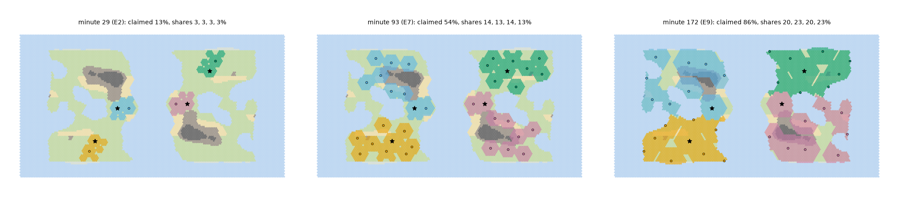

# 07b — Territory Findings (WS-A part 2)

> The second half of workstream A in [06-next-steps.md](06-next-steps.md) §3. Four civilizations share the standard 160 × 100 hex map ([05](05-simulation-structure.md) §4.1). Each one grows along the tuned population and settlement curve from [07](07-balance-findings.md). The model radiates claims per 05 §11 and measures **first contact**, **Dominion share** and **how full the map is**. It ends with the **constants I recommend** for start placement, map size, early claim radii, ownership and Dominion.
> **Re-run on the live (WS-H + R6) trajectory: §9.** Every structural recommendation holds. The early map came out emptier than §6 (L2), which is fixed by seasonal-camp claims (§9.4, adopted).
> Still design only. Model: [balance/tools/territory_sim.py](balance/tools/territory_sim.py) with sweeps in [territory_sweeps.py](balance/tools/territory_sweeps.py). Outputs: [balance/territory-model.xlsx](balance/territory-model.xlsx) and [balance/territory-maps.png](balance/territory-maps.png).

---

## 1. Summary

| Question | Answer |
|---|---|
| **Does first contact happen in E1–E2 (06 §6 item 5)?** | **No, not with v0.1 placement.** Spreading four starts as far apart as possible puts the nearest rival 68 tiles away. First contact then comes at **minute 57–68 (E5)**. With starts in **neighbour pairs 25 tiles apart**, every seed makes first contact at **minute 17.8 (start of E2)**. Start spacing is the lever. Map size is not. |
| **Is Dominion ≥ 50% reachable, and when?** | **Not by peaceful expansion.** Across every archetype mix the best share is **28–33%**, and nobody reaches the 40% warning. Conquering one whole neighbour gives **47–49%**. Only a neighbour *plus* part of a third civilization crosses 50%: **Dominion win at minute 113–118 (E7)**. With 2 players the rule as written can trigger with **no war at all** (a 51/46 split wins at minute 118). |
| **Does the map feel empty early?** | **Yes.** At minute 30 each civilization owns **106 tiles (1.8% of the world)** and only **7% of habitable land is claimed**. In a Z2 view (~3,600 tiles) your territory fills about 3% of the screen. Rivals sit off-screen until E5 under v0.1 placement. The recommended set doubles early territory (**176 tiles, 12% claimed**) and puts the paired rival on the edge of the Z2 view at contact. The early map should still read as a frontier. Fill it with a home-range tint, not with more ownership (T5). |

**Two problems outside the questions asked:**
1. **The map cannot supply the territory balance_sim assumes.** Each civilization has room for about **1,600 land tiles**. `params.py` assumes 2,200–2,500 from E6 on. Feeding the real room back stretches the arc from **171.5 to 188 min**. Raising the late per-settlement caps ×1.6 restores 171.5 (T6).
2. **Dominion Legacy is back-loaded.** **81%** of all Dominion points are earned in E7–E9, and **2.7%** in E0–E3. That contradicts 01 §7.1's "holding land early and long matters". Scoring each year on the share of *claimed* land fixes it (T8).

| Change (headline) | v0.1 | Recommended |
|---|---|---|
| Start placement (05 §4.5) | unspecified (max-spread implied) | **neighbour pairs, nearest rival 25 walking tiles (22–28)** |
| Map size per player count (05 §4.1) | 160 × 100 for 4 | **~4,000 tiles per civ: 2p 112 × 72 · 3p 140 × 86 · 4p 160 × 100 · 6p 196 × 122 · 8p 226 × 142** |
| Base claim radius (05 §20, §9.5) | camp 2 (3 with TER-01) | **camp 3 from the start**; Village 4 from E2 (TER-04) |
| Ownership threshold T (05 §11.2) | 1.0 | **0.7** |
| Lead margin / flip delay | 20% / one season | **unchanged** |
| Falloff (05 §11.1) | unspecified | **max(0, 1 − d / (r + 1))** |
| Dominion victory (01 §7.2) | ≥ 50% for 5 years | **≥ 50% and ≥ 2× the runner-up, for 5 years** |
| Dominion Legacy per year (01 §7.1) | share of habitable land | **share of claimed land** (victory still uses habitable) |
| balance_sim Territory, E7–E9 caps (07, WS-H) | 2,200–2,500 tiles; food 2,500 / 6,000 / 12,000 | **1,600 tiles; caps ×1.6** |

## 2. The model

A deterministic, season-by-season spatial model. One step = one season (15 s at Standard). Every run is reproducible. The numbers here come from the frozen WS-A part-1 tuned constants (07 §5); see §8.

**Map.** A 160 × 100 hex grid, odd-r offset with no wrap. The Continents layout uses value noise and two landmasses split by an ocean channel, with **40% land** (6,400 tiles; ASSUMED, since 05 doesn't say). Biomes come from latitude and noise. Habitable weight follows 05 §11.3: Ice and Peaks 0, Desert and Tundra 0.5, which gives about 5,800 habitable weight (≈ 1,450 per civilization). Base runs use **point-symmetric** maps: rotating the map 180° maps it onto itself, and starts 3 and 4 are the images of starts 1 and 2. So every civilization has the same geography. That's the fairness a WS-G pass would aim for. Statistics use four such map seeds.

**Civilizations.** Each follows a `balance_sim.py` trajectory: population, settlement count and era per season. The base is 4× Balanced, with archetype mixes as variants. Population is split evenly over settlements, as in the mean-field single-civ model.

**Fission sites** (05 §9.4: "tile quality × distance fit − rival pressure"). A candidate tile must be habitable and not owned by a rival. It must be at least *r* + 1 from your own settlements and 2*r* + 1 from rival settlements. Before E4 (TER-09) it must also be on a landmass you already hold. Score = (new unclaimed habitable land within *r* + 0.15 infill) × distance fit, peaked at 2*r* + 1 from the nearest own settlement. All civilizations decide from the previous season's state, and clashing picks are resolved by score, so loop order gives nobody an edge. When the trajectory merges settlements (E8's radius 9), the most redundant interior settlement folds into its neighbours.

**Claims** (05 §11.1): `Claim(c, tile) = Σ Emit(s) × Falloff(d, r)`, with `Emit = √(pop per settlement) × CohesionFactor (1.0) × ClaimMult`. ClaimMult is ×1.15 in E1, ×1.3 E2–E6 and ×1.56 from E7 (TER-03, TER-05 and TER-12; ASSUMED). Falloff is `max(0, 1 − d / (r + 1))`, and the radius *r* is the per-era tier radius. Presence is modeled but off by default (T5). SoftClaim and structures are not modeled.

**Ownership** (05 §11.2): a civilization becomes the owner when its claim is ≥ T *and* ≥ 1.2 × the runner-up's. The condition must hold for a full season before a tile changes hands, whether it is gained, lost or flipped. **Contested** = habitable tiles with a claim ≥ T and no owner.

**Contact** (05 §12.1). Each civilization's figures range *Reach* tiles from their nearest settlement. Reach is ASSUMED: **6 · 9 · 12 · 15 · 20 · 25 · 35 · 50 · 80 · 160** for E0…E9, standing in for forays, scouts (WAY-01 +50%), the seasonal round, traders and ships. Distances are walking paths:
- E0–E1: land plus 1-tile straits (SEA-01).
- E2–E3: coastal water within 2 tiles of land (SEA-03/04).
- E4 on: open sea (Sail, WAY-05).

Thresholds:
- **Aware:** path distance between nearest settlements ≤ Reach_a + Reach_b + 3 (sight).
- **Contacted:** ≤ Reach_a + Reach_b + 2 ("figures within 2 tiles").
- **Border touch:** owned tiles adjacent.

**Conquest stand-in.** No war model exists. A *capture event* moves *k* of a loser's settlements, with their share of its population, to the winner at a given minute.

**Limits.**
- No seasonal noise, Beacons, Posture, Overreach, secession, Free Folk, war or raids.
- Reach is a step function per era, so contact times cluster at era starts.
- One worldgen algorithm. Worldgen fairness is WS-G's to design.

## 3. Base runs

Standard pace, 4× Balanced, map seed 1. Figures are per civilization and averaged where they barely differ.

**v0.1 placement: starts spread as far apart as possible** (nearest rival 68 tiles, two per continent).

| Era | End (min) | Pop/civ | Settl. | Owned tiles/civ | Share each | Claimed | First contacts |
|---|---:|---:|---:|---:|---|---:|---|
| E0 | 7.5 | 20 | 2 | 38 | 0.7% | 2.6% | |
| E1 | 17.5 | 43 | 2 | 66 | 1.1% | 4.4% | |
| E2 | 29.2 | 106 | 3 | 103 | 1.7% | 7.0% | |
| E3 | 42.0 | 295 | 3 | 149 | 2.5% | 10.0% | |
| E4 | 57.0 | 848 | 4 | 288 | 4.8% | 19.4% | |
| E5 | 73.8 | 2,553 | 7 | 560 | 9.4–9.6% | 38.0% | **5 of 6 pairs at minute 67.5–74** |
| E6 | 93.0 | 9,028 | 12 | 952 | 14.8–16.9% | 63.3% | (overseas pair at 91) |
| E7 | 115.2 | 40,315 | 19 | 1,554 | 21.1–28.1% | 98.7% | borders touch at 93.5 |
| E9 | 171.8 | 175,386 | 15 | 1,570 | 21.3–28.0% | 98.6% | |

**Recommended placement: neighbour pairs 25 tiles apart** (§6, R1). Each pair shares a continent, and the pairs are far apart.

| Era | End (min) | Owned tiles/civ | Share each | Claimed | Contact |
|---|---:|---:|---|---:|---|
| E0 | 7.5 | 38 | 0.7% | 2.6% | |
| E1 | 17.5 | 69 | 1.2% | 4.8% | **both pairs meet at minute 17.8** |
| E2 | 29.2 | 106 | 1.8% | 7.3% | |
| E4 | 57.0 | 286 | 4.6–5.1% | 19.6% | |
| E5 | 73.8 | 547 | 8.8–9.6% | 36.9% | cross-continent contacts at 67.5–74 |
| E6 | 93.0 | 941 | 14.5–16.6% | 62.4% | |
| E7 | 115.2 | 1,530 | 17.7–30.6% | 97.6% | borders touch at 67.8 |
| E9 | 171.8 | 1,545 | 18.3–30.1% | 96.8% | |

The map fills in **E7 (90% claimed at minute 108.5–113)**. That holds for every player count when land per civilization is held constant (§4 T7). Borders between paired neighbours first touch in E4–E5 (minute 53–87 depending on seed). The contested strip stays thin, at 0.3–0.8% of habitable land.

## 4. Findings

### T1 — Contact timing is set by start spacing, not map size
Median first contact over four map seeds:

| Nearest rival (tiles) | 20 | 22 | 25 | 28 | 30 | 35 | 40 | 50 | max (≈ 68) |
|---|---|---|---|---|---|---|---|---|---|
| First contact (min) | 7.8 | 17.8 | **17.8** | 29.5 | 29.5 | 35.9 | 42.2 | 57.2 | 62.4 |
| Era | E1 | E2 | **E2** | E3 | E3 | E3 | E4 | E5 | E5 |

- 06 §6's E1–E2 window is minutes 7.5–29.2. **22–25 tiles** lands in its middle on every seed. 20 tiles is contact on the first season of E1, which is too soon after the opening. From 28 tiles on, contact misses E2 by a season.
- Contact clusters at era starts because Reach steps per era (9 → 12 tiles at E2). In the game, reach grows project by project (WAY-01, WAY-02, SEA-01/02), so contact will spread across late E1 and E2.
- **Reach sensitivity:** Reach ×0.75 moves contact to E4 (minute 42); Reach ×1.25 leaves it at 17.8. The E1–E2 promise therefore depends on the scout and foray range WS-E/WS-F give figures. The model needs about **12 tiles of routine range by E2**.
- **Map size doesn't matter:** with paired starts, first contact is minute 17.8 on 2-, 3-, 4-, 6- and 8-player maps alike. The one exception is a 2-player seed whose start pair straddled a lake (42.2).
- The other pairs meet only by sea or long reach, at minutes 53–93 (E4–E7). That staggering is good: one rival early, the wider world mid-game.

### T2 — Dominion ≥ 50% is a conquest victory with four players
Best Dominion share over the arc, standard map, paired starts:

| Scenario | Best share | Crosses 40% | Crosses 50% | Dominion win |
|---|---:|---|---|---|
| 4× Balanced | 30.6% | — | — | — |
| Wanderer vs 3 Balanced | 28.1% | — | — | — |
| Grower vs 3 Sage | 33.0% | — | — | — |
| Wanderer / Sage / Grower / Builder | 33.3% | — | — | — |
| Conquest: whole neighbour at E5 / E6 / E7 start | 47.1 / 47.8 / 49.3% | min 113 / 109 / 108.5 | — | — |
| Conquest: neighbour at E6 + 2 settlements of a third civ at E7 | 53.8% | 108.5 | 113.2 | **118.0** |
| … + 4 settlements | 58.8% | 93.5 | 108.8 | 113.5 |
| … + 8 settlements | 66.5% | 93.5 | 108.5 | 113.2 |

- **Peaceful expansion can't pass ~33%.** Once a civilization fills its room, rivals cannot settle on its land. Claims then push borders only by a tile or two, because emission grows as √pop. A Grower's early lead decides the frontier race, not the final map.
- **50% needs one whole neighbour plus part of a second civilization.** Your continent is about half the land, and your neighbour holds half of that. The earliest a determined conqueror can win is **E7 (minute ~113)**, roughly the moment the map fills.
- The rule works as a "the board is decided" condition for 3+ players. It breaks for **2 players**: there 50% is just "slightly more than your rival". In one 2-player seed a peaceful 50.6 / 45.9 split triggered a Dominion win at minute 118.

**Recommendation (R7):** Dominion victory = **≥ 50% of habitable land *and* ≥ 2× the runner-up's share, for 5 consecutive years.** At 4+ players this is the current rule in practice: whoever holds 50% after a conquest already has 2×. At 2 players it means about 67%. Keep the 40% warning. Nothing in this model (no war) can reach 50% without capture, so the Civ Mind's war logic (WS-E) decides whether this victory ever happens against AI. The design should accept that it's rare.

### T3 — The early map is empty, and that's mostly fine
At minute 30 (end of E2), 4× Balanced:
- Per civilization: **106 people, 3 settlements, 106 owned tiles = 1.8% of the world**. All four together: 7.3% of habitable land.
- A Z2 view (08 §1, ~80 tiles across, ~3,600 tiles) shows your territory as ~3% of the screen. A Z1 view (~25 tiles, ~350 tiles) shows one settlement's claim disk and its 35 people.
- Under v0.1 placement the nearest rival is 68 tiles away, about one Z2 screen off, until E5.

Bigger early radii help, but only so much. At minute 30, owned land per civilization:

| Variant | Min 2 | Min 7.5 | Min 17.5 | Min 30 | Share at min 30 |
|---|---:|---:|---:|---:|---:|
| v0.1 radii 2 / 3 / 3 (E0 / E1 / E2), T 1.0 | 19 | 38 | 69 | 106 | 1.8% |
| radii 3 / 3 / 4, T 1.0 | 19 | 38 | 74 | 176 | 3.1% |
| **radii 3 / 3 / 4, T 0.7 (recommended)** | **37** | **74** | **74** | **176** | **3.1%** |

The map at 12% claimed in E2 should still read as a sparse frontier, which suits a Paleolithic-to-Neolithic setting. The real fixes are proximity (T1: your rival is at the edge of the Z2 view by E2) and visibility of where your people *go* (T5). Shrinking the map would starve the late game (T6, T7).

### T4 — T only matters for small bands; late ownership is decided by the lead margin and the falloff edge
Emission is √(pop per settlement). It runs from about 3 (a band of 10) to about 170 (a 12,000-person city × 1.56). An absolute T = 1.0 therefore stops binding after E2. From then on, ownership is set by the falloff cutoff at *r* + 1 and the 20% lead.

| Variant (seed 1) | Owned at min 2 | Owned at min 30 | Contested at E7 / end | Civ→civ flips | First border touch |
|---|---:|---:|---|---:|---:|
| As written (T 1.0, lead 20%, tail 1) | 19 | 106 | 0.3% / 0.8% | 17 | 67.8 |
| T 0.5 | 19 | 106 | same | 17 | 67.8 |
| T 2.0 / T 4.0 | 7 / 0 | 59 / 24 | same | 17 | 67.8 |
| Lead 10% / 35% | 19 | 106 | 0.2% / 0.6% · 0.7% / 2.3% | 18 / 0 | 67.8 |
| Falloff tail 0.5 / 2 | 7 / 19 | 106 / 159 | 0.4% / 1.2% | 1 / 92 | 67.8 / 53.2 |
| Incumbent keeps tile while highest and ≥ T | 19 | 106 | 0.3% / 0.5% | 17 | 67.8 |
| No flip delay | 19 | 106 | same | 17 | 67.5 |

- **T:** with radius 3 camps, **T = 0.7** lets a typical band of 10 own its whole radius from the first season (√10 × ¼ = 0.79). A 6-person daughter band still owns only radius 2 (0.61), so tiny splinters claim less. T = 1.0 silently caps every E0 camp at radius 2, whatever the radius constant says. Higher T only empties the early map.
- **Lead 20%:** gives a contested strip about one tile wide (0.3–0.8% of habitable land). That's legible as the striped band in 08 §5. 35% doubles the strip and freezes borders (0 flips). 10% removes the strip. **Keep 20%.**
- **Falloff:** `1 − d/(r + 1)` makes "claim radius *r*" mean what it says. A longer tail (2) blurs every border and makes flips 5× more frequent. A shorter one (0.5) shrinks small camps. Write the falloff into 05 §11.1.
- **Flip delay and incumbent rule:** no measurable effect here, because the model has no seasonal noise. Keep the one-season delay as written. WS-F's paper prototype should test it with winter die-back and raids.

### T5 — Presence should be a home-range tint, not ownership
Adding a presence claim (0.6, radius = half of Reach) below T changes ownership by at most one ring. Presence that could reach T on its own would turn the whole home range into owned land (radius ~6, about 300 tiles per civ by E2). That would make early Dominion a function of the Reach constant instead of settlement. **Recommendation (R5):** cap Presence at 0.5 × T, so it never owns a tile alone, and render the home range as a light hatch in the civ's color (08 §5). At minute 30 the hatch covers about 300 tiles per civ (radius ~6 around three settlements), against 176 owned. That's what makes the early map feel lived-in. It also shows paired rivals' ranges touching at first contact.

### T6 — The map can't supply the territory balance_sim assumes
`params.py` `Territory` (07's ASSUMED per-era land per civ): 60 · 200 · 500 · 900 · 1,400 · 1,800 · 2,200 · 2,400 · 2,500 · 2,500. The map gives each of four civilizations about **1,600 land tiles** (1,450 habitable weight), and realized holdings at E9 are 1,100–1,750 tiles. From E6 on, balance_sim lets each civ found more settlements than its land can hold.

| balance_sim run (Balanced, Standard) | Arc | E8 | E9 | Pop at E9 | Settlements E7 / E9 |
|---|---:|---:|---:|---:|---|
| WS-A part 1 tuned | 171.5 | 26.8 | 29.5 | 175k | 21 / 15 |
| Territory capped at 1,600 | **188.0** | 31.8 | **41.0** | 105k | 15 / 9 |
| Territory 1,600 + E7–E9 per-settlement caps ×1.6 | **171.5** | 26.2 | 30.2 | 168k | 15 / 9 |

- The radius-9 merge in E8 leaves room for only 9 metropolises. Population then caps at 9 × 12,000.
- A land-poor civilization also falls behind in *research*: room 1,300 runs a 201 min arc. Land then compounds twice (Dominion and Insight), which is the snowball 06 §7 lists as a risk.

**Recommendation (R6, for WS-H):** set Territory to the map's room (**1,600 from E5 on**, the standard ~4,000 tiles per civ). Make late growth vertical: E7–E9 food caps **4,000 / 9,600 / 19,200** and housing caps **6,400 / 16,000 / 32,000** per settlement. That's the city density of TER-13 and TER-15 rather than more settlements. It reproduces the 171.5 min arc with every era inside its window.

In the territory game itself, merging settlements must never abandon claimed land: absorbed towns become suburbs that keep claiming. With 9 metropolises at radius 9, claimed land falls from 93% (E7) to 86–91% (E9). That's acceptable: the gaps are mountains and coasts.

### T7 — Map size per player count: hold ~4,000 tiles per civilization
| Players | Map | Tiles | Land (40%) | Habitable / civ | First contact | All pairs met | 90% claimed | Shares at end |
|---|---|---:|---:|---:|---|---|---|---|
| 2 | 112 × 72 (one landmass) | 8,064 | 3,226 | 1,430–1,490 | 17.8 / 42.2 | same | 108.5 | 46–51% |
| 3 | 140 × 86 | 12,040 | 4,816 | 1,360–1,430 | 17.8 | 74.0 | 109–113 | 22–45% |
| **4** | **160 × 100** | **16,000** | 6,400 | 1,450 | 17.8 | 86.5–93.2 | 108.5–108.8 | 18–30% |
| 6 | 196 × 122 | 23,912 | 9,564 | 1,350–1,460 | 17.8 | 108–116 | 108.5–108.8 | 12–20% |
| 8 | 226 × 142 | 32,092 | 12,837 | 1,450 | 17.8 | 115.5 | 108.5–108.8 | 9–17% |

- **Keep 160 × 100 for 4 players.** At ~4,000 tiles (≈ 1,600 land) per civilization, the map fills at **minute ~109 (early E7)** at every player count. That's when Industry-era wars and Dominion contests should start. A bigger map per civ would delay the fill into E8 and leave the E5–E6 borders soft. A smaller one would starve the late game (T6).
- **6 and 8 players:** 32,000 tiles is twice 05 §19's 16,000-tile budget, a WS-L concern. Middle civilizations get squeezed (9–13% shares; up to 600 blocked fissions in one 8-player seed). Use a **3-continent layout from 6 players**, and run the fairness check below on every start set.
- **Odd counts (3)** can't use point symmetry, and a fairness search over random maps still left a 22% vs 45% split on one seed.

### T8 — Dominion Legacy is earned almost entirely in the late game
Share of each civilization's Dominion Legacy earned per era, paired starts: E0 0.1% · E1 0.5% · E2 0.6% · E3 1.5% · E4 2.5% · E5 4.3% · E6 9.0% · E7 20.7% · E8 28.8% · E9 32.0%.

- **E0–E3 (42 min, 24% of the match) earn 2.7%.** Habitable share starts near zero and the map fills only in E7. So "land is a running integral, so holding land early and long matters" (01 §7.1) is false as scored. Expansion choices in E0–E4 barely register in the score that is supposed to be half the game.
- **Recommendation (R8):** score each year's Dominion as **your share of claimed land** (your owned weight ÷ habitable weight owned by anyone, Free Folk included). Keep the **victory** on share of *all* habitable land. Results (recommended set):
  - **When it's earned:** E0–E3 earn **24%** and E7–E9 **46%**, roughly in step with time.
  - **Leader advantage:** a Grower leading three Sages earns ×1.36 the others' Dominion, against ×1.50 now.
  - **Size:** totals are about 2× larger, so re-weight Dominion against Mastery to keep its ~50% target (01 §7.1).
  - The early land race becomes worth playing for, without a runaway.

### T9 — Equal room isn't equal land: the frontier race decides shares
On a fair map, mirrored civilizations end within a point of each other. Within a pair, though, the two can differ by **12 points (18% vs 30%)**, even when their Voronoi room is equal (±3%). The inland sea forces one civilization the long way round, and the other reaches the open middle first and keeps it (see the E9 panel of territory-maps.png). Peaceful claims can't take it back (T2).

**Recommendations (R9):**
- **WS-G:** fairness passes should *simulate expansion* (run this model on the start set) and require **simulated E7 shares within ±15% of each other**. Comparing local resources (05 §4.5 step 7) or Voronoi room isn't enough.
- **WS-E:** the Civ Mind's site score should value contested frontier land, i.e. "race to the midline", above safe interior land once a rival is Aware. The player's Beacon (05 §11.4) is the counter-lever.

## 5. Recommended constants (change list)

| # | Doc § | Constant | v0.1 | Recommended | Finding |
|---|---|---|---|---|---|
| R1 | 05 §4.5 (WS-G) | Start placement | unspecified | **Neighbour pairs: nearest rival 25 walking tiles (22–28); other starts ≥ 60 tiles or across water** | T1 |
| R2 | 05 §4.1, 01 §13 (WS-G) | Map size | 160 × 100 for 4 | **~4,000 tiles and ~1,600 land tiles per civ: 112 × 72 (2) · 140 × 86 (3) · 160 × 100 (4) · 196 × 122 (6) · 226 × 142 (8); 40% land; 3 continents from 6 players; even row count** | T7 |
| R3 | 05 §11.2, §20 | Ownership threshold T | 1.0 | **0.7** | T4 |
| R3b | 05 §11.2 | Lead margin; flip delay | 20%; one season | **unchanged** | T4 |
| R3c | 05 §11.1 | Falloff | unspecified | **Falloff(d, r) = max(0, 1 − d / (r + 1))** | T4 |
| R4 | 05 §9.5, §20; 03c TER-01 | Base claim radius | camp 2 (3 with TER-01) | **camp 3 from the start; Village 4 (TER-04, E2)**. Per-era model radius 3 · 3 · 4 · 4 · 5 · 5 · 5 · 7 · 9 · 9. TER-01 keeps "claims decay 50% slower" and loses the radius bump | T3, T4 |
| R5 | 05 §11.1; 08 §5 | Presence | uncapped | **≤ 0.5 × T (never owns alone); render the home range (½ Reach) as a hatch** | T5 |
| R6 | params.py / 05 §9.1 (WS-H) | balance_sim Territory; E7–E9 per-settlement caps | 2,200–2,500 tiles; food 2,500 / 6,000 / 12,000, housing 4,000 / 10,000 / 20,000 | **1,600 tiles from E5; food 4,000 / 9,600 / 19,200, housing 6,400 / 16,000 / 32,000** | T6 |
| R6b | 05 §9.4 | Settlement merges | — | **Merged settlements keep claiming as suburbs; no land is abandoned** | T6 |
| R7 | 01 §7.2, 05 §11.3 | Dominion victory | ≥ 50% for 5 years | **≥ 50% and ≥ 2× the runner-up, for 5 consecutive years**; 40% warning unchanged | T2 |
| R8 | 01 §7.1, 05 §11.3 | Dominion Legacy per year | 100 × share of habitable land | **100 × share of *claimed* habitable land**; re-weight vs. Mastery so Dominion stays ~50% | T8 |
| R9 | 05 §4.5, §6.2 (WS-G, WS-E) | Fairness; site choice | resource score ±5% | **Simulated E7 share within ±15%; Civ Mind values contested frontier once a rival is Aware** | T9 |
| R10 | 05 §12.1 (WS-E/F) | Figure range (Reach) | unspecified | **≥ 12 tiles of routine range by E2** (the model's 6 · 9 · 12 · 15 · 20 · 25 · 35 · 50 · 80 · 160) | T1 |

## 6. Recommended run

All recommended constants together: paired starts at 25 tiles, T 0.7, radii 3 · 3 · 4 · 4 · 5 · 5 · 5 · 7 · 9 · 9, and balance_sim coupled per R6 (arc 171.5 min). Standard pace, 4× Balanced, four map seeds.

| Era | End (min) | Pop/civ | Settl. | Owned tiles/civ | Share range (4 seeds) | Claimed |
|---|---:|---:|---:|---:|---|---:|
| E0 | 7.5 | 20 | 2 | 74 | 1.2–1.3% | 5.0–5.3% |
| E1 | 17.5 | 43 | 2 | 74 | 1.2–1.3% | 5.0–5.3% |
| E2 | 29.2 | 106 | 3 | 175–179 | 2.9–3.2% | 11.8–12.5% |
| E3 | 42.0 | 295 | 3 | 175–179 | 2.9–3.2% | 11.8–12.5% |
| E4 | 57.0 | 848 | 4 | 322–336 | 5.2–5.9% | 21.9–23.3% |
| E5 | 73.8 | 2,553 | 7 | 571–609 | 9.0–10.7% | 38.8–42.0% |
| E6 | 93.0 | 9,028 | 12 | 940–1,016 | 14.8–17.6% | 63.9–68.1% |
| E7 | 115.0 | 42,951 | 15 | 1,411–1,485 | 19.0–26.8% | 90.6–95.2% |
| E8 | 141.2 | 84,565 | 9 | 1,353–1,447 | 18.8–25.6% | 86.1–91.2% |
| E9 | 171.8 | 168,316 | 9 | 1,353–1,447 | 18.8–25.6% | 86.1–91.2% |

- **Contact:** paired neighbours meet at **minute 17.8 on all four seeds** (06 §6 item 5 ✓). The cross-continent pairs meet at minutes 53–93 (E4–E7).
- **Borders:** paired borders touch at minutes 53–87.
- **Dominion:** nobody passes 27% without conquest.
- **Map figure:** [balance/territory-maps.png](balance/territory-maps.png) shows seed 1 at the end of E2, E6 and E9.

## 7. What this does not settle (follow-ups)

1. **WS-H:** adopt R6 (Territory = map room, denser late caps) in the re-fit, then re-run this model on the new trajectories: `CIVSIM_BALANCE_DIR` unset uses the live `balance_sim.py`.
2. **WS-F paper prototype (06 §5 #2):** the hysteresis and incumbent rules under seasonal noise, raids and winter die-back. The war and capture rules decide whether R7 is ever reached against AI.
3. **WS-G:** a worldgen that makes fair point-symmetric or rotationally fair maps for 2–8 players, plus R9's simulated fairness check (`territory_sim.place_starts` and `run` are a starting point). Also the 3-continent layout for 6–8 players, and odd player counts.
4. **WS-E:** frontier-race site scoring, scout range (R10), and when the Civ Mind starts a war of conquest.
5. **WS-L:** 6–8 player maps exceed the 16,000-tile budget in 05 §19.
6. **01 §7.1:** re-weight Dominion vs. Mastery under R8.
7. **Apply R1–R10** to 01, 03c (TER-01), 05 and 08, and add this document to the README index.

## 8. Reproducing

- **Run the model:** `python docs/MVP/balance/tools/territory_sim.py` runs one standard-map summary (needs numpy).
- **Run the sweeps:** `territory_sweeps.py [group]` runs every table in this document, about 10 min.
- **Build the workbook:** `build_territory_xlsx.py [--sweeps cached.json] [--png]` writes the workbook and the map figure (needs openpyxl, plus matplotlib for `--png`). Sheets:
  - Params
  - Eras (era-end tables, contact, Legacy by era)
  - Series_paired and Series_maxspread (every season, with share charts)
  - Contact, Early, Ownership, Dominion, MapSize, Coupling, Recommended
  - Map_E2end, Map_E5end, Map_E9 (colored tile grids)
- **Input version:** this document's numbers use the WS-A part-1 tuned constants (07 §5). WS-H was editing `params.py` and `balance_sim.py` at the time, so the runs used a frozen copy of those two files via `CIVSIM_BALANCE_DIR=<folder>`. With the variable unset, the model reads the live files.

## 9. Re-run on the live trajectory (07c follow-up, 2026-10-18)

### 9.1 What changed in the input
§6's recommended run used the **WS-A part-1** trajectory with R6 forced in as per-era cap tables (`COUPLED`). The live balance model has since moved on:
- **WS-H demography** ([09](09-population-and-health.md)): new fertility, mortality and the late-winter fission trigger. The third settlement now waits until about minute 45 (09 §7.4).
- **R6 adopted as per-project steps** ([07c](07c-e0-e2-checks.md#2-r6-in-the-balance-model) §2): Territory 1,600 from E5; ×1.6 late density carried on NRG-07 and TRN-12.
- **Arc** 173.5 min on the earlier research curve. The current progressive single-civ arc is 195 min ([07c §10](07c-e0-e2-checks.md#10-progressive-research-cadence-follow-up-2026-10-24)); the four-civ territory run still uses the earlier trajectory.

This re-run uses §6's recommended rules (paired starts at 25 tiles, T 0.7, radii 3 · 3 · 4 · 4 · 5 · 5 · 5 · 7 · 9 · 9) on the **live trajectory with no overrides**. `COUPLED` would now double-apply the late caps; `recommended()` is guarded against that. Four map seeds, 4× Balanced, Standard pace.

**Reproduce:** from `balance/tools`, run `uv run --no-project --with numpy python -c "import territory_sweeps as S; S.table(S.live()); S.table(S.live(camps=1))"` (~80 s). The workbook ([territory-model.xlsx](balance/territory-model.xlsx), sheets *Live* and *Recommended*) and the map figure ([territory-maps.png](balance/territory-maps.png)) were rebuilt on 2026-10-18 from these inputs.

**All §9 numbers come from the corrected model (§9.5).** The first §9 re-run used the old map code. Its asymmetry made one civilization per seed look boxed in, and those figures are superseded.

### 9.2 Results vs. §6 (no seasonal camps)

| Era | End (min) | Pop/civ | Settl. | Owned tiles/civ | Share range | Claimed | §6 owned · claimed |
|---|---:|---:|---:|---:|---|---:|---|
| E0 | 7.8 | 22 | 2 | 74 | 1.2–1.3% | 5.0–5.3% | 74 · 5.0–5.3% |
| E1 | 17.8 | 46 | 2 | 74 | 1.2–1.3% | 5.0–5.3% | 74 · 5.0–5.3% |
| E2 | 29.5 | 115 | **2** | **118** | 2.0–2.1% | **7.9–8.3%** | 175–179 · 11.8–12.5% |
| E3 | 42.5 | 288 | **2** | **118** | 2.0–2.1% | **7.9–8.3%** | 175–179 · 11.8–12.5% |
| E4 | 57.2 | 798 | 3 | 257 | 4.3–4.6% | 17.3–18.0% | 322–336 · 21.9–23.3% |
| E5 | 73.8 | 2,220 | 5 | 439 | 7.3–7.9% | 29.4–30.9% | 571–609 · 38.8–42.0% |
| E6 | 92.8 | 7,393 | 9 | 716 | 11.9–13.5% | 49.7–53.9% | 940–1,016 · 63.9–68.1% |
| E7 | 115.5 | 33,148 | 15 | 1,382 | 22.2–24.5% | 93.3–96.7% | 1,411–1,485 · 90.6–95.2% |
| E8–E9 | 143.0 / 173.8 | 83,731 / 140,703 | 9 | 1,283 | 20.9–23.6% | 86.1–91.2% | 1,353–1,447 · 86.1–91.2% |

| Measure | Live re-run (4 seeds) | §6 / §4 | Verdict |
|---|---|---|---|
| First contact (paired) | **minute 18.0 on every seed** (first season of E2) | 17.8 | ✅ R1 holds |
| All pairs met | 74–93 | 86.5–93.2 | ✅ |
| Paired borders first touch | 61–93 | 53–87 | ✅ |
| 90% of habitable land claimed | **95–99.5** (start of E7) | 108.5–113 | ✅ still "fills in early E7", ~10 min sooner |
| Final shares | **20.9–23.6%** (mirrors identical) | 18.8–25.6% | ✅ fairer than §6 |
| Peaceful Dominion ceiling (5 archetype mixes) | **24.2–29.3%** | 28–33% | ✅ R7/D13: conquest needed |
| Whole neighbour captured at E5 / E6 start | 38.7% / 41.6% | 47.1% / 47.8% | Lower (L3) |
| Neighbour at E6 + 2 / + 4 settlements of a third civ | 45.7% / 51.6%; **win (≥ 50% and 2×) only with + 4, at 120.8** | 53.8% / 58.8%; win 118.0 / 113.5 | ✅ Dominion win still needs conquest, late E7 |
| Dominion Legacy earned in E0–E3 / E7–E9, claimed-land scoring (R8) | **24.4% / 46.7%** | 24% / 46% | ✅ R8 holds |
| Same, old habitable scoring | 3.0% / 80% | 2.7% / 81% | (confirms why R8 is needed) |
| Longest settlement shortfall (any civ) | **≤ 2 seasons** | — | ✅ no civilization is boxed in (§9.5) |

### 9.3 Findings
- **L1 — Every structural recommendation still holds.** R1 (contact at minute 18), R3 (T 0.7), R7 (conquest-only Dominion), R8 (claimed-land scoring) and the "fills in early E7" shape all reproduce on the live trajectory.
- **L2 — The early map was emptier than 07b assumed (fixed by §9.4).** With WS-H demography the second fission waits until about minute 45, so through E2–E3 a civilization holds **2 settlements and 118 tiles instead of 3 and ~177** (claimed 8% instead of 12% at the end of E2). This is 09 §7.4's open question, now measured. **Adopted 2026-10-18:** 09 §7.4 option (a), WAY-02 seasonal camps as claim sources (§9.4).
- **L3 — Conquest is worth a little less, and the map fills earlier.** With fewer, larger settlements in E5–E6, capturing a whole neighbour yields 39–42% (was 47–48%). A Dominion win needs a neighbour **plus about 4 settlements of a third civilization**, earliest at **minute ~121** (late E7). That is still D13's intent, and 01 §7.2 says "around minute 120".
- **L4 — Resolved: the "blocked fissions" were a model artifact (§9.5).** The first re-run showed one civilization per seed short of its settlement target for ~67 seasons. On the corrected model the longest shortfall is 2 seasons on every seed, and the mirrored civilizations finish identically.

### 9.4 Seasonal camps as claim sources (adopted 2026-10-18)

**Rule** (05 §11.1, 03c WAY-02): each settlement founded in E1–E3 sets up **2 seasonal camps**, 1–3 tiles beyond its claim radius. Each camp claims **radius 2 at 50% of its band's emission**. Camps are active from WAY-02 (modeled as the middle of E1) and stay as **satellite camps** (fishing, herding, hunting stations) until town and city radii absorb them. Settlements founded from E4 on get none.

**Model:** `territory_sim.place_camps`, switched on with `Camps=1` (now part of `recommended()`). Placement is greedy for new habitable land, on unclaimed or own land on the same landmass, at least r + 3 tiles from rival settlements, and never on rival-owned tiles. TER-02's 75% strength is **not** modeled, so the results are conservative.

A first version switched camps off at E4. That made owned land **drop** for ~2 minutes at the E3→E4 change (194 → 166 tiles) until the third settlement arrived. Territory that visibly shrinks at an era change is wrong, so camps are sticky.

| Era end | Owned/civ, no camps (§9.2) | **Owned/civ, camps** | Claimed, no camps | **Claimed, camps** |
|---|---:|---:|---:|---:|
| E1 | 74 | **150** | 5.0–5.3% | **10.1–10.8%** |
| E2 | 118 | **187** | 7.9–8.3% | **12.4–13.1%** |
| E3 | 118 | **187** | 7.9–8.3% | **12.4–13.1%** |
| E4 | 257 | **309** | 17.3–18.0% | **20.5–21.6%** |
| E5 | 439 | **491** | 29.4–30.9% | **31.2–33.6%** |
| E6 | 716 | **818** | 49.7–53.9% | **52.9–57.1%** |
| E7 | 1,382 | **1,294** | 93.3–96.7% | **93.2–96.1%** |
| E8–E9 | 1,283 | **1,232** | 86.1–91.2% | **86.0–90.0%** |

| Measure | No camps | **Camps** |
|---|---|---|
| First contact (paired) | 18.0 | **18.0** (unchanged; it depends on reach) |
| Paired borders first touch | 61–93 | **67–93** |
| 90% claimed | 95–99.5 | **94.8–99.5** |
| Final shares | 20.9–23.6% | **20.3–23.6%** |
| Peaceful Dominion ceiling | 24.2–29.3% | **24.9–28.8%** (everyone has camps, so no archetype gains much) |
| Conquest: neighbour at E6 + 2 / + 4 settlements of a third civ | 45.7% / 51.6%; win — / 120.8 | **45.4% / 50.9%; win — / 120.8** |
| Dominion Legacy earned E0–E3 / E7–E9 (claimed scoring) | 24.4% / 46.7% | **24.4% / 46.7%** |
| Longest settlement shortfall | ≤ 2 seasons | **≤ 2 seasons** |

**Result:** the early map now meets or beats §6's target. End-of-E2 claimed land is **12.4–13.1%** (§6: 11.8–12.5%), and owned land doubles in E1 and grows +58% by the end of E2. **No territory is lost at any era change.** Contact, map fill, the Dominion ceiling, the timing of Legacy and D13's "conquest only, around minute 120" are unchanged. Late eras end slightly smaller with camps (1,232 vs 1,283 tiles), because early camps shift where the frontier settles. That is within seed noise.

### 9.5 Model fixes: exact symmetry and mirror-invariant tie-breaks (2026-10-18)
The first §9 re-run showed one civilization per seed short of its settlement target for ~67 seasons (counted as ~70 "blocked fissions"), while its mirror image on the same supposedly symmetric map was not. The cause was two model bugs, not geography:
1. **The maps weren't exactly point-symmetric.** The noise layers were mirrored, but the continent-shape term (map edges and the ocean channel) used hex x-coordinates with a half-tile row offset that a 180° rotation flips. Coastlines therefore differed by a few tiles between mirrored starts. **Fix:** mirror the shape term too. Land and biomes are now exactly symmetric on every seed.
2. **Tie-breaks depended on tile index order**, which runs in opposite directions on the two halves of a rotated map. **Fix:** fission-site and camp tie-breaks count tiles from the civilization's own end of the map.

With both fixes, mirrored civilizations finish identically. No civilization is short of its settlement target for more than 2 seasons, and final shares are tighter (20.3–23.6%). §3–§7's original numbers were produced with the asymmetric maps. Their conclusions are confirmed here, but where numbers differ, **§9 supersedes them**.

**Design takeaways:**
- **For world generation (WS-G, 12 §2):** symmetry must cover *every* layout term and be computed in hex-lattice (axial) coordinates. A rotation of offset coordinates is not a symmetry of the grid. A few tiles of coastline were enough to lock one civilization out of the frontier race.
- **For the fairness pass (12 §11.2):** the frontier race is sensitive to small differences. Keep the simulated-share test, and add **"no civilization below its settlement target for more than 8 seasons in E1–E7"** as a cheap early warning of a boxed-in start.
