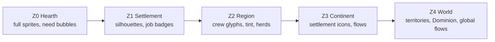

# 08 — UI and World Display (concept)

> How CivSim looks and how the player reads it. This covers the camera, the little figures, how each era looks on the map, territory, overlays, the focus bar, the 509-node research web, notifications, follow cam, onboarding, hands-off controls, and how late eras are presented cheaply in the MVP.
> **Concept level.** Layouts, encodings and rules, not final art or pixel mockups. Those come in workstreams WS-I and WS-J ([06](06-next-steps.md#3-remaining-design-workstreams)) once the balance model has settled the numbers.

---

## 0. Why the display is game design here

In a hands-off game the player spends most of their time *watching*. The display therefore carries three jobs that buttons carry in other strategy games:

1. **Cause and effect:** a research choice must visibly change what figures do (pillar P3, [01 §2](01-game-structure.md#2-design-pillars)).
2. **State at a glance:** who is winning, who is starving, where borders are moving, without opening a panel (pillar P4).
3. **Calling the player back:** the game decides when something deserves attention, so the player can relax the rest of the time (§11).

**Display principles**

| # | Principle | Rule of thumb |
|---|-----------|---------------|
| V1 | **Show, then tell** | Every state change has a map-visible proxy first; numbers live in tooltips and panels. |
| V2 | **One channel, one meaning** | Civ identity = color + emblem; research theme = icon shape (hammer, hearth, compass) + hue family; method tier = tool silhouette + metal tint. Channels are never reused. |
| V3 | **Readable at every zoom** | Each zoom level has its own representation (§1); nothing just shrinks into noise. |
| V4 | **Calm by default** | Motion and color budget go to *changes*: new methods, borders flipping, threats. Steady state is quiet. |
| V5 | **Colorblind-safe and pattern-backed** | Every color encoding has a redundant pattern, shape or icon (§4.3). |

---

## 1. Camera and zoom levels

**View:** a tilted top-down "diorama" view (≈ 50° pitch, orthographic-leaning perspective), free pan, smooth zoom, and limited rotation in 4 steps. Hex tiles are **invisible by default**: terrain reads as continuous land, and the grid appears only in overlays and placement hints.

| Level | Name | Approx. view | What you see | Figures render as | Typical figures on screen |
|-------|------|--------------|--------------|-------------------|---------------------------|
| **Z0** | **Hearth** | ~6 tiles across | Individual faces (2–3 px features), tools in hand, carried goods, need bubbles (🍖 ❄ 💤), work animations | **Full sprite** with tool, outfit, carry item | 10–40 |
| **Z1** | **Settlement** | ~25 tiles | The whole settlement and its work radius: fields, quarries, paths; structure detail; job-site badges | **Simplified sprite**: silhouette + tool + civ sash; no faces | 40–200 |
| **Z2** | **Region** | ~80 tiles | Several settlements, territory tint and borders, trails and roads, herds, caravans | **Crowd glyphs**: work crews merge into a cluster icon showing the job, with a count (e.g. ⛏ ×12); lone travelers stay as dots | clusters + dots |
| **Z3** | **Continent** | ~250 tiles | Settlements as tier icons sized by population, borders, flows (routes, rails, sea lanes), wonders | **None.** Population shown as settlement icon size and a density shimmer | 0 |
| **Z4** | **World** | whole map | Civ territories, Dominion %, contact lines, global flows (E8–E9), climate stress | None | 0 |

**Level-of-detail rules**
- Transitions are **cross-fades with hysteresis** (±10% zoom), so glyphs don't flicker when the player hovers near a boundary.
- **Representation scale is independent of zoom.** From E4, one figure stands for 2–500 people (one figure per person through E3, per [07 F6](07-balance-findings.md#f6--population-is-10-below-the-representation-scale-budget-in-e2e6)) ([05 §5.2](05-simulation-structure.md#52-representation-scale-one-figure-stands-for-n-people)). At Z0–Z1 the figure looks like one person. Its "household of N" shows only on hover and in the follow card (§9). That keeps the diorama human-scale in every era.
- **Render budget:** ≤ 600 figures per civ in total. At Z0–Z1 only figures within the view frustum (plus margin) are fully animated; off-screen figures are simulated, not drawn.
- **Era transition re-flow:** when the representation scale steps up, figures briefly converge toward their household's representative, then the extra figures fade out. This is the "gathering" animation from [01 §8](01-game-structure.md#8-eras).



---

## 2. How figures read

### 2.1 The figure kit
Figures are **toy-like peg figures**: a rounded body, a head, simple limbs, and no realistic anatomy. This makes them friendly, cheap to animate, and readable at small sizes. Every figure carries four readable channels:

| Channel | Encodes | Notes |
|---------|---------|-------|
| **Held tool silhouette** | Action family and **method tier** | Shape tells the action (axe, sickle, spear, basket, hammer, net, scroll, rifle, laptop). Material tint tells the tier: **stone** grey-brown and chunky; **copper** orange; **bronze** gold; **iron** dark grey; **steel** blue-white with a glint; **machine** era: the figure walks to or operates a machine sprite instead. |
| **Headwear and outfit** | **Role** and era clothing | Shaman: antler or feather crown. Smith: apron. Scribe: tablet or scroll. Priest: tall hat. Soldier: helmet. Researcher: lab coat. Chief or ruler: circlet. Outfits change by era (hides → woven tunics → layered medieval → coats → work clothes → casual). |
| **Civ sash and banner** | **Civilization identity** | A colored sash on every figure, plus an emblem on banners and structures (§4.3). |
| **Carry item** | What's flowing | A visible bundle on back or head: meat, grain sack, stone block, logs, ore, crate, later a cart or vehicle. |

**Life stage** reads by size: children are small and follow adults, and elders are slightly stooped with a walking stick.

**State cues** are small and transient: sick (pale tint, slow walk), hungry (thinner, bubble), cold (shivering animation), fleeing (fast run, arms up), Legend (small star above the head, §9.2), innovator (sparkle trail for one season after a Moment).

### 2.2 Animation language (one gesture per action family)
Chop = overhead swing; dig/forage = crouch and pull; hunt = stalk then throw or draw; fish = cast or haul; farm = sow sweep or harvest cut; build = hammer and lift; craft = seated work loop; haul = loaded walk; teach = gesture to a group; worship or celebrate = gathered circle with raised arms; fight = clash loop. A **new method** reuses its family's gesture with a new tool. Only a few rungs get bespoke animations (§12).

### 2.3 Keeping crowds of hundreds readable
- **Spatial grouping:** the Settlement Planner already clusters work by site, so crews look like crews.
- **Crew glyphs at Z2** collapse same-job groups into one icon with a count.
- **Idle de-emphasis:** idle or resting figures are slightly desaturated and smaller. Busy figures pop.
- **Highlight on purpose:** hovering a job badge highlights everyone doing that job and dims the rest. Hovering a project in the research web highlights everyone it affects (§7.7).
- **Motion budget:** ambient sway is low; strong motion is reserved for work, combat, flight and Moments.
- **Max density:** if a tile holds more figures than can be distinguished, the extras render as a "busy" crowd shimmer with a count.

---

## 3. How each era looks on the map

The map itself is the era indicator. Each era adds a visual layer, and the late eras shift the visual weight from **figures** to **flows**.

| Era | Terrain and land use | Structures | Figures | Flows layer | Lighting and atmosphere |
|-----|---------------------|------------|---------|-------------|--------------------------|
| **E0 Dawn** | Wild: untouched forests, grasslands, herds roaming; only trails where people walk | Fire pits, lean-tos, thorn rings | Hides or nothing, stone tools | Footpaths that fade if unused | Firelight glow at camps; strong seasonal palette shifts (snow, green-up) |
| **E1 Hunters** | Burned grassland patches (FIR-05), painted cave mouths | Tents, pit houses, storage pits, shrines, totems | Tailored clothing, bows, dogs | Seasonal migration trails between camps | Cave-art decals on cliffs |
| **E2 Roots** | **Field patchwork** appears (irregular plots), pastures with fences, cleared forest edges | Wattle huts, mudbrick, longhouses, granaries, megaliths | Woven cloth, polished axes, herders with flocks | Footpaths between villages; first exchange trails | Smoke plumes from kilns and hearths |
| **E3 Bronze** | Irrigation canals (blue lines), straighter fields, quarries and mine scars | Temples, ziggurats, walls, markets, palaces | Bronze glint, chariots, scribes | **Caravans** (pack animals) on trade routes; sailboats on coasts | Bronze-age warm palette; city walls cast shadows |
| **E4 Iron** | **Paved roads** (pale stone lines), terraces, aqueduct arches | Columns, theatres, forts, harbors, lighthouse | Iron tools, legion helmets, togas or tunics | Road traffic (carts), galleys and trading ships, courier riders | Lighthouse beam at night (cosmetic) |
| **E5 Faith & Fief** | Three-field strips, manors, windmills on hills | Castles, cathedrals, monasteries, mills | Layered clothing, knights, monks | Pilgrim and market traffic, cogs on sea lanes | Bell towers; cathedral silhouettes on skylines |
| **E6 Discovery** | Enclosed hedged fields, canals, botanical gardens | Star forts, palaces, universities, early factories | Coats, muskets, scholars | **Ocean sea lanes** (dashed arcs across oceans) with caravels and galleons | Map gains a subtle "chart" grain at Z3–Z4 |
| **E7 Industry** | Mine slag heaps, rail cuts, rapid city growth | Factories with chimneys, rail stations, gasworks | Work clothes, rifles, engineers | **Rail lines** with trains; steamships trailing smoke | **Pollution haze** begins (brown-grey near industry); gaslight dots in cities |
| **E8 Modern** | Highways, suburbs, dams and reservoirs, open pits | Skyscrapers, power stations, airfields, reactors | Suits and overalls; vehicles carry most haulage | Car and truck flow along highways, **power lines**, aircraft arcs | **Night lights**: city glow visible at Z3–Z4 |
| **E9 Information** | Solar fields, wind farms, megacity sprawl, rewilding near sustainable civs | Data centers, launch sites, smart towers, Apex uplinks | Casual clothing; screens and phones; few manual laborers | **Data-link arcs** glowing between cities, satellites crossing the sky layer, container ship lanes | Haze either thick (dirty growth) or clearing (sustainable). A climate-stress tint on the world view |

### 3.1 Light, day and night
- A **cosmetic day/night cycle** of about **2 minutes real time**, decoupled from the season calendar (seasons are only 15 s at Standard and 7.5 s at Quick, so a day per season would strobe). It is purely visual. Figures' **rest** is staggered by the sim and not tied to visual night (see the implied change to [05 §5.4](05-simulation-structure.md#54-needs-drive-behavior-priority), §14).
- Night is when late eras shine: firelight in E0, lighthouse beams in E4, gaslight in E7, city glow and power-line pulses in E8, data arcs in E9.
- Accessibility option: **Always day** (night as a tint only).

### 3.2 Seasons
Seasons are the strongest ambient signal in early eras: palette shift, snow cover, leaf color, herd migrations, river ice. Winter is visually harsh (desaturated, snow, figures huddled near fires) because it is the core early-game pressure ([05 §4.3](05-simulation-structure.md#43-seasons-and-climate)).

### 3.3 The flows layer
From E3 onward, a **flows layer** draws movement of goods, people, power and information as animated lines with moving tokens:

| Flow | First appears | Encoding |
|------|---------------|----------|
| Trade caravan or ship | E2–E3 (TRD-03, SEA-06) | Pack-animal or boat tokens moving along a dotted route; thickness = volume |
| Road traffic | E4 (TRN-07) | Cart tokens; later cars and trucks as flowing dots |
| Sea lanes | E6 (SEA-12) | Dashed ocean arcs with ship tokens |
| Rail | E7 (TRN-12) | Solid line with train tokens and smoke puffs |
| Power | E8 (NRG-09) | Thin pylons line; pulses at night |
| Air | E8 (TRN-15) | High arcs with plane tokens |
| Data | E9 (COM-16) | Glowing arcs between cities; brightness = bandwidth |
| Pollution | E7 (KEY-7) | Haze volume on tiles; drift downwind |

Flows are **on by default from Z2 outward** and can be toggled. At Z0–Z1 the physical vehicles render instead.

---

## 4. Territory display

### 4.1 Encodings
| State | Encoding |
|-------|----------|
| **Owned** | Low-alpha **tint** in the civ color over terrain, plus a **solid border line** (civ color with a dark outline) and the civ **border pattern** (§4.3) |
| **Contested** | **Diagonal stripes** alternating the two leading civs' colors. A slow crawl animation shows the direction of pressure |
| **Seasonal camp** (WAY-02) | A small tent or windbreak icon at the camp, with its radius-2 claim drawn as owned land (tint + border). The band's figures are shown walking the round between camps by season, which makes the claim legible |
| **Home range** | Light **hatch** in the civ color over the area its people routinely walk (½ of scouting reach around each settlement). Presence never owns land on its own ([05 §11.1](05-simulation-structure.md#111-claim-field)), but the hatch makes the sparse early map read as lived-in, and shows paired rivals' ranges touching at first contact |
| **Unclaimed** | No tint |
| **Flipping** | The border line animates (ripple) over the season before a flip, which matches the sim's hysteresis ([05 §11.2](05-simulation-structure.md#112-ownership-with-hysteresis)) |
| **Treaty border** (DIP-05) | Double line with small seal markers |
| **Soft claim** (culture, E8+) | Faint dotted halo of a civ's color over *rival* tiles it influences |
| **Free Folk** | Neutral grey tint with a leaf emblem |

### 4.2 Claim-strength overlay
A toggle that replaces the flat tint with **saturation proportional to claim strength**. A selected tile shows a small bar chart of the top three civs' claims. Use it to see where borders are about to move.

### 4.3 Colorblind-safe civ palette
Eight civ colors from the **Okabe–Ito** palette, each paired with a **border pattern** and an **emblem** so color is never the only cue:

| Slot | Color | Hex | Border pattern | Emblem |
|------|-------|-----|----------------|--------|
| 1 | Orange | `#E69F00` | solid | sun |
| 2 | Sky blue | `#56B4E9` | long dash | wave |
| 3 | Bluish green | `#009E73` | dot | leaf |
| 4 | Yellow | `#F0E442` | dash-dot | star |
| 5 | Blue | `#0072B2` | double line | mountain |
| 6 | Vermilion | `#D55E00` | zigzag | flame |
| 7 | Reddish purple | `#CC79A7` | short dash | moon |
| 8 | Neutral dark | `#4D4D4D` (light outline) | chain | antler |

- The player's own civ gets a thin **white inner outline** on its borders for instant self-identification.
- **Research theme colors** (amber, green, blue) appear only in UI panels, never on the map, so they don't collide with civ colors (principle V2).
- Colorblind modes: deuteranopia, protanopia and tritanopia presets adjust tints; the patterns stay.

---

## 5. Overlays catalog

Overlays sit in a left toolbar (§6), one at a time plus the always-on territory tint. Each overlay states its **legend** and **data freshness**. Overlays that need knowledge appear only after the related project is completed: a diegetic reward that makes Reach and Inquiry research tangible.

| Overlay | Shows | Encoding | Available from |
|---------|-------|----------|----------------|
| **Resources** | Known renewables and deposits | Icons per type; deposit size as icon size; unknown deposits not shown | Start (sight only); expands with MIN-01, INQ-03, MIN-08, INQ-13, MIN-16 |
| **Food security** | Per-settlement months of stores and next-winter forecast; tile yields | Settlement gauge rings (green → amber → red) + yield heat on tiles | Start (simple); forecast with NUM-01 Tally Marks |
| **Cohesion & Overreach** | Cohesion per settlement; Overreach gradient from the capital | Ring color + a "fraying rope" icon on at-risk settlements; distance gradient | Start; Overreach detail with GOV-07 |
| **Claims** | Claim strength field (§4.2) | Saturation + tile bar chart | Start |
| **Know-how heat** | Where each lineage's Know-how is being earned | Heat map for a selected lineage (picker); slotted lineages listed first | Start |
| **Efficiency & methods** | Which **method rung** each job site uses, and where figures fall back to a lower rung | **Method badges** on job sites (tool-tier icon + "×4.0"); **amber "fallback" badge** when a better rung is known but blocked (missing tool, input, `[Has]`/`[Near]`), with the reason on hover | Start |
| **Adoption** | How far a selected method has spread | Per-figure dot (knows / doesn't) at Z1; per-settlement % at Z2+ | Start |
| **Trade & flows** | Routes, volume, partners | Flows layer emphasized; partner list | TRD-02 |
| **Fauna** | Herds, migration routes, predators, over-hunting warnings | Herd glyphs, arrow routes, red pulse when a herd is collapsing | Start; detail with INQ-01 |
| **Health** | Disease pressure, outbreaks, sanitation | Settlement pressure ring + outbreak icon; spread arrows along routes | MED-01; sanitation layer with MED-12 |
| **Danger** | Predators, raiders, armies, unrest | Red markers with direction arrows; threat radius | Start |
| **Pollution & climate** | Pollution per tile; global climate stress | Haze density map + world-level stress gauge | KEY-7 (pollution); INQ-19 (full climate data) |
| **Beacons** | Your Beacons and their bias fields | Pillar marker + soft radial field; fission groups' intended paths | ART-05 Songlines |
| **Gates** | Where `[Seen]` gate resources were sighted and which projects they reveal | Eye icon at sighting spots + linked project chips | Start |

**Hover anywhere** shows a compact tile card: terrain, owner, claim top-3, resources, current workers and their method rung.

---

## 6. Main HUD

```text
┌──────────────────────────────────────────────────────────────────────────────────────────┐
│ ◉ ASH VALLEY FOLK   E1 HUNTERS  ▓▓▓▓▓▓▓▓░░ KEY-2 Sedentism  9/14 · ●●○○   Y12 ❄Winter   │
│ 👥 186  ⌂ 5 camps  ⚑ Dominion 11.4% (2nd)  ★ Legacy 2,340 (1st)        ⏸ ▶ ▶▶ ▶▶▶  [◎] │
├────┬──────────────────────────────────────────────────────────────────────┬──────────────┤
│ ◐  │                                                                      │ CHRONICLE  ▾ │
│ ⛏  │                                                                      │ Y12 Oru led  │
│ 🍖 │                                                                      │ 19 east...   │
│ ⚑  │                        WORLD VIEW (diorama)                          │ Y12 First to │
│ 🔥 │                                                                      │ tame dogs!   │
│ ⚙  │                                                                      │ Y11 Harsh    │
│ ♥  │                                                                      │ winter...    │
│ ☁  │                                                                      │──────────────│
│────│                                                                      │ ALERTS       │
│ ✦  │   [Beacon] [Posture: Balanced ▾]                                     │ ⚠ Famine risk│
│    │                                                                      │   Reed Camp  │
├────┴──────────────────────────────────────────────────────────────────────┴──────────────┤
│         ┌─ PRIMARY 57% ──────────┐ ┌─ SECONDARY 29% ─┐ ┌─ TERTIARY 14% ┐  Insight 31/yr   │
│         │ ◔ FOR-04 Wild Cereal   │ │ ◑ FOD-03 Storage│ │ ◕ BLD-03 Pit  │  [Research web]  │
│         │   Harvest · 1.5 min ✦  │ │   Pits · 2.8 min│ │   House · 4 m │  ┌──────────────┐│
│         │   next: FOR-05, FOR-06 │ │   next: —       │ │   next: —     │  │   minimap    ││
│         └────────────────────────┘ └─────────────────┘ └───────────────┘  └──────────────┘│
└──────────────────────────────────────────────────────────────────────────────────────────┘
```

| Region | Contents |
|--------|----------|
| **Top bar** | Civ name and emblem; current **era** and **keystone progress** (breadth count `9/14` plus 4 pips for the named prerequisites); calendar (year and season icon); population; settlements; Dominion % and rank; Legacy and rank; speed controls; **Director** toggle `[◎]` (§11.2) |
| **Left toolbar** | Overlays (§5); below the divider: player levers: **Beacon** placement (count left) and **Posture** dropdown, shown once unlocked |
| **Right column** | **Chronicle** (collapsible, filterable) and **Alerts** stack (§10) |
| **Bottom** | **Focus bar** (§7) centered; Insight/yr; Research-web button; minimap |
| **Contextual** | Tile card on hover; follow card when a figure is selected (§9) |

**Lean-back mode** (one key): hides everything except the focus bar, the top-bar era strip and alerts. For watching.

---

## 7. Focus bar

The single most important control. It is always visible and sized by share, so Primary is literally the biggest.

```text
┌─ PRIMARY · 4/7 ───────────────────────────┐ ┌─ SECONDARY · 2/7 ──────────┐ ┌─ TERTIARY · 1/7 ───┐
│ [🔨] STN-06 Microliths            ◔ 64%   │ │ [🏠] FOD-03 Storage Pits   │ │ [🧭] WAY-02 Seasonal│
│ Stoneworking · Method                     │ │ ◑ 38%     ETA 2.8 min      │ │ Round  ◕ 12%       │
│ ETA 1.5 min (6 seasons)   ✦ Know-how +22% │ │ ✦ Know-how +5%             │ │ ETA 4.1 min        │
│ ▸ next in queue: HNT-06 Bow & Arrow       │ │ ▸ queue empty              │ │ ▸ queue: ART-05     │
│ ⚠ diffusion −10% (River Folk know it)     │ │                            │ │ ★ keystone path    │
└───────────────────────────────────────────┘ └────────────────────────────┘ └────────────────────┘
   drag to reorder ⇄ · right-click: queue / remove · empty slot shows "Elders suggest: …" ghost
```

**Each slot shows**
- Theme icon (🔨 Craft · 🏠 Kin · 🧭 Reach, i.e. hammer, hearth, compass), project id and name, lineage and type.
- A **progress ring** with %, and an **ETA** in real minutes and in seasons (it recalculates as Insight and Know-how change).
- **Know-how glow** (✦) when practice is speeding it up, with the % of the project it is covering.
- Modifiers that change cost: **diffusion** discount, **EraLag** discount, gate notes (e.g. "Dormant: no tin yet").
- A **★ keystone path** tag if the project is on the critical path to the next keystone.
- **Queue peek:** the next 1–2 queued projects.

**Interactions**
- Drag a project from the research web onto a slot, or press `1`/`2`/`3` with a project selected.
- Drag between slots to re-rank. Progress is never lost ([02 §7](02-research-structure.md#7-project-states)).
- **Cascade animation:** when Primary completes, Secondary and Tertiary visibly slide up and the queue head drops into Tertiary.
- **Empty slot:** shows a ghost card with "Elders suggest: X (reason: famine risk)" from the Council. One click accepts it; otherwise the Council auto-fills after one season (configurable).
- **Leaning** sliders (Craft/Kin/Reach) live in a small popover on the Insight readout.

---

## 8. Research web (509 nodes)

### 8.1 Layout: lanes × eras
The web is a **grid**, not a free graph. Each project has a fixed home, so players build spatial memory over the session.

- **Columns = eras** E0 → E9, left to right. Within an era, sub-columns order a lineage's projects by catalog sequence.
- **Rows = 33 lineage lanes**, grouped into three **theme bands**: Craft (11 lanes, top), Kin (11, middle), Reach (11, bottom). Lane order inside a band follows the catalog index ([03 §3](03-research-catalog.md#3-lineage-index)).
- **Keystones** sit on a dedicated spine between eras: vertical gates spanning all bands.
- **In-lane links** are drawn as a continuous lane rail (cheap, calm). **Cross-lane links** are drawn **only on demand** (§8.5). Otherwise each node shows small port ticks on its edges (●→) indicating "has outside prerequisites/dependents", which avoids spaghetti.

```text
            E0 Dawn        E1 Hunters          E2 Roots            E3 Bronze   ║K3║   E4 Iron …
          ┌──────────────┬───────────────────┬──────────────────┬───────────┐ ║  ║
CRAFT STN │ ●─●─●─●      │ ●─●─●             │ ●─◐─◇            │ ○ ?       │ ║  ║
      FIR │ ●─●─●  ●     │ ◉─●               │ ○─○              │ ░░░       │ ║  ║
      WOD │ ●            │ ◉                 │ ○ ?              │ ░░░       │ ║  ║
       …  │              │                   │                  │           │ ║  ║
──────────┼──────────────┼───────────────────┼──────────────────┼───────────┤ ║  ║
KIN   FOR │ ●─●          │ ●─●─◉─○           │ ○ ?              │ ░░░       │ ║  ║
      HNT │ ●─●─●        │ ●─●─②─○ ?         │                  │           │ ║  ║
       …  │              │                   │                  │           │ ║  ║
──────────┼──────────────┼───────────────────┼──────────────────┼───────────┤ ║  ║
REACH WAY │ ●            │ ①─○               │ ?                │ ░░░       │ ║  ║
      COM │ ●─●          │ ○─?               │                  │           │ ║  ║
       …  │              │                   │                  │           │ ║  ║
          └──────────────┴───────────────────┴──────────────────┴───────────┘ ║  ║
 ● completed   ○ available   ? glimpsed   ░ fog (hidden)   ①②③ slotted   ◉ Council suggestion
 ◐ dormant (hatched)   ◇ wonder   node size ∝ number of dependents (hub emphasis)
```

### 8.2 Node states (matches [02 §7](02-research-structure.md#7-project-states))
| State | Look |
|-------|------|
| **Hidden** | Not drawn. The lane beyond the frontier is **fog** (soft texture), so you can see that *something* lies ahead without a count |
| **Glimpsed** | Silhouette card with the name, a "?" and the **one missing prerequisite** highlighted |
| **Available** | Full card outline in the theme hue |
| **Slotted** | Filled ring with slot number ①②③ and a progress arc |
| **Completed** | Solid fill, check mark; **Pioneer** star if you were First |
| **Dormant** | Hatched fill with the missing `[Has]`/`[Near]` condition named |
| **Gate-hidden** | Lanes with a `[Seen]` gate show an **eye** icon in the fog ("explore to reveal") |

### 8.3 Zoom semantics
| Web zoom | Shows | Use |
|----------|-------|-----|
| **W1 Overview** | One cell per (lineage × era): a mini bar of completed / available / glimpsed counts; theme bands and the keystone spine | "Where am I strong or weak?" |
| **W2 Lanes** | Nodes as dots with short names; slotted and suggested markers | Everyday browsing |
| **W3 Detail** | Full cards: icon, name, type, cost, ETA-if-Primary, effects in shorthand, prerequisites and unlocks, flavor line | Deciding |

### 8.4 Search, filters and lenses
- **Search** by name, id, or **effect keyword** (`fish`, `winter`, `claim`, `bronze`, `Beacon`). It matches effect text and goods names, not only titles.
- **Filters:** theme, type (D/M/S/R/I/W/K), era, state, gate type.
- **Lenses** (one at a time; they re-weight node brightness):
  - **Keystone path:** highlights the critical path to the next keystone and shows the `breadth n/N` counter ([04 §2](04-research-paths.md#2-critical-paths-and-breadth)).
  - **Cheap now:** sorted by effective cost after Know-how, diffusion and EraLag.
  - **Affects action…:** pick an action family (e.g. Chop). It highlights every project that adds a rung or modifier to it, which shows the method ladder in the web.
  - **Urgent:** the Council's urgency signals (famine → food lineages, raids → DEF/WAR).
  - **Rivals know:** projects contacted civilizations have completed (diffusion targets).

### 8.5 Cross-theme links on demand
Selecting a node draws its **upstream tree** (prerequisites, recursively, back to completed nodes) and its **downstream fan** (what it unlocks, 2 steps), as curved lines **colored by the source theme**. Hovering shows a single-step neighborhood. This is how the weave between themes ([04 §3](04-research-paths.md#3-the-weave-how-the-themes-feed-each-other)) becomes discoverable without drawing all ~800 edges at once.

### 8.6 Hub emphasis and suggestions
- **Node size** scales with the number of dependents, so hubs like Spoken Language, Watt Engine and Electric Grid ([03 §4.3](03-research-catalog.md#43-hub-projects-most-required-by-other-projects)) read as load-bearing.
- **Council suggestions:** up to three ◉ markers, each with a **reason tag** from the scorer's dominant factor ("famine risk", "Know-how stored", "keystone path", "copper seen nearby", "rivals know it: −20%").

### 8.7 "What will this change?" preview
A W3 card includes a **sim preview**: "Affects 34 figures currently chopping · Chop ×3.0 → ×4.0 · needs polished-stone tools (you have 12)". On hover, the world view highlights the affected figures (§2.3). This is the strongest cause-and-effect tool in the UI.

---

## 9. Follow cam and Legends

### 9.1 Follow cam
Click a figure to follow it. The camera eases to Z0–Z1 and tracks. A **life card** docks on the right:

```text
┌ ORU THE RESTLESS ★ ───────────────── Ash Valley Folk ┐
│ 31 yrs · Adult · Reed Camp · Hunter (skill 7)          │
│ Partner: Ama · Children: 3 · Parents: † Teo, Lin      │
│ Needs   🍖▇▇▇▅  ❄▇▇▅▅  💤▇▇▇▇  🛡▇▇▇▇  🤝▇▅▅▅           │
│ Doing:  stalking aurochs with Bow (HNT-06) → carry     │
│ Knows:  Bow ✓ Atlatl ✓ Nets ✗ (learning)               │
│ Deeds:  first to hunt with a bow (Y9) · led fission    │
│         to the eastern Beacon (Y12)                    │
│ [Follow family] [Pin to watch list] [Show household ×1]│
└────────────────────────────────────────────────────────┘
```

- At representation scale > 1, the card adds "**Household ×N**": the figure represents N people, with their cohort summary.
- **Watch list:** pin figures, Legends or settlements. Director mode (§11.2) favors pinned subjects.

### 9.2 Legends
- Legends carry a small **★** over the head at Z0–Z2, and a distinct accessory (a colored cloak or feather).
- **Hall of Legends** panel: portrait cards (procedural), dates, deeds, and "where are they now" (follow if alive, grave or monument if not). ART-06 adds visible monuments for dead Legends.
- Chronicle entries about Legends are clickable and jump the camera.

---

## 10. Notifications and highlights

### 10.1 Tiers
| Tier | Examples | Presentation | Interrupts? |
|------|----------|--------------|-------------|
| **Critical** | Raid or war on your settlement; famine imminent (< 1 season of stores); epidemic outbreak; a rival crosses 40% Dominion; Apex uplink sabotaged | Red alert card + soft horn; optional **auto-pause** (single-player setting) | Yes |
| **Moment** | Project completed (innovator performs the new action) | **Picture-in-picture** vignette (bottom-left, 4–6 s) showing the innovator with a sparkle, caption and project chip. Click to jump. The camera is never hijacked unless Director mode is on | Gently |
| **Milestone** | **Era transition**; **Firsts** (world announcements); first contact; Wonder completed; Legend born or dead | Era transition: 3 s full-width banner + "gathering" re-flow + new era palette fade-in. Firsts: a gold banner across the top for all players ("The River Folk were first to sail"). First contact: emblem handshake card | Briefly |
| **Info** | Slot auto-filled by the Council; queue empty; trade route opened; settlement founded | Toast (3 s), also logged | No |
| **Ambient** | Births, minor events, weather | Chronicle only | No |

### 10.2 Attention budget
- **At most one interrupting notification every 30 s**, except Critical. Lower tiers batch ("3 projects completed").
- **Moments queue:** if several projects complete close together, PiP vignettes play in sequence, and anything older than 20 s collapses into a toast.
- Every notification is **one click to the location** and is logged in the Chronicle.

### 10.3 Chronicle
- A storybook feed: short, named sentences ([05 §15](05-simulation-structure.md#15-events-and-the-chronicle)), with era-appropriate typography (carved glyphs in E0–E2, manuscript in E5, newsprint in E7, a feed in E9; cosmetic only).
- Filters: My civ / World / Legends / Wars / Research. Search. Export as a "match story" at the end of the game.

---

## 11. Hands-off controls

### 11.1 Speed and pause
- Pause, 0.5×, 1×, 2×, 4× (single-player). Multiplayer: 1× plus a pause budget ([01 §6](01-game-structure.md#time-scale)).
- **Auto-pause rules** (single-player, each toggleable): on Critical alerts · when a slot empties and the Council is set to "ask" · on era transition · on first contact.

### 11.2 Director mode (auto-camera)
A toggle `[◎]` that turns the game into a self-directing documentary.
- **Scoring:** the camera picks the next subject by `interest = eventWeight × recency × (1 − recentlyShown) × watchListBonus`. Event weights: Moment 5, battle 6, fission departure 4, first contact 6, Wonder progress 3, Legend action 3, famine 5, era transition 8.
- **Shots:** each subject gets a 6–12 s shot with an easing move. It cuts to Z3 for flows and borders every ~60 s, then returns to people.
- **Never** leaves a Critical event unshown. The player can grab the camera at any time; Director resumes after 10 s of no input.
- Combined with **lean-back mode** (§6), this is the "screensaver that is also a game" mode.

### 11.3 "While you were away" digest
When the window regains focus after more than 2 minutes, a card summarizes what happened: projects completed, slots auto-filled, era progress, Dominion change (with a mini map diff), wars and contacts, Legends. Each line jumps to the location.

---

## 12. Onboarding: the first 10 minutes

The first match uses **Gentle start**: no rival contact before KEY-1, and the first three winters are mild. Tips are contextual one-liners; only the very first is modal. Every tip fires **on its trigger**, not at a fixed time, so the sequence holds even when a run deviates.

> **Timings come from the tuned balance run** ([07 §6](07-balance-findings.md#6-tuned-run), Standard pace): a starter project completes in about 0.75 min, the first fission comes at about 7.0 min, and KEY-1 lands at about 7.5 min, inside the 7–9 min target in [02 §8.3](02-research-structure.md#83-cost-formula) and [06 §6](06-next-steps.md#6-vertical-slice-acceptance-criteria-draft-for-d4). A year is 60 s at Standard, so winter arrives at 0:45 and recurs every minute. **First fission is a knife-edge:** across archetypes it lands anywhere from minute 6 to 13 ([07 F5](07-balance-findings.md#f5--no-fission-before-minute-77-demography-needs-to-run-faster)), so the fission tip must not assume it comes before KEY-1.

| Time (Standard) | What happens | What it teaches |
|------|--------------|-----------------|
| 0:00 | Camera opens at Z0 on twelve people around an ember. One line: *"You are their curiosity. Choose what they learn."* | The Spark role |
| 0:10 | The focus bar is pre-filled with the Council's picks: **FOR-01, SOC-01, FIR-01**. Prompt: "Swap any of these, or let the elders choose." | 3 slots, 4:2:1, the Council (acceptance: first meaningful choice ≤ 30 s, [06 §6](06-next-steps.md#6-vertical-slice-acceptance-criteria-draft-for-d4)) |
| ~0:45 | **First Moment:** an innovator tries the new method; a PiP vignette plays; adoption dots spread | Projects change behavior; adoption |
| 0:45–1:00 | **First (mild) winter:** the palette turns to snow and figures gather at the fire. Tip: "Seasons turn every 15 seconds. Winter is when stores matter." | Seasons; the calendar |
| 1:00–2:00 | Glimpsed nodes appear; tip: "Open the research web (R) to see what's next" | Glimpse fog; web navigation |
| 2:00–3:00 | Efficiency overlay tip on a job site badge: "Chop ×1.5 → ×2.0" | Method ladders |
| ~3:30 | **Autumn of year 4:** the food overlay pulses; tip: "This winter will be hard. Storage and shelter matter." | Food security; urgency |
| 3:45–4:00 | **First full-strength winter:** figures huddle; if stores are low, a Critical alert appears | Threat and recovery |
| ~4:00–6:00 | The keystone strip lights up once half of KEY-1's named prerequisites are done: "Symbolic Mind: 8/13 · ●●○○" | Eras and keystones |
| ~6:00–7:00 (6–13) | **First fission** (on trigger): a daughter band leaves; territory tint expands; tip on claims | Fission, territory, Dominion |
| ~7:30 | KEY-1 completes: era-transition banner; Hunters-era nodes emerge from the fog | Era progression |

At Quick pace (7.5 s seasons, [07 F7](07-balance-findings.md#f7--pace-by-research-cost-cant-work-scale-the-calendar-instead)) the same sequence runs in about half the time. Onboarding should default to Standard.

Later tips unlock on first relevance (first contact, Beacon unlock via ART-05, Posture via GOV-02, first Dormant project). Each can be replayed from the Help panel.

---

## 13. Lower-fidelity treatment for late eras (MVP)

The MVP gives **bespoke Moments only to E0–E4** ([01 §14](01-game-structure.md#14-scope-mvp-vs-full-game)). E5–E9 projects use a **generic kit** that still satisfies "show, then tell":

| Element | Bespoke (E0–E4) | Generic kit (E5–E9 in MVP) |
|---------|-----------------|----------------------------|
| Moment | Innovator performs a unique animation with the new tool | **Badge burst**: the project icon pops above the relevant job sites or structures, a ring pulse spreads across the settlement, and the caption plays in the PiP |
| Method rungs | New tool sprite and gesture variant | Tool **tint** change (§2.1 material ladder) plus the job-site **method badge** updating (×multiplier) |
| Structures | Unique models | **Modular era building kit** (walls, roofs, chimneys in era style) plus a **type sign** icon on the roof (factory gear, university book, reactor atom) |
| Institutions | Gathering animation, banners | **Banner swap** on civic buildings plus a settlement ring pulse |
| Effects at scale | Visible on figures | Carried mostly by the **flows layer** (§3.3) and overlays: rail, power, data arcs and haze are where late eras visibly change |

**Minimum asset per project (all 509):** an icon, a one-line flavor, a Chronicle line and a badge. Everything else is optional polish, prioritized by how many players will see it (early eras and hub projects first).

---

## 14. Changes this design implies for other documents

| Doc | Change | Applied? |
|-----|--------|----------|
| [01 §13](01-game-structure.md#13-ux-surfaces-non-binding-sketch) | Point UX surfaces to this doc; add Director mode, lean-back mode and the "While you were away" digest; Moments are picture-in-picture, not camera takeovers | ✅ small edit |
| [02 §10](02-research-structure.md#10-adoption-how-a-completed-project-reaches-the-map) | Innovator Moment is shown as PiP (link here) | ✅ small edit |
| [02 §15](02-research-structure.md#15-the-council-of-elders-auto-pick) | The Council scorer must expose its **dominant factor** as a reason tag for UI suggestions | ✅ small edit |
| [05 §5.4](05-simulation-structure.md#54-needs-drive-behavior-priority) | "Rest" is staggered by the sim, not tied to a global night; visual day/night is cosmetic (§3.1) | ✅ small edit |
| [05 §16.5](05-simulation-structure.md#165-visible-feedback) | Point visual hooks to this doc; add the **fallback badge** requirement (the sim must report *why* a figure fell back to a lower rung) | ✅ small edit |
| 05 (new data needs) | The sim must expose per-job-site **method rung + fallback reason**, per-settlement **food forecast**, **claim top-3 per tile**, and **event interest weights** for Director mode | Listed here; detail in WS-E/WS-I |
| [06 §3](06-next-steps.md#3-remaining-design-workstreams) | WS-I and WS-J now build on this doc | ✅ linked |

## 15. Open questions for WS-I / WS-J
1. Exact pitch and rotation limits for the diorama view (fixed 4-way vs. free rotation).
2. Whether Z3–Z4 should switch to a stylized **parchment-map** look in early eras and a **satellite** look in E9 (strong era identity vs. consistency).
3. Procedural portraits for Legends: style and cost.
4. Research web on small screens (Steam Deck, laptop): is W2 legible at 800 px tall?
5. Audio cues for each notification tier (WS-K).
