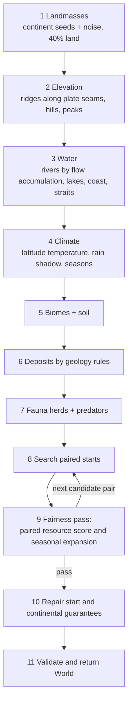

# 12 — World Generation (WS-G)

> How a match's world is built: landmasses, terrain, climate, biomes, water, fauna, deposits, start placement, the resource guarantees, and the fairness pass. It is detailed to the level the first three eras need, but it generates the whole world, including late-era deposits (coal, oil), at match start.
> Inputs: [05 §4](05-simulation-structure.md#4-the-world), [02 §6.1](02-research-structure.md#61-keystone-critical-gates-and-world-generation-guarantees) (guarantees), [07b](07b-territory-findings.md) (map size, start spacing, fairness), [10](10-e0-e2-actions-and-goods.md) (rates that biome multipliers scale).
> The M2 implementation is in `src/CivSim.Sim/World/`. Its as-built scope and validation status are recorded in §14; this document remains the target design for features outside the four-player MVP.

---

## 1. Goals

1. **Fair:** every civilization's expected land and early economy are within tolerance (§11). Fairness is checked by *simulating expansion*, not just by counting resources ([07b](07b-territory-findings.md) T9).
2. **Varied:** geography should push civilizations toward different research paths (rivers → irrigation, coasts → seafaring, steppe → horses, cold → clothing).
3. **Readable:** coastlines, rivers and biomes form shapes a player can learn at a glance (08 §3).
4. **Guaranteed:** every civilization can reach every keystone (02 §6.1).
5. **Deterministic:** the same seed and settings always produce the identical world (05 §18).
6. **Fast:** a 4-player map generates in < 5 s, fairness pass included, on the target machine.

## 2. Map sizes and layouts

| Players | Size (hexes) | Tiles | Land share | Layout | Start arrangement |
|--------:|--------------|------:|-----------:|--------|-------------------|
| 2 | 112 × 72 | 8,064 | 40% | One continent | One neighbour pair |
| 3 | 140 × 86 | 12,040 | 40% | Two continents (2 + 1) | One pair + one far start; fairness by search (§11.3) |
| **4 (MVP)** | **160 × 100** | **16,000** | 40% | **Two continents**, separated by an ocean channel | **Two neighbour pairs, one per continent** |
| 6 | 196 × 122 | 23,912 | 40% | Three continents | Three pairs |
| 8 | 226 × 142 | 32,092 | 40% | Three continents (3 + 3 + 2 starts) | Four pairs |

- **~4,000 tiles and ~1,600 land tiles per civilization** at every count. The map then fills in early E7 whatever the player count ([07b](07b-territory-findings.md) T7).
- Even row counts (hex odd-r offset), no wrap in the MVP.
- **Symmetry:** for even player counts the generator builds **point-symmetric** maps (a 180° rotation maps the world onto itself, so each pair's geography is mirrored). The rotation must be **exact**: apply it in hex-lattice (axial) coordinates, to *every* layout term (noise, continent shape, channel, edges, rivers, deposits). A rotation of offset coordinates is not a symmetry of the grid. In the territory model a few tiles of coastline asymmetry were enough to box one civilization out of the frontier race ([07b §9.5](07b-territory-findings.md#95-model-fixes-exact-symmetry-and-mirror-invariant-tie-breaks-2026-10-18)). Any deterministic tie-break in placement code must also be mirror-invariant. It then adds **cosmetic asymmetry**: local noise on biome borders, decorative features, and the art of each herd and staple. These change the look but not the numbers. A "Natural" (non-symmetric) option is post-MVP.

## 3. Pipeline

Each step uses its own RNG stream: `hash(matchSeed, "worldgen", stepName, i)`. Every step is integer or fixed-point arithmetic (05 §18).

### 3.1 Landmasses
- Place *C* continent seeds (2 for 4 players) on the half-map, then mirror them.
- Grow land by noise-weighted flood fill until 40% of tiles are land. Continents are separated by ≥ 6 ocean tiles (so E0–E3 crossing is impossible and E4 Sail is needed). Coastal **straits** (1-tile water gaps) are allowed within a continent.
- Add 3–6 small islands per half-map (≤ 40 tiles each) reachable by outriggers (SEA-04, E2): early-reach prizes. As generated they are 7 tiles each and lie 12 to 21 tiles off the nearest continent, so SEA-04's range is measured from land (any water within 11 tiles of it; 21 §3), not in 3-tile hops; the two continents, 33 tiles apart, stay out of reach until Sail.

### 3.2 Elevation
- 1–2 **mountain ridges** per continent, along an invented plate seam: peaks (impassable), mountains, then hills on both flanks.
- Foothills hold most ore (§6). Ridges also create **rain shadows** (§3.4).

### 3.3 Water
- **Rivers** by flow accumulation from high to low elevation. A tile becomes a river edge once accumulation reaches the threshold, giving 3–5 major rivers per continent.
- **Lakes** in closed basins (2–4 per continent).
- **Salmon-run rivers:** rivers in Cold or Temperate bands that reach the sea get the salmon flag (×3 Autumn fish, [10 §4.3](10-e0-e2-actions-and-goods.md#43-fish)).
- **Freshwater springs:** 1 per ~60 land tiles away from rivers, so dry interiors are still habitable.

### 3.4 Climate
- **Temperature** from latitude: the map spans roughly 70°N to 10°S in feel, with polar ice at the top edge only and tropics at the bottom. Elevation cools by one band per mountain tier.
- **Rain** from a prevailing west wind: windward slopes wet, leeward dry (rain shadow → steppe and desert).
- **Climate bands** (05 §4.2): Cold, Temperate, Warm, Arid, Tropical. Seasons per band: Tropical has wet and dry seasons (no winter); Arid has a hot summer and a mild winter.
- **Year-to-year variance** (seeded per year, [09 §4.3](09-population-and-health.md#43-winter-hazards)): each winter is harsh (30%), normal (45%) or mild (25%). Drought years: 8% chance per Arid/Warm region per year (forage −40%, river fish −30%).

The M2 generator produces the **static starting climate**. Seasonal climate variance, drought, wildfire and flood simulation belong to the living-world milestone, not world generation.

## 4. Biomes and their yields

Multipliers apply to the base rates in [10](10-e0-e2-actions-and-goods.md). Temperate forest is the 1.0 reference.

| Biome | Climate | Move cost | Forage | Game (herds per 100 tiles) | Wood stock (L/tile) | Soil fertility | Habitable weight | Notes |
|-------|---------|----------:|-------:|----------:|----------:|---------------:|----------------:|-------|
| Temperate forest | Temperate | 1.5 | 1.0 | 4 (deer, aurochs, boar) | 30 | 70 | 1.0 | Heavy clearing; good all-rounder |
| Open woodland | Temperate / Warm | 1.2 | 1.1 | 5 | 15 | 65 | 1.0 | Wild-grain stands common (25% of tiles) |
| Grassland / steppe | Temperate / Arid edge | 1.0 | 0.8 | 7 (bison, horse, aurochs) | 2 | 75 | 1.0 | Stands 40%; horses here; fire spreads fast |
| Savanna | Warm | 1.0 | 1.15 | 8 | 4 | 55 | 1.0 | Stands 35%; big game |
| Tropical forest | Tropical | 1.6 | 0.9 (no winter) | 3 | 40 | 45 | 1.0 | Year-round forage; disease ×1.2 |
| Wetland | any non-Cold | 2.0 | 1.15 | 3 + waterfowl | 5 | 85 (when drained/used for rice) | 1.0 | Fish ×1.2; rice in Warm |
| Taiga | Cold | 1.5 | 0.7 | 4 (reindeer, elk) | 25 | 35 | 1.0 | Needs FIB-04 to settle |
| Tundra | Cold | 1.3 | 0.45 | 5 (reindeer) | 0 | 15 | 0.5 | Needs FIB-04; herd following |
| Desert | Arid | 1.5 | 0.35 | 1 (camels, gazelle) | 0 | 20 (100 with irrigation) | 0.5 | Oases at springs; camels |
| Mountain | any | 4.0 | 0.4 | 2 (goats, sheep) | 10 | 25 | 1.0 | Ores; wild goats and sheep |
| Peak | — | impassable | 0 | 0 | 0 | 0 | 0 | |
| Ice | Polar | 3.0 | 0 | 0 | 0 | 0 | 0 | Map's top edge |
| Coast / shallows | water | (boat) | — | fish 1.5 R/tile | — | — | — | Coast-adjacent land gets shellfish +0.3 R/tile forage |

**Seasonal forage profile** (fraction of the annual-average regrowth, [10 §4.1](10-e0-e2-actions-and-goods.md#41-forage-plants)): Temperate 0.6 / 1.0 / 0.9 / 0.15 (Sp/Su/Au/Wi); Cold 0.4 / 1.1 / 0.8 / 0.05; Warm 0.9 / 0.8 / 1.0 / 0.5; Arid 1.0 / 0.4 / 0.6 / 0.6; Tropical wet 1.1, dry 0.8.

The Standard generator assigns Wetland to non-Cold, non-Arid lowlands with rainfall ≥68 and elevation <120. This keeps damp lowlands common enough to appear among eligible starts.

## 5. Water

| Feature | Per tile | Notes |
|---------|----------|-------|
| River edge | Fish 1.2 R/season; freshwater; soil +10 on adjacent tiles; movement: crossing needs a ford (shallow every ~4 tiles) or SEA-01 | Floodplain tiles (river + flat) soil 85 |
| Salmon run | Autumn fish ×3 | Weirs ×3 (HNT-09) |
| Lake | Fish 1.0 R; freshwater | |
| Coast | Fish 1.5 R; shellfish +0.3 forage on the shore | Whales offshore (E3, HNT-10) |

The M3 economy projects fish-bearing coastal water through the second water tile from land. Shore fishing uses the first tile; SEA-03 permits access to the second tile and gives the documented +50% deeper-water fishing rate. Lake tiles beyond the shore follow the corresponding SEA-02 rule.
| Spring | Freshwater | Desert oases |

## 6. Fauna

Herds are group-agents (05 §4.4). Herd size is in animals; growth is per year before hunting.

| Species | Biomes | Herd size | Growth/yr | Meat per kill (R) | Hide | Migrates? | Domesticable (project) | Exposure gate |
|---------|--------|----------:|----------:|------------------:|-----:|-----------|------------------------|---------------|
| Deer | forest, woodland | 15–30 | 30% | 4 | 1 | Local | — | — |
| Aurochs | woodland, grassland, forest edge | 20–40 | 18% | 15 | 2 | Seasonal (15 tiles) | Cattle (HUS-04) | — |
| Wild boar | forest, wetland | 10–20 | 40% | 5 | 1 | Local | Pigs (HUS-04) | — |
| Bison | grassland, steppe | 40–100 | 15% | 15 | 2 | Seasonal (25 tiles) | — | — |
| Horse | steppe, grassland | 20–50 | 18% | 10 | 1 | Seasonal (20 tiles) | HUS-07 (E3) | `[Seen: Wild horses]` |
| Reindeer | tundra, taiga | 50–150 | 20% | 5 | 1 | Long (40 tiles) | herd following (HUS-02) | — |
| Wild goat / sheep | mountain, hills | 15–30 | 30% | 3 | 1 | Altitudinal | HUS-03 | `[Seen: Wild goats or sheep]` |
| Gazelle / antelope | savanna, desert edge | 30–60 | 30% | 3 | 1 | Seasonal | — | — |
| Camel / llama | desert, high mountain (Americas-like set) | 10–20 | 15% | 8 | 1 | Long | HUS-09 (E4) | `[Seen: Camels or Llamas]` |
| Small game & birds | all habitable | (not agents) | — | 1 | 0 | — | — | always present for bows (HNT-06) |

**Predators** (individual roaming agents): wolves (all non-desert biomes, packs of 4–8, **1 pack per 120 land tiles**: this is the `[Seen: Wolves]` guarantee in practice), big cats (savanna, forest, 1 per 200), bears (forest, taiga, 1 per 250). Predators attack lone figures (2% per season when within 2 tiles at night with no fire; FIR-01, DEF-01 and HUS-01 reduce it). They avoid groups ≥ 4.

**Herd placement:** herds are seeded in proportion to the biome's game density, with seasonal migration paths along grazing gradients. **Each start gets at least 2 herds within 12 tiles**, one of which is large game.

## 7. Natural events (E0–E2 relevant)

| Event | Where | Chance | Effect |
|-------|-------|--------|--------|
| Wildfire | Grassland, steppe, savanna, dry woodland in Summer–Autumn | 3% per region-season (×2 in drought) | Burns 5–30 tiles; regrowth +40% forage / +30% game for 3 years; **source of fire** for FIR-01 bands that lost theirs; destroys unprotected structures |
| Flood | Floodplain tiles in Spring | 5% per major river per year | Fields lose a harvest; soil +10 afterwards |
| Harsh winter / mild winter | everywhere | 30% / 25% per year | 09 §4.3 |
| Drought | Warm and Arid regions | 8% per region per year | Forage −40%, fish −30% |
| Herd crash (disease) | per herd | 2% per year | Herd −50% |

## 8. Deposits

Placed by geology rules, then counted per 1,000 land tiles (targets, before guarantees). **Depth tier** 1 is surface; tier 2 needs Shaft Mining (MIN-04, E3); tier 3 needs Steam Pumping (MIN-11, E7).

| Deposit | Rule | Per 1,000 land | Depth | Gate / used by |
|---------|------|---------------:|-------|----------------|
| Stone (knapping) | any hill, riverbed cobbles | ubiquitous | 1 | STN |
| Flint / chert | chalk and limestone lowlands, river gravels | 25 | 1 (2 for mines) | STN-05/06, MIN-01/02 |
| Clay | river and lake margins, wetland edges | 20 | 1 | `[Seen: Clay]`, CER, BLD-05 |
| Ochre | hills, cave regions | 8 | 1 | MIN-01, CHM-01 |
| Native copper | foothill outcrops | 3 | 1 | `[Seen: Native copper]`, MET-01 |
| Copper ore | foothills, mountains | 6 | 1–2 | MET-02 |
| Arsenical copper | mountains | 3 | 2 | MET-04 |
| Tin | granite mountains, river placers | **1** | 1–2 | MET-05 (strategic) |
| Gold / silver | mountains, river placers | 1.5 / 1 | 1–2 | `[Seen: Gold or Silver]`, MET-07 |
| Iron | widespread hills and bogs | 10 | 1–2 | MET-08 |
| Salt | arid lowlands, coast pans, salt domes | 3 | 1 | `[Seen: Salt]`, MIN-06 |
| Coal | ancient lowland basins | 4 (in 1–2 basins per continent) | 2–3 | `[Seen: Coal]`, MIN-09 |
| Oil | sedimentary basins, offshore shelves | 2 (+ offshore) | 3 | `[Seen: Oil seep]`, MIN-13 |
| Saltpeter / sulfur | caves and arid / volcanic zones | 1.5 / 1 | 1 | CHM-07 |
| Bauxite | tropical uplands | 2 | 1 | MET-16 |
| Rare earths / lithium | old mountain cores, salt flats | 1 | 2 | MIN-15 |
| Silk moths | Warm and Temperate woodland | 4 regions per map | — | `[Seen: Silk moths]`, FIB-09 |
| Sugarcane | Tropical, Warm wetland | 3 regions per map | — | FOD-10 |

## 9. Start placement

### 9.1 Start-tile requirements
A candidate start tile must have:
- Habitable, non-Cold climate (Cold starts are a post-MVP option).
- Freshwater (river, lake or spring) within 2 tiles.
- ≥ 60% habitable land within radius 6.
- ≥ 2 herds within 12 tiles (§6).
- Forage score within radius 3 ≥ 0.9 × the map median.
- Not within 4 tiles of a peak or the coast's single-tile spits (avoids cramped starts).

### 9.2 Start score
`Score = 0.30 × forage(r3) + 0.20 × game(r12) + 0.15 × water + 0.10 × stone/flint(r10) + 0.10 × soil(r6) + 0.10 × room(Voronoi land) + 0.05 × coast access`, normalized to the map median.

### 9.3 Spacing: neighbour pairs
- Each continent hosts one **neighbour pair**. The two starts are **25 walking tiles apart (22–28)**, measured as a weighted path using the biome movement costs in §4; a single shallow-water tile may connect shores.
- Starts of different pairs are **≥ 60 tiles apart or across ocean**.
- Why: your first rival appears in **late E1–E2** (minute ~18 at Standard), and the wider world in E4–E7 ([07b](07b-territory-findings.md) T1). That gives every match an early rival to read and react to, which is exactly what a smart AI needs to show off (14).

### 9.4 Placement search
1. Generate candidates on the half-map that meet §9.1.
2. For each pair of candidates with the right spacing, compute both scores; keep pairs whose scores are within ±5%.
3. Choose the best-scoring pair on each continent of the half-map, then mirror (symmetric maps). For 3 players, choose the far start separately and run §11.3.

## 10. Guarantees

Applied after placement. If a requirement is missing, the generator **injects** the smallest deposit or herd that satisfies it at a plausible tile (by the geology rule), as near the edge of the radius as allowed.

**Start guarantee** (within the given walking distance of every start):

| Item | Radius | Why |
|------|-------:|-----|
| Freshwater | 2 | Survival |
| Clay | 20 | `[Seen: Clay]`, KEY-3 path |
| Native copper outcrop | 20 | `[Seen: Native copper]`, KEY-3 path |
| Flint | 15 | STN-05/06 quality |
| Wolves (a pack's range) | 20 | `[Seen: Wolves]`, KEY-4 path |
| Wild goats/sheep (or camelids) | 25 | `[Seen: Wild goats or sheep]`, KEY-4 path |
| Two herds, one large game | 12 | Early food |
| A wild-grain stand cluster (≥ 4 tiles) | 10 | FOR-04, the road to agriculture |

**Continental guarantee** (each continent with a start):

| Item | Rule |
|------|------|
| Gold or silver | ≥ 1 deposit; prefer between the pair (contested) |
| Coal | ≥ 1 basin; prefer between or equidistant |
| Oil | ≥ 1 field (onshore or offshore shelf) |
| Tin | ≥ 1 source per 2 starts on the map; may be on one continent only (strategic trade) |
| Iron | ≥ 2 deposits |
| Salt | ≥ 1 |

## 11. Fairness pass

### 11.1 Resource check
Both members of each pair: start score within ±5%; guarantee distances within ±20% of each other.

The M2 implementation compares ten nearest-distance samples after repairs: freshwater, clay, native copper, flint, wolves, small herd, large game, the nearest two herds, and wild grain. Each distance is normalized by its allowed radius. The average normalized distance may differ by at most 20% between pair members (a maximum aggregate score delta of 2,000 across ten samples). This supplies a deterministic interpretation for the design's parity target.

### 11.2 Expansion simulation
Run the territory model of [07b](07b-territory-findings.md) (claims + fission + frontier race, 4× Balanced trajectories) on the candidate world. **Accept if every civilization's simulated E7 land share is within ±15% of the mean** **and no civilization is below its settlement target for more than 8 seasons in E1–E7** (an early warning of a boxed-in start, [07b §9.5](07b-territory-findings.md#95-model-fixes-exact-symmetry-and-mirror-invariant-tie-breaks-2026-10-18)) (relative), e.g. 22–30% when the mean is 26%. Equal room isn't equal land: the frontier race decides shares (07b T9), so this check catches maps where one civilization must go the long way round a lake or ridge.

### 11.3 Odd player counts
Point symmetry is impossible for 3 players. Search up to 40 candidate worlds and take the first passing §11.1–11.2; if none passes, take the best and widen the tolerance to ±20% (logged in the match's world report).

### 11.4 Budget
Expansion simulation is mean-field and runs per season on the hex grid: ≤ 1 s per candidate for 4 players. Typical worlds pass in 1–3 candidates.

## 12. Validation tests (for the generator)

| Test | Pass condition |
|------|----------------|
| Determinism | Same seed → byte-identical world on all platforms |
| Land share | 40% ± 2% |
| Guarantees | 100% of starts meet §10 in 10,000 generated worlds |
| Fairness | §11 passes; distribution of E7 shares logged |
| Contact timing | Paired starts reach first contact at minute 15–25 in the 07b model |
| Variety | Every complete 1,000-seed window contains each required start biome type; across the full audit, ≥ 60% of starts have a river and ≥ 30% have coast access |
| Performance | 4-player world in < 5 s including fairness |

## 13. Open items
- **Natural (non-symmetric) worlds** and Earth-like maps (post-MVP, D9).
- **6–8 player maps** exceed the 16,000-tile budget in 05 §19 (WS-L).
- **Cold starts** as an advanced option once FIB-04's pacing is tested.

## 14. M2 implementation status (2026-10-18)

The four-player Standard path is implemented in `src/CivSim.Sim/World/WorldGenerator.cs`. It builds a deterministic 160 × 100 world with land, elevation, rivers, lakes, springs, climate, biomes, soil, deposits, fauna, point-mirrored starts and repaired start/continental guarantees. `WorldAcceptance` checks the generated result before `Generate` returns it. The harness command is `dotnet run --project src/CivSim.Harness -- worldgen --seed N` or `--audit-seeds N`.

The fairness pass in `TerritoryFairnessSimulator.cs` replays seasons 1–462 through E7. It uses the per-season tuned Standard Balanced population trajectory exported from `balance/tools/territory_sim.py`, the reference fission seasons and settlement targets, claim radii and multipliers, T = 0.7, the 1.2 lead, the one-season ownership delay, E4 overseas reach, and the adopted WAY-02 camps. Population is stored in thousandths; claim arithmetic and site ties are integer deterministic. First contact uses the territory model's unit-cost reach graph. Start-pair spacing uses §4 biome movement costs and allows a single-tile strait.

M2 scope is four players on the standard map. The current implementation uses deterministic value noise and simplified landform, climate, hydrology, geology and fauna placement rules; it does not yet simulate seasonal weather, fauna migration, natural events, 2/3/6/8-player layouts, or terrain movement in the territory contact model. The distance-fit curve is a fixed lookup table sampled at 0.1σ rather than the reference model's floating-point exponential. Those limits are explicit; they do not change the static map layers or the four-player validation gates.

The Release build succeeds with zero warnings or errors, and the full test suite passes (138/138). The seed 42 fingerprint remains `f51b5947f6b2eb3b`; its golden test passed on macOS and Windows in [CI run 39156059788](https://github.com/juchheim/civsim/actions/runs/39156059788). An initial 10,000-seed audit pooled biome counts across the full range and concealed a gap: seeds 1–1,000 had no Wetland starts. Wetland classification was broadened to rainfall ≥68 and elevation <120, and the harness now checks variety separately for every complete 1,000-seed window. The corrected Release audit accepted all 10,000 worlds with no failures in 29m 25.0s; all ten windows contained all six required start biomes. The slowest world generated in 4,644 ms. Land share was 3,997 bp in every world; E7 shares ranged from 1,945 to 2,757 bp. All 40,000 starts had nearby rivers and coast access. The 40,000 starts included 154 Wetlands, with 20 in seeds 1–1,000. The Release suite passes 138/138 and the corrected M2 acceptance gates pass locally.
