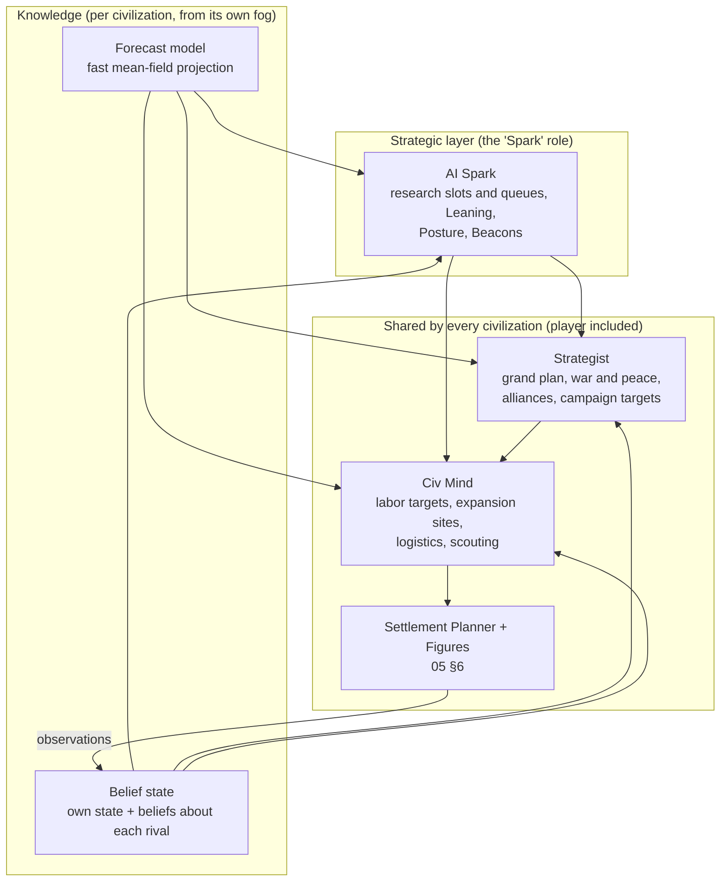

# 14 — AI Opponents: Designing a Smart AI (WS-E)

> The first release is **one player vs. three AI civilizations** (D14), and the AI **must be smart** (D15). This document defines what "smart" means, how the AI is built to get there, how it plays the first three eras, and how its quality is **measured**. The measurement harness replaces the human paper prototypes.
> Rules the AI plays by: [02](02-research-structure.md) (research), [05](05-simulation-structure.md) (sim), [10](10-e0-e2-actions-and-goods.md)–[13](13-contact-and-conflict.md) (E0–E2 numbers, world, conflict).
> Design only. No code.

---

## 1. What "smart" means here

The AI is smart when a skilled player feels **outplayed in ways that make sense**, never cheated. Concretely, a smart AI:

| # | Capability | Looks like, in play |
|---|------------|---------------------|
| A1 | **Plans ahead** | Researches toward a goal several projects away; stockpiles before a winter it predicts; builds walls before the rival's bronze arrives |
| A2 | **Reads the map** | Exploits its geography (coast → fish and boats; river → irrigation; steppe → horses); races for contested land and strategic deposits (tin, coal, oil) |
| A3 | **Reads its opponents** | Infers a rival's tech from the tools it sees; notices a weakly defended village; spots a rival who is snowballing |
| A4 | **Picks its fights** | Raids only when the expected value is positive; wars when it has a window; makes peace when the war stops paying |
| A5 | **Uses diplomacy as a weapon** | Gifts a strong neighbour early; allies against the leader (including the player); keeps its word because reputation pays |
| A6 | **Adapts** | Changes plan when the world changes: famine, a lost settlement, a new rival's First, a broken alliance |
| A7 | **Doesn't blunder** | No avoidable starvation, no undefended villages next to a known raider, no suicide raids on palisades, no stalled keystones |

**Non-negotiable constraints:**
- **No cheating at any difficulty.** The AI sees only what its figures see (fog of war), gets no resource or research bonus, and plays by the same rules. (A future "handicap" setting may exist for players who want it, off by default and labeled.)
- **Same simulation.** Below the strategic layer, AI and player civilizations run the *same* Civ Mind, Settlement Planner and figure AI (05 §6). The player's people are just as competent at living.
- **Deterministic.** Every AI decision is reproducible from the match seed and commands. There are no wall-clock time limits: budgets are counted in fixed iterations (§12).

## 2. Architecture



| Layer | Who runs it | Decides | Cadence |
|-------|-------------|---------|---------|
| **AI Spark** | AI civilizations only. For the player's civilization the *player* is the Spark. | Focus slots and queues, Leaning, **Posture**, **Beacons** | Each season, plus on events |
| **Strategist** | Every civilization. For the player's civilization it obeys the player's Posture and Beacons as constraints. | Grand plan (§3.3); war, peace, raids, alliances; campaign targets | Each season, plus on events |
| **Civ Mind** | Every civilization | Labor targets, expansion sites, scouting, logistics, garrisons | Each season |
| **Planner + figures** | Every civilization | Work orders and jobs (05 §6) | Continuous |

**Why the player's civilization gets the same Strategist:** diplomacy and war are automatic in the MVP (D7). The player shapes them through Posture (Raid / Fortify / Expand / Prosper) and Beacons, and their people must not throw away the lead the player's research earned. Difficulty only changes the **AI Spark and the AI civilizations' Strategist** (§9), never the player's own.

## 3. The knowledge layer

### 3.1 Belief state (fog-fair)
Per civilization, updated from its figures' observations ([13 §2.5](13-contact-and-conflict.md#25-what-can-be-inferred-by-sight-no-cheating)):

| About | Contents | Source |
|-------|----------|--------|
| Self | Exact | own state |
| The map | Last-seen terrain, deposits, herds, claims | scouts, routine reach, WAY-04 sharing |
| Each rival | Estimated population (band ±25%), settlements seen, **tech estimate** (§5.2), military estimate (warriors and weapons seen), defenses seen, Relations, reputation, **archetype posterior** (§5.3), public Firsts and Keystones, Posture signal (warpaint outfits indicate Raid posture) | sightings, contact, public announcements |
| Uncertainty | Each estimate carries a confidence that decays with time since last seen | |

### 3.2 Forecast model
A **fast, deterministic mean-field projection** of a civilization: the same equations as the balance model ([07](07-balance-findings.md), [09](09-population-and-health.md), [07b](07b-territory-findings.md)), run season by season.
- **Inputs:** current (believed) state, a research plan, a posture, assumed events (e.g. "war with X from season t").
- **Outputs per season:** population, food security, Insight, keystone ETA, claimed land, military strength, Legacy components.
- **Cost:** one 20-year projection of one civilization ≈ 0.05 ms (no spatial detail; claims from 07b's per-era curves adjusted by the frontier estimate). The AI can afford **hundreds of rollouts per season** (§12).
- **For rivals** the same model runs on the *believed* state with the rival's estimated archetype as its policy.

### 3.3 Grand plans (Strategist)
The Strategist always holds one **grand plan** and re-scores the alternatives each year:

| Plan | Pursued when the forecast says… |
|------|-------------------------------|
| **Frontier race** | Unclaimed land within reach is worth more than anything else (E0–E3 default) |
| **Prosper / tall** | Land is closed off; Mastery and Firsts beat expansion |
| **Defend** | A rival's believed strength × hostility exceeds own defense within the forecast horizon |
| **Conquer X** | A war against X raises projected Legacy (incl. Dominion) after costs, with a feasible force ratio (§6.2) |
| **Coalition vs. leader** | Some civilization (player or AI) is forecast to reach the 40% Dominion warning or the Apex first |
| **Apex race** | E9 and own Apex ETA is competitive |

Switching plans costs a **commitment penalty** (10% of the current plan's value) so the AI doesn't dither. Hard events (a captured settlement, a broken alliance, a new First by a rival) remove the penalty.

## 4. Research intelligence (AI Spark)

### 4.1 Value of a project
Not a static weight table. The value of researching project *p* next is measured with the forecast model:
```
V(p) = ΔU(forecast with p added to the plan) − ΔU(baseline plan)
U    = E[Legacy over horizon H]                      # Dominion + Mastery + Firsts + Wonders, as scored (01 §7)
     + λ_survival × (−expected avoidable deaths)
     + λ_security × (−P(losing a settlement in H))
     + option value(p)                               # unlocks hubs, glimpses, keystone closure
```
- **Horizon H:** 3–4 era-lengths of projects, but at least 2 years of sim time.
- **Option value:** each project gets a bonus for the number of high-value projects it enables (hub emphasis from [03 §4.3](03-research-catalog.md#43-hub-projects-most-required-by-other-projects)) and for being on the **next keystone's closure** ([07](07-balance-findings.md) §5 #12).

### 4.2 Plan search
1. **Candidates:** all Available projects, plus Glimpsed ones one step away.
2. **Beam search** over sequences of the next ~6 projects assigned to slots (beam width by difficulty, §9). The prior ordering comes from the Council scorer (02 §15), so search starts from sensible plans.
3. **Evaluate** each sequence with the forecast model (own civ, plus rivals' believed forecasts where they interact: contact, Firsts races, threats).
4. **Choose** the best; put the **most time-critical** project in Primary, the next in Secondary, and a **long-horizon, Know-how-fed** project in Tertiary (cheap progress from practice, 02 §9).
5. **Re-plan** every season, and immediately on events (famine forecast, contact, raid, new Glimpse, a rival's First).

### 4.3 Keystone routing
- The AI computes the closure and breadth N of the next keystone ([04 §2](04-research-paths.md#2-critical-paths-and-breadth)) and schedules **forced backfills** early, so they never stall the keystone (07 F8).
- **Free picks** (N − critical) go to the highest-V projects, which is where personality and geography show.

### 4.4 Exploiting the economics
- **Know-how:** prefers projects in lineages its people are practising (a fishing civilization's SEA and HNT projects come cheap).
- **Diffusion:** after contact, researches what neighbours already know at −10% each (02 §8.3), and **avoids racing for Firsts it can't win** (estimated rival ETA from beliefs).
- **Firsts:** goes for a First when its ETA beats every believed rival ETA by ≥ 1 season.

### 4.5 Posture and Beacons (the AI uses the player's levers)
- **Posture:** Expand while the frontier race is open, Fortify when §6.4's threat is high, Raid only when §6.1's expected value is positive for a sustained period, Prosper when land is closed off.
- **Beacons:** placed on the highest-value unclaimed regions: contested midlines ([07b](07b-territory-findings.md) R9), strategic deposits (tin, coal, oil), river mouths, islands within outrigger range.

## 5. Reading the opponent

### 5.1 What it observes
Only what its figures see (§3.1). The AI does know the **public rules**: the paired-start spacing ([12 §9.3](12-world-generation.md#93-spacing-neighbour-pairs)), so it scouts in the likely direction of its neighbour from minute 0; and the public Chronicle of Firsts and Keystones.

### 5.2 Tech estimate
From sightings: tool sprites map to tiers (T1–T7, copper), structures to projects (pit house → BLD-03, palisade → DEF-03, kiln → FIR-07), roles to projects (warriors → WAR-04, shamans → BEL-03). The estimate is the **minimum closure** consistent with what was seen, plus an archetype-typical "unseen" fraction. Public Keystone announcements pin the era exactly.

### 5.3 Archetype posterior
A Bayesian estimate over the five archetypes (Builder, Grower, Wanderer, Warlord, Sage), updated from behavior: settlement count growth (Grower), tool tiers (Builder), reach and claims (Wanderer), warriors and raids (Warlord), shrines, elders and tech pace (Sage). **The player is modeled exactly like any rival**, from behavior alone. A player who rushes warriors gets read as a Warlord.

### 5.4 Threat and opportunity
- **Threat(rival → me)** = P(rival attacks within H) × expected loss. P from Relations, the archetype posterior, the rival's warriors seen, its posture signal, its distance, its food stress (hungry neighbours raid, 13 §3.1) and its forecast plan.
- **Opportunity(me → rival)**: windows when a rival is weak: famine or epidemic seen (sick figures are visible), its warriors away (at war elsewhere, or on a seasonal round), stores full after harvest, tech gap in our favor *closing soon* (strike before their walls or bronze).

## 6. War, raid and defense intelligence

### 6.1 Raid decision (E1+)
```
EV(raid on s) = P(success | believed defenses) × loot value(s)
              − E[raider deaths] × value of a life (≈ forecast Legacy loss per adult)
              − Relations and reputation cost (with the target and with third parties who'd learn of it)
              − P(retaliation) × expected retaliation loss
```
- P(success) and the casualty expectations come from the [13 §5.5](13-contact-and-conflict.md#55-expected-results-tuning-targets) table, applied to **believed** defenses. If the belief is stale (> 2 seasons), the AI **scouts first**.
- **Timing:** target stores peak in early winter after harvest; raid when the target's adults are dispersed (hunting drives, seasonal round); avoid raiding into a winter that the AI's own band can't survive with losses.
- A raid is launched only if EV > 0 by a margin set by personality (Warlord low, Grower high).

### 6.2 War of conquest
- **Value:** forecast Legacy with the war (capturing settlements per [13 §8](13-contact-and-conflict.md#8-war-and-the-capture-of-settlements-all-eras): land, Dominion, deposits such as coal and tin, removing a rival's Firsts race) minus the forecast without it (Cohesion costs, deaths, third-party reactions, a truce lock-in).
- **Feasibility:** projected force ratio at arrival ≥ **1.5** on the target settlement (≥ 2.0 against walls), including believed reinforcements within relief range.
- **Windows:** declares when the ratio will *decrease* if it waits (the rival's walls, bronze or alliance are coming), or when the rival is distracted (war with a third civilization, epidemic, famine).
- **The Dominion endgame:** the Strategist tracks every civilization's path to the 50%-and-2× victory (D13) and, when it leads, plans the sequence of conquests that reaches it, earliest ~minute 113 (07b T2). When it doesn't lead, it plans to stop whoever does (§7.3).

### 6.3 Campaign planning
1. **Target:** the most valuable settlement it can take and hold: weakly defended, high land or resource value, close to own supply, not at the rival's core first (unless a decapitation wins the war).
2. **Concentrate:** one strike force, never split below the feasibility ratio.
3. **Supply:** forces carry preserved food (FOD-02/07); campaigns start after harvest.
4. **Hold:** after capture, garrison and pacify (Cohesion recovery projects: GOV, BEL, ART) before the next target.
5. **Stop:** offer peace when objectives are met, when the force ratio falls below 1.0, or when a coalition forms against it.

### 6.4 Defense
- **Garrisons** are allocated across settlements by Threat (§5.4) × value, so the AI never leaves the village nearest a known raider undefended.
- **Researches defense on time:** if a rival's forecast bronze or warrior ETA falls before its own palisade's ETA, DEF and WAR projects jump in priority (this is A1 in practice).
- **Signal networks** (COM-04) and lookouts on the border facing the threat.
- **Defensive alliances** with anyone else the threat also threatens.

## 7. Diplomacy intelligence

### 7.1 First contact (13 §3)
- If the neighbour is believed stronger, or the AI wants trade and diffusion: send a **gift party** first (+20% friendly).
- If it plans to raid soon: stay unseen as long as possible (scouts avoid contact), so first contact happens on its terms.

### 7.2 Alliances, trade and promises
- **Trade** when both sides gain (13 §4.2): the AI uses trade to satisfy `[Seen]` and `[Has]` gates it lacks (tin!).
- **Alliances** when a shared threat exists or to secure a flank before a war elsewhere.
- **Reputation as an asset:** the AI breaks a pact only if the forecast gain exceeds the reputation cost (13 §3.3) by a wide margin. Smart AIs are mostly trustworthy, which makes their rare betrayals meaningful.
- **Peace acceptance:** accepts when the forecast with peace beats continued war (§6.3 stop rules apply symmetrically).

### 7.3 Balance of power
- When any civilization (player or AI) is forecast to cross the **40% Dominion warning**, reach the Apex first, or lead Legacy by > 25%, every other AI's Strategist evaluates the **Coalition vs. leader** plan (§3.3).
- Coalition behavior: alliances among the non-leaders, trade embargo on the leader, coordinated wars timed for when the leader is committed elsewhere.
- It applies to the player and to AIs alike. A runaway AI gets ganged up on too. The AIs aren't rubber-banding: they react to the same public information a human would.

## 8. Economic and expansion intelligence (Civ Mind, every civilization)

### 8.1 Labor
Allocate labor by **marginal value per worker-season**: the next ws goes to whichever job raises forecast utility most, given current deficits (05 §6.3). This is what keeps tool chains supplied, stores filled and buildings ahead of demand.

### 8.2 Winter planning
Each autumn the Civ Mind forecasts food security for the winter, including a harsh-winter scenario (30%, [09 §4.3](09-population-and-health.md#43-winter-hazards)). It targets **FS ≥ 1.0 in a harsh winter** when stores allow: shifts labor to preserving, hunting drives and storage building in autumn, and splits a group early (late-winter trigger) rather than starving.

### 8.3 Herds and stocks
Hunts are kept under each herd's sustainable yield (growth 15–30%/yr, [12 §6](12-world-generation.md#6-fauna)) unless the herd will leave anyway (migration) or famine forces it. A smart AI never crashes its own herd by accident. It may **deliberately over-hunt a herd on a rival's side** of the frontier (denial).

### 8.4 Expansion and the frontier race
- **Site scoring** (05 §9.4): tile quality × distance fit × Beacon bias − rival pressure, **plus a frontier bonus** for contested midland once a rival is Aware ([07b](07b-territory-findings.md) R9). It also values chokepoints (river crossings, passes) and strategic deposits.
- **Fission timing:** the AI Spark sets Posture Expand while the frontier is open, which lowers the fission trigger (09 §7.1).
- **Consolidation:** once the frontier closes, Prosper posture grows cities vertically (07b T6).

## 9. Personalities and difficulty

### 9.1 Archetypes change style, not competence
| Archetype | Leaning (Craft / Kin / Reach) | Raid margin | Expansion | Diplomacy | Signature |
|-----------|-------------------------------|-------------|-----------|-----------|-----------|
| Builder | 0.5 / 0.25 / 0.25 | high (rarely raids) | moderate | trade-friendly | Tool tiers, wonders, efficient core |
| Grower | 0.2 / 0.6 / 0.2 | high | fast fission | friendly | Many settlements, big population |
| Wanderer | 0.2 / 0.2 / 0.6 | medium | widest claims, overseas early | first to contact, gifts | Maps, boats, trade routes |
| Warlord | 0.3 / 0.2 / 0.5 (WAR/DEF) | **low** | opportunistic | alliances of convenience | Raids, conquest windows |
| Sage | 0.25 / 0.5 (LRN/BEL) / 0.25 | high | slow early, surges | friendly, tolerant | Insight, Firsts, institutions |

Archetypes are weights *inside* the same planner. A Warlord at Legend difficulty still won't raid a palisaded village it can't take.

### 9.2 Difficulty: better thinking, never bonuses
| Level | Forecast horizon | Beam width | Opponent modeling | Re-plan | Deliberate imperfection |
|-------|-----------------:|-----------:|-------------------|---------|-------------------------|
| **Settler** (learning) | 1 era | 2 | none (treats rivals as average) | yearly | 20% of picks from the Council prior instead of search; reacts to threats 2 seasons late |
| **Chieftain** (default) | 2 eras | 4 | archetype posterior | each season | 5% Council-prior picks |
| **Warlord** (experienced) | 3 eras | 8 | full (§5) | each season + events | none |
| **Legend** (expert) | 4 eras | 16 | full + coalition coordination timing | each season + events | none |

At **every** level: same fog, same rules, same resources. Imperfection at the lower levels comes from shallower thinking and slower reactions, which still look like plausible decisions, never from random nonsense.

## 10. Measuring smart: the AI harness

Paper prototypes with people are replaced by an automated **AI harness** (decision D15). It is designed now and built with the vertical slice.

### 10.1 The harness
- **Headless, deterministic, fast-forward** runs of the real simulation (no rendering): a full E0–E2 match (~30 min of game time) in ~10–20 s of compute; a full arc in a few minutes.
- **Tournaments:** round-robins of AI levels, archetypes and scripted opponents on varied seeds and map sizes; an **Elo ladder** per build.
- **Every AI or balance change** runs a regression suite (≥ 500 matches) before it is accepted.

### 10.2 Scripted opponents (stand-ins for players)
| Bot | Plays like |
|-----|-----------|
| Random | Random available projects (sanity floor) |
| Council | The v0.1 static scorer (02 §15): a "naive" opponent |
| Opening scripts | The validated Grower, Builder and Wanderer openings ([04 §7](04-research-paths.md#7-example-strategic-paths-openings)), then Council |
| Rusher | WAR lineage first, Raid posture at GOV-02, raids from first contact |
| Turtle | DEF and Prosper, never raids |
| Exploit searcher | An evolutionary search over simple policies (project order + posture schedule) that looks for **cheap strategies that beat Warlord-level AI**. Anything it finds is a bug to fix |

### 10.3 Acceptance targets
| Metric | Target |
|--------|--------|
| Warlord AI vs. Council bot (same archetype, mirrored seeds) | wins ≥ 85% on Legacy |
| Warlord AI vs. each opening script | wins ≥ 70% |
| Warlord AI vs. Rusher | survives ≥ 95% (loses no settlement in ≥ 80%); wins ≥ 70% |
| Legend vs. Warlord | wins ≥ 65% |
| Chieftain vs. Warlord | wins 25–40% (a real step, not a cliff) |
| Archetype balance at equal difficulty | no archetype wins > 30% of 4-player free-for-alls (25% is fair) |
| Exploit searcher | finds no fixed policy that beats Warlord > 55% after 10,000 evaluations |
| Dominion victories (Warlord, 4 AIs, Standard) | 5–20% of matches end in Dominion victory (rare but real, D13) |

### 10.4 Blunder detectors
Automated checks flagging AI mistakes, with target rates per match at Warlord level:

| Blunder | Detector | Target |
|---------|----------|-------:|
| Avoidable starvation | Deaths by starvation while own stores or a sister settlement within reach held food, or after a forecast warning with spare labor | ~0 |
| Undefended loss | Settlement raided or captured after the threat was observed ≥ 2 seasons earlier with no defensive response | < 0.1 |
| Suicide raid | Raid launched with believed P(success) < 30% | 0 |
| Keystone stall | Breadth met but keystone not slotted for > 1 season | 0 |
| Herd crash | Own over-hunting drives a home-range herd extinct (not denial) | < 0.2 |
| Idle labor | > 15% of adults idle for a whole season while deficits exist | 0 |
| Dithering | Grand plan switched > 2× in 3 years without a hard event | 0 |
| Cheating check | AI decision reads any state outside its belief state | 0 (tested by fuzzing: randomize unseen state and check that decisions don't change) |

## 11. Explainability
- Every strategic decision is logged with its **top reasons** (the forecast terms that decided it): *"Raid on Ash Valley rejected: palisade seen 1 season ago, P(success) 0.15"*.
- A **debug overlay** shows each AI's grand plan, beliefs and threat map (for development).
- **Player-facing "rival intelligence"**: the Chronicle may surface *observable* behavior as flavor: *"The Heron Folk are raising palisades; they watch your warriors."* It never reveals the AI's hidden state.

## 12. Determinism and performance budget
- Fixed iteration budgets (rollouts, beam width) per difficulty; **no wall-clock cut-offs** (they would break lockstep and replays).
- AI work is staggered: each civilization's Spark and Strategist run on different ticks of the season, on a worker thread.
- **Budget:** ≤ 2 ms per AI civilization per sim tick on average at Warlord (≈ 300 forecast rollouts per season); Legend may use 2×.

## 13. The E0–E2 playbook (what a smart AI visibly does)

| Time (Standard) | Behavior |
|-----------------|----------|
| 0:00 | Opening slots from its archetype's validated opening, adjusted to its start (coast → HNT-07 early; few herds → forage line; cold edge → FIB lineage). One scout leaves toward the **likely rival direction** (public paired-start rule) |
| 0:45–3:00 | First projects land; labor shifts to new methods as adoption spreads. Autumn: stockpiling for a harsh winter, if labor allows |
| First winter | FS forecast drives drives (hunting) and preserving. If a harsh winter is forecast with FS < 1, it lines up FOD-02/FOR-03 |
| ~7:00 | First fission. The site is chosen **toward the frontier** (and the Beacon), not just the best local tile |
| 7:30 | KEY-1 with free picks fitting its plan (Warlord: hunting into WAR-01/02; Wanderer: WAY/TER) |
| 10–18 | Seasonal round; herd management; scouts locate the rival. **Before contact:** decides its first-contact intent (gift or hide) from the believed rival strength |
| ~18 | **First contact.** Reads the rival's tools and numbers; updates the archetype posterior; sets Relations goals |
| 18–29 | E2: Sedentism, fields and herds; **frontier race** to the midline; palisade if Threat is high; raids only with positive EV (an unprepared Grower neighbour in early winter is the classic target) |
| ~29 | KEY-3 on schedule; copper; chiefdom. It enters the Bronze era either with a defensible border or with a plan to break the neighbour's |

## 14. Tuning
- AI parameters (utility weights λ, margins, horizons, archetype weights) are **data**, tuned offline by self-play optimization in the harness (e.g. evolution strategies against the §10.3 targets). There is no runtime learning in the MVP: behavior must stay deterministic and testable.
- Balance and AI are tuned **together**: a balance change that makes one archetype dominant shows up in §10.3 as an archetype imbalance.

## 15. Open questions
- How much of the AI's **intent** should be legible to the player (warpaint, war drums before a raid) without making it trivial to counter?
- Should the AI **adapt across matches** to a specific player's habits (post-MVP; needs a fairness review)?
- Legend-level coalition behavior must not feel like "everyone hates the player". The harness should verify that AIs gang up on AI leaders as often as on human leaders.
