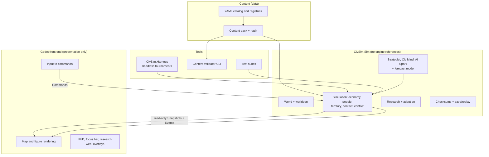

# 15 — Architecture Decision Record (WS-L)

> **Decision:** build CivSim as an **engine-independent, deterministic C# simulation library** with a **Godot 4 (.NET) front end**, a **headless console harness** for AI tournaments, and a **YAML content catalog** compiled into a hashed content pack.
> This document records the questions asked, the options weighed, the recommendation, the rules that follow from it, and the risks. It is the input to the catalog tooling spec ([16](16-catalog-format-and-tooling.md)) and the vertical-slice plan ([17](17-vertical-slice.md)).
> Status: **accepted 2026-10-18** (the four items in §10 confirmed; D17 and D18 in [06](06-next-steps.md#2-decisions-i-made-that-you-may-want-to-override)). Design only. No code.

---

## 1. What the design demands of the technology

These come from decisions already made (D11, D14, D15) and the specs.

| # | Demand | Source | What it means technically |
|---|--------|--------|---------------------------|
| R1 | **Bit-identical simulation** from the same seed and command log | [05 §18](05-simulation-structure.md#18-determinism-multiplayer-saves), [06 §6](06-next-steps.md#6-vertical-slice-acceptance-criteria-draft-for-d4) #8 | Fixed-point arithmetic, seeded RNG streams, stable iteration order, no wall-clock reads; identical results on macOS (Apple silicon) and Windows (x64) |
| R2 | **Headless, fast-forward simulation** for the AI harness and replays | [14 §10](14-ai-opponents.md#10-measuring-smart-the-ai-harness) | The sim must run with no renderer; a full E0–E2 match in about 20 s of compute, a full arc in minutes; many matches in parallel processes |
| R3 | **A smart AI that thinks with a forecast model** | [14 §3–4](14-ai-opponents.md#3-the-knowledge-layer) | Hundreds of cheap rollouts per AI per season, inside the tick budget |
| R4 | **Hundreds of animated figures** and a research web of 509 nodes | [05 §19](05-simulation-structure.md#19-performance-budget-mvp-target-mid-range-pc-4-civilizations), [08](08-ui-and-world-display.md) | ≤ 600 rendered figures per civilization (≤ 2,400 in the MVP), instancing, level of detail, a UI toolkit that handles a large zoomable graph |
| R5 | **Mac first, Windows by release, Steam** | Your answers (§2) | Cross-platform stack; no Mac-only frameworks; Steamworks integration |
| R6 | **Built mostly by Claude from code and text files** | Your answers (§2) | Text-based project and scene files, command-line builds and tests, little reliance on clicking through an editor |
| R7 | **Catalog as editable data** (modding is nice to have later) | Your answers (§2) | Content lives in data files, not code; the engine loads it at start |

## 2. Questions asked and your answers

| Question | Your answer | Consequence |
|----------|-------------|-------------|
| Platforms for the first playable | **macOS desktop** (and Windows by release, confirmed in the follow-up) | Cross-platform from day one; Windows CI early, Windows playtesting later |
| Engine experience | **None, rely on Claude to build it** | Pick the stack Claude can drive end to end from files and a terminal (R6) |
| Release path | **Steam / paid PC game** | Native desktop builds; no browser constraint |
| Modding | **Nice to have later** | Catalog stays data-driven; no mod tooling in the MVP |
| Visual style | **Undecided, recommend** | Recommendation in §5.4 |
| Sim core location | **Separate engine-independent library** | Locked: §5.1 |

## 3. Options considered

Criteria: **A** Claude can build and test it from files and a terminal · **B** deterministic and headless · **C** performance for the budgets · **D** Mac + Windows + Steam · **E** UI for a 509-node web and a rich HUD · **F** project risk and lock-in.

| Option | A | B | C | D | E | F | Verdict |
|--------|---|---|---|---|---|---|---------|
| **1. Godot 4 (.NET) + C# sim library** | ✅ text scenes, CLI build and export, code-first | ✅ sim is a plain library; harness is a console app | ✅ fine for the budgets (§7) | ✅ | ✅ Control nodes, GraphEdit, MultiMesh | ✅ MIT license, no fees; sim portable to any engine | **Recommended** |
| 2. Godot 4 + Rust sim via gdext | ⚠️ two toolchains, longer compile-fix loops | ✅✅ | ✅✅ | ⚠️ native extension per platform, release lag behind Godot | ✅ | ⚠️ gdext "occasionally ships breaking changes" and its platform notes conflict across sources | Upgrade path for hot spots, not the start |
| 3. Unity (C#) | ⚠️ editor-centric, asset metadata, prefab and scene workflow is click-heavy | ⚠️ possible, but the sim usually leaks into engine types | ✅ | ✅ | ✅ | ⚠️ proprietary; the install-fee scheme was cancelled in 2024 but pricing keeps changing | Viable, but a worse fit for R6 |
| 4. Bevy (Rust, code only) | ⚠️ everything is code, including UI | ✅ | ✅✅ | ✅ | ❌ no built-in editor or mature UI for a big graph view | ❌ frequent API churn is a known trait; I could not confirm its 2026 status | Rejected |
| 5. TypeScript + web renderer in Electron or Tauri | ✅✅ Claude's strongest language | ⚠️ doubles only, so fixed-point needs int tricks | ⚠️ 2–5× slower sim for the harness | ⚠️ Steam via a wrapper | ✅ | ⚠️ unusual path for a paid Steam game | Rejected: determinism and the AI harness cost too much |
| 6. Swift and Metal (native Mac) | ✅ | ✅ | ✅ | ❌ Mac only | ⚠️ | ❌ a Windows release means a rewrite | Rejected by your Windows answer |

**Why not Rust for the sim, since it is faster?** It would be, and the AI forecasts would run several times quicker. But R6 favors one language and one toolchain, and the budgets in §7 fit comfortably in C# with disciplined data layout. Because the sim is a separate library behind a narrow interface (§5.1), the forecast model can be moved to Rust later if the AI harness proves too slow. Starting with two languages would slow every change now for a speedup we may never need.

## 4. Recommendation in one table

| Decision | Choice |
|----------|--------|
| **A1 Engine** | **Godot 4, .NET edition**, pinned to one stable release |
| **A2 Language** | **C#** everywhere, on the .NET LTS version the pinned Godot release supports |
| **A3 Sim core** | **`CivSim.Sim`**, an engine-independent class library with no Godot references |
| **A4 Visual style** | **2.5D**: a 3D scene viewed through an orthographic-leaning camera, terrain as flat low-poly hex meshes, figures and structures as **billboard sprites** (§5.4) |
| **A5 Determinism** | **Fixed-point Q32.32 math**, PCG-family RNG streams keyed by `hash(seed, system, entity, tick)`, ordered collections only, checksums every N ticks (§6) |
| **A6 Content** | **YAML files**, compiled into a **content pack** with a SHA-256 hash that is part of every save and replay ([16](16-catalog-format-and-tooling.md)) |
| **A7 Saves and replays** | **Snapshot plus command log**, versioned; a replay is the seed, content hash and command list (§5.6) |
| **A8 Threading** | Sim on its own thread at a fixed 10 Hz; AI planning on a worker with a **fixed apply tick** (§5.5); the harness parallelizes across processes |
| **A9 Harness** | **`CivSim.Harness`**, a console app that runs headless tournaments and regression suites |
| **A10 Steam** | **GodotSteam or a C# Steamworks binding**, chosen at release (§9) |

## 5. The design

### 5.1 Layers and the one-way interface



- **Commands in:** slot changes, queue edits, Leaning, Beacon placement, Posture, pause, speed. Plain structs with the tick they apply.
- **Snapshots and events out:** read-only view structs, double-buffered, plus an event stream (Chronicle lines, Moments, alerts). The front end *never* writes sim state.
- **No Godot types inside `CivSim.Sim`.** Enforced by project references: the library does not reference the engine assembly, so the build fails if anyone tries.
- **The front end interpolates** between the last two snapshots, so rendering is smooth at any speed, and the player's speed controls only change how fast ticks are produced.

### 5.2 Why Godot specifically
- **Text-based everything.** Scenes (`.tscn`), resources and project settings are plain text, so Claude can create and review them with ordinary file tools and diffs are readable.
- **Command-line workflow.** Headless import, run and export from a terminal; the same scenes run on macOS and Windows.
- **Built-in UI toolkit** with the pieces the design needs (large zoomable graph views, scrolling lists, themes) so the research web (08 §8) and the HUD do not need a third-party UI layer.
- **Instancing** (MultiMesh) for hundreds of billboard sprites, and an orthographic camera, are core features.
- **No fees or runtime licensing.** MIT license. Unity's per-install fee was cancelled in 2024, but its subscription pricing still changes (a 5% increase for Pro took effect in January 2026).
- **Steam is a well-trodden path** (§9).

Pin to **one stable release** for the whole project. The latest I could confirm as stable is **4.6.3** (maintenance release, 20 May 2026). 4.7 builds exist but I could not confirm that 4.7 had reached stable, so re-check at M0 and don't upgrade mid-milestone.

### 5.3 Why C# for the sim
- One language across sim, harness, tools and front end, with `dotnet build` and `dotnet test` from the terminal.
- **Fast enough.** The sim budget is ≤ 4 ms per tick at 10 Hz for about 2,400 figures plus AI ([05 §19](05-simulation-structure.md#19-performance-budget-mvp-target-mid-range-pc-4-civilizations)). Struct arrays and index-based entity ids (no per-figure objects) keep memory flat and the garbage collector quiet.
- **Fixed-point is straightforward.** 128-bit intermediates (`Int128`, `Math.BigMul`) make a Q32.32 multiply simple.
- **Testing and debugging** are mature; Claude is strong at C#.

### 5.4 Visual style: recommendation
08 already specifies a **tilted top-down diorama (≈ 50° pitch, orthographic-leaning)** with sprite figures, invisible hex tiles and four-step rotation. That is a 2.5D look. The cheapest way to get it with free rotation, smooth zoom and crisp sprites is:
- a **3D scene** with an **orthographic or low-field-of-view camera**,
- **terrain** as flat or gently shaded low-poly hex meshes, with tint, borders and overlays drawn as shader effects or decals,
- **figures, herds and small structures** as **billboard sprites** (always facing the camera), instanced for speed, with the tool, outfit and carry item layered per 08 §2,
- **large structures and wonders** as simple low-poly models or composite sprites.

**Why not full 3D:** animated 3D characters multiply the art and rigging cost, and at Z1–Z2 the figures are silhouettes and crowd glyphs anyway (08 §1). **Why not flat 2D:** rotation, pitch and the depth cues of the diorama would need to be faked. **Fallback:** if the camera work proves costly at M7, drop rotation and render the same data with a fixed-angle 2D tile map; the sim and the snapshot interface do not change.

### 5.5 Threading model
- **Sim thread:** a fixed-step loop, 10 ticks per second at 1×. Faster speeds run more ticks per second, never larger steps. In the harness the loop runs flat out.
- **Presentation thread:** the Godot main thread reads the latest finished snapshot.
- **AI planning** (Spark and Strategist, [14 §12](14-ai-opponents.md#12-determinism-and-performance-budget)) runs on **worker threads**, but it never changes sim state directly. Each plan is computed from a snapshot taken at tick *t* and **applied at the fixed tick *t + K***. If a worker is late, the sim **waits** (it never skips the plan). The apply tick, not the completion time, decides behavior, so results do not depend on how fast the machine is.
- **Parallelism inside a tick** is allowed only for pure functions over disjoint data with an ordered merge (for example, per-settlement claim fields). Anything that touches shared state, order or the RNG stays single-threaded.
- **The harness** gets its speed from running many matches in **separate processes**, not from parallelizing one match.

### 5.6 Saves and replays
- **Snapshot:** a versioned binary dump of all sim state (entities as arrays, RNG states, tick, content-pack hash) every N minutes, plus on demand.
- **Replay:** `seed + settings + content hash + command log`. Replaying must reproduce every checksum.
- **Bug reports are replays.** A desync, an AI blunder or a balance problem attaches its replay file and anyone can reproduce it exactly.
- **Version policy:** snapshots carry a format version. Old saves are not migrated in the MVP; replays are tied to the exact build and content hash that made them.

## 6. Determinism rules (binding on `CivSim.Sim`)

| # | Rule | Why |
|---|------|-----|
| D1 | **No `float` or `double` in sim state or sim math.** Use the `Fix64` type (Q32.32 on a 64-bit integer). Presentation may use floats freely. | Float behavior can differ across CPUs and compilers |
| D2 | **No transcendental functions on floats** (`Math.Sqrt`, `Exp`, `Pow`, `Sin`). Use integer square root and lookup tables, or exact fixed-point approximations validated in tests. | Same reason; the claim formula needs square roots and falloffs |
| D3 | **No `System.Random`.** One PCG-family generator per (system, entity), seeded from `hash(matchSeed, system, entityId, tick)` with a fixed hash function. | Reproducible streams that don't depend on call order |
| D4 | **No `string.GetHashCode()`, no default hash codes, no iteration over `Dictionary` or `HashSet`.** Use integer ids and arrays or sorted structures. | .NET randomizes string hashes per process, and hash iteration order is unspecified |
| D5 | **Stable iteration order** everywhere: by ascending entity id. Ties break by id. | Determinism and the mirror-invariance lesson from [07b §9.5](07b-territory-findings.md#95-model-fixes-exact-symmetry-and-mirror-invariant-tie-breaks-2026-10-18) |
| D6 | **No wall-clock reads, no thread timing, no file or network access** inside a tick. | Not reproducible |
| D7 | **Presentation never feeds back.** The front end sends commands and nothing else. | Otherwise render frame rate would change the sim |
| D8 | **State checksum every 50 ticks** (5 s). Replays and CI compare checksums, and a mismatch is a failing test. | Early desync detection |
| D9 | **CI runs the same replay on macOS (arm64) and Windows (x64)** and requires identical checksums. | Proves cross-platform determinism before it matters |
| D10 | **AI decisions read only the belief state** ([14 §3.1](14-ai-opponents.md#31-belief-state-fog-fair)); a fuzz test randomizes unseen state and requires unchanged decisions. | Fog fairness, enforced by tests |

## 7. Performance budgets and how they are met

| Budget | Target | How |
|--------|--------|-----|
| Sim tick (4 civs, 2,400 figures + AI) | ≤ 4 ms average at 10 Hz | Struct-of-arrays, id-indexed entities, no allocations in the tick, staggered updates ([05 §3.2](05-simulation-structure.md#32-update-cadence-level-of-detail)) |
| AI forecast | ~0.05 ms per 20-year projection, ≈ 300 per civ per season | Mean-field fixed-point model; no spatial detail ([14 §3.2](14-ai-opponents.md#32-forecast-model)) |
| Headless match | **E0–E2 in ≤ 20 s; full arc in ≤ 5 min** on a current laptop | Release build, no renderer, flat-out loop |
| Rendering | ≤ 600 figures per civ (≤ 2,400 total); 60 fps on a mid-range Mac | Billboard MultiMesh instancing, view-frustum culling, crowd glyphs at Z2 |
| Content load | < 1 s for the full 509-project pack | Binary content pack, loaded once |
| Memory | < 1 GB total | Arrays of structs; snapshots reuse buffers |

If a budget is missed, the order of remedies is: profile and fix the data layout; reduce update frequency of that system; move the hot function to native code (Rust) behind the same interface. Changing language or engine is the last resort, and the architecture keeps it possible.

## 8. Repository layout and build

```
civsim/
├─ docs/                      design documents (this folder)
├─ content/                   YAML catalog and registries (source of truth, see 16)
├─ src/
│  ├─ CivSim.Sim/             deterministic simulation library (no engine references)
│  ├─ CivSim.Content/         YAML loader, schema, validator, content-pack builder
│  ├─ CivSim.Harness/         headless tournaments and regression suites (console app)
│  ├─ CivSim.Cli/             `civsim` command: validate, build-pack, replay, diagram
│  └─ CivSim.Tests/           unit, determinism, golden and fuzz tests
├─ game/                      Godot 4 .NET project (presentation only)
└─ .github/workflows/         CI on macOS and Windows runners
```

- **Dependency rule:** `Sim` ← `Content`, `Harness`, `Cli`, `Tests`, `game`. Nothing in `Sim` depends on anything above it.
- **CI (every push):** build; unit and golden tests; the content validator; the determinism replay on macOS and Windows with a checksum comparison; a headless Godot import to catch broken scenes.
- **Nightly CI:** the AI harness regression suite and the acceptance-target report ([14 §10.3](14-ai-opponents.md#103-acceptance-targets)).
- **Claude's workflow:** change the sim and its tests first and verify headlessly. Presentation changes are verified with scripted headless scene tests and screenshot capture. Replays serve as the reproducible bug report.

## 9. Risks and mitigations

| Risk | Impact | Mitigation |
|------|--------|-----------|
| **Godot .NET quirks and version churn** | Build breaks on upgrade | Pin one stable version; upgrade only between milestones; keep presentation thin |
| **GC pauses in a big sim** | Frame hitches, missed ticks | Struct arrays, no per-tick allocation, a GC-pressure test in CI, sim on its own thread |
| **Fixed-point mistakes** (overflow, precision) | Wrong balance, desync | A `Fix64` type with checked-mode tests; golden comparison against the Python balance models ([balance/tools](balance/tools/params.py)) |
| **Determinism drift** across Mac and Windows | Replays break | Rules D1–D10; the two-platform CI job from the first milestone |
| **C# cannot export to the web in Godot 4** (per Godot's docs for 4.2 and forum reports; re-check) | No browser build | Not a goal. If a web demo is ever wanted, it would need a separate front end over the same sim |
| **Steam integration with a C# Godot project** | Release delay | GodotSteam's GDExtension lists Windows and universal Mac builds; whether it fits a .NET project, or whether a C# Steamworks binding is better, is a release-time check, not a blocker now. Mac builds will also need signing and notarization for Steam |
| **2.5D camera and sprite work costs more than expected** | Slower presentation | The flat-2D fallback in §5.4 uses the same snapshots |
| **AI harness too slow in C#** | Slow tuning loop | Move the forecast model to Rust or native behind the same interface (§7) |
| **A lone developer with a language they don't know** | Review burden | Keep the codebase small and conventional, with tests as the primary spec, and write the architecture rules above into the repo's README and CLAUDE.md |

## 10. Confirm these four (confirmed 2026-10-18)

1. **Engine and language:** Godot 4 (.NET) with C#. *(Alternative: Unity, if you already have access and prefer it; the sim library design is unchanged.)*
2. **Visual style:** 2.5D diorama (3D scene, orthographic-leaning camera, billboard sprites), with flat 2D as the fallback.
3. **Fixed-point (`Fix64`) simulation** with the determinism rules D1–D10, and the Mac + Windows determinism check in CI.
4. **Build order:** simulation and content tooling first, headless and tested; the Godot presentation follows ([17](17-vertical-slice.md)).

## 11. Sources checked

- [Godot release news](https://godotengine.org/news/release): the 4.6.3 maintenance release (20 May 2026) is the latest I could verify as stable.
- [Godot C# platform notes (4.2 docs)](https://docs.godotengine.org/en/4.2/tutorials/scripting/c_sharp/index.html): C# projects cannot export to the web. Written for 4.2; re-check for the pinned version.
- [GodotSteam GDExtension listing](https://godotengine.org/asset-library/asset/edit/13299): Windows and universal Mac supported.
- [godot-rust gdext (project stats, April 2026)](https://oosmetrics.com/repo/godot-rust/gdext): usable for games, with occasional breaking changes.
- [Unity runtime fee page](https://unity.com/runtime-fee): per-install fee cancelled in 2024; Pro and Enterprise prices rose 5% on 12 January 2026.

**Not confirmed:** whether Godot 4.7 has reached stable; gdext's exact macOS and Windows support (sources conflict); Bevy's 2026 status. None of these changes the recommendation.
