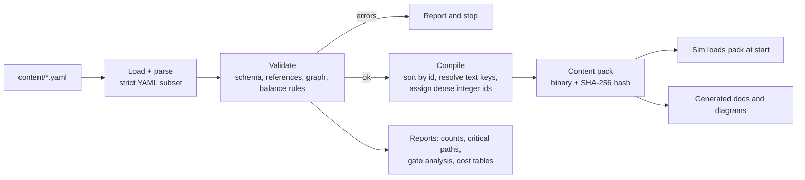

# 16 — Catalog Data Format and Tooling (WS-M)

> How the 509 projects, the ten keystones and every other piece of game content are stored as **data**, how that data is checked, compiled and loaded, and which tools keep it honest. Decision context: [15](15-architecture-decision.md) (A6, A9, R7).
> Today the catalog lives as markdown tables ([03a](03a-research-craft.md)–[03c](03c-research-reach.md)) with E0–E2 numbers in [11](11-e0-e2-project-specs.md). This document defines what replaces them as the **source of truth**.
> Design only. No code.

---

## 1. Principles

1. **Data, not code.** Every project, ladder rung, good, structure, role, biome, fauna and constant is a data record. The sim contains rules, never content.
2. **One source of truth.** After import, the YAML files are authoritative. The markdown catalog and the diagrams in [04](04-research-paths.md) are **generated** from them, so they cannot drift.
3. **Validate before anything runs.** Content that fails validation cannot become a content pack, so the sim and the game never see an invalid catalog.
4. **Reproducible.** A compiled pack is canonical (sorted, normalized) and has a content hash. Saves and replays store the hash ([15 §5.6](15-architecture-decision.md#56-saves-and-replays)).
5. **Moddable later, not now.** Ids are stable and namespaced, files are plain text and the loader accepts overlay packs. Mod tooling is out of the MVP (your answer: nice to have later).

## 2. File layout

```
content/
├─ catalog/                    one file per lineage (33)
│  ├─ stn-stoneworking.yaml    projects STN-01 … STN-14
│  ├─ fir-fire.yaml  …  inq-inquiry.yaml
│  └─ keystones.yaml           KEY-1 … KEY-10
├─ registries/
│  ├─ actions.yaml             action families and their method ladders (10 §3–§8, 02 §12)
│  ├─ goods.yaml               goods registry (10 §10)
│  ├─ structures.yaml          structures and their costs (10 §6)
│  ├─ roles.yaml               roles and their Insight outputs
│  ├─ tools.yaml               tool tiers (10 §5.2)
│  ├─ biomes.yaml  fauna.yaml  deposits.yaml     world generation (12 §4–§8)
│  ├─ eras.yaml                era names, EraBase, representation scale, claim radius, reach
│  ├─ archetypes.yaml          Builder, Grower, Wanderer, Warlord, Sage (14 §9)
│  └─ difficulty.yaml          AI levels (14 §9.2)
├─ constants/
│  └─ balance.yaml             tuned constants: Insight, caps, hazards, fertility, claims (07, 07b, 09, 13)
├─ text/
│  └─ en.yaml                  names, flavor, Moments, Chronicle templates (localizable)
└─ schema/                     JSON Schemas used by the validator and by editors
```

**Why one file per lineage:** about 15 projects each, readable in one screen, and changes show up as small diffs.

## 3. The project record

### 3.1 Schema

| Field | Type | Required | Notes |
|-------|------|:-------:|-------|
| `id` | `LIN-NN` | ✅ | Stable forever. Never reused |
| `name` | string key | ✅ | Resolved through `text/en.yaml` |
| `theme` | `craft \| kin \| reach` | ✅ | Must match the lineage |
| `lineage` | 3-letter code | ✅ | One of the 33, defined in `lineages` at the top of the file |
| `era` | 0–9 | ✅ | Minimum era to research |
| `type` | `D \| M \| S \| R \| I \| W \| K` | ✅ | [02 §4](02-research-structure.md#4-project-types) |
| `requires` | list of ids | ✅ | All-of |
| `requires_any` | list of ids | | One-of; at most one group per project |
| `gates` | list of `{kind, target}` | | `seen`, `has`, `near`, `climate` ([02 §6](02-research-structure.md#6-gates-the-world-shapes-research)) |
| `cost` | number | | Optional override; default is `EraBase × TypeMult` ([02 §8.3](02-research-structure.md#83-cost-formula)) |
| `effects` | list of typed primitives | ✅ for tuned projects | Primitive kinds in §3.2 |
| `practice` | list of `{action, share}` | ✅ | Where Know-how comes from ([10 §11](10-e0-e2-actions-and-goods.md#11-know-how-mapping-practice--lineage-e0e2)); shares sum to 100% across the project's lineage |
| `flavor` | text key | ✅ | One-line Chronicle text |
| `moment` | text key | E0–E4 | The innovator scene |
| `anchor` | string | ✅ | Historical reference (writers only, not shown in game) |
| `status` | `draft \| numeric \| tuned` | ✅ | §3.3 |

### 3.2 Effect primitives
Exactly the primitives in [11 §1](11-e0-e2-project-specs.md#1-effect-primitives-syntax-used-in-the-tables), each with typed parameters, so the validator can check them and the sim can execute them. Examples:

| Primitive | Shape | Checked against |
|-----------|-------|-----------------|
| `method` | `{action, rung, name, mult \| rate, tool?, requires?}` | The action's ladder in `actions.yaml`: rung numbers unique and contiguous, multipliers rising |
| `hazard` | `{cause, mult, ages?}` | `cause` is one of the 7 causes in [09 §4.2](09-population-and-health.md#42-causes-and-how-catalog-effects-act); value is the **population-average** multiplier |
| `cap` | `{kind: food\|lean\|housing, mult, take?}` or `{kind: group, value}` | Matches the target table in [09 §5.2](09-population-and-health.md#52-the-cap-projects) within tolerance |
| `unlock_structure` / `unlock_good` / `unlock_role` | `{id}` | The id exists in the registry |
| `claim`, `reach`, `reveal`, `cohesion`, `adopt`, `know_how`, `planner`, `combat`, `defense`, `diplo`, `relations`, `lever`, `rule`, `gate_use` | typed fields | Per primitive |

### 3.3 Status ladder
Content moves through three states, and the validator reports counts per state:
- **`draft`**: prose effect only (today's state for E3–E9). Runs only in the validator and the docs.
- **`numeric`**: all effects are typed primitives with numbers (today's E0–E2, [11](11-e0-e2-project-specs.md)).
- **`tuned`**: numbers verified by the balance model and acceptance checks ([11 §6](11-e0-e2-project-specs.md#6-acceptance-checks-for-this-spec)).
The **vertical slice** ships only `numeric` or `tuned` projects. Draft projects are hidden by era gating.

### 3.4 Example
```yaml
# content/catalog/stn-stoneworking.yaml
lineage: {code: STN, theme: craft, name: stn.lineage}
projects:
  - id: STN-04
    name: stn.04.name
    era: 0
    type: M
    requires: [STN-03, FIB-01]
    effects:
      - {method: {action: chop, rung: 3, name: hafted_axe, mult: 3.0, tool: tool.t4}}
      - {unlock_good: {id: G-TOOL4}}
      - {rule: {id: unlock_hunt_rung_2}}
    practice:
      - {action: knap, share: 50}
      - {action: chop, share: 50}
    flavor: stn.04.flavor
    moment: stn.04.moment
    anchor: "Hafted tools, c. 300 ka, Middle Paleolithic"
    status: numeric
```

## 4. Registries

Each registry is a list of records with a stable id, validated against its schema, and referenced by id from projects.

| Registry | Contents | Source today |
|----------|----------|--------------|
| `actions` | Action families (20), their base rates, season multipliers, and **method ladders** (rungs with multipliers, tools, inputs, unlocking project) | [10 §3–§8](10-e0-e2-actions-and-goods.md), [02 §12](02-research-structure.md#12-method-ladders-greater-and-greater-efficiency) |
| `goods` | Id, category, spoilage, load, barter value, first project | [10 §10](10-e0-e2-actions-and-goods.md#10-goods-registry-e0e2) |
| `structures` | Id, labor, materials, capacity and effects, upkeep, unlocking project | [10 §6](10-e0-e2-actions-and-goods.md#6-build-structures-available-in-e0e2) |
| `roles` | Id, Insight per year, unlocking project, caps | [02 §8.1](02-research-structure.md#81-insight-production-per-in-game-year), [07 §5](07-balance-findings.md) |
| `tools` | Tier, make time, inputs, durability, what it enables | [10 §5.2](10-e0-e2-actions-and-goods.md#52-knap-carve-grind-tool-tiers) |
| `biomes`, `fauna`, `deposits` | Yields, move cost, herd sizes and growth, deposit rules | [12](12-world-generation.md) |
| `eras` | Name, EraBase, representation scale, claim radius, reach, sea level | [07 §5](07-balance-findings.md), [07b](07b-territory-findings.md), [13 §2.2](13-contact-and-conflict.md#22-routine-reach-where-your-people-go) |
| `archetypes`, `difficulty` | AI parameters | [14 §9](14-ai-opponents.md#9-personalities-and-difficulty) |

**Cross-reference rule:** every id mentioned anywhere (a good in a recipe, a structure in an effect, a role in a project) must exist in its registry. This is the main new check over the Python scripts (§6).

## 5. From files to a running game



- **Strict YAML subset:** no anchors, no merge keys, no implicit type coercion (a project id is always a string), duplicate keys are errors. This avoids YAML's classic pitfalls.
- **Dense integer ids:** the compiler assigns each project, good, structure and role a small integer id in sorted-id order, so the sim indexes arrays instead of looking up strings ([15 §6](15-architecture-decision.md#6-determinism-rules-binding-on-civsimsim) D4).
- **Content hash:** SHA-256 of the canonical pack bytes. It is written into every save and replay header; loading a save with a different pack is refused.
- **Text keys** are resolved at display time, so the sim never touches strings.
- **Hot reload in development:** the Godot front end can reload a pack between matches. It never swaps content mid-match.

## 6. The validator (`civsim validate`)

### 6.1 Checks
Checks marked **new** do not exist in the Python scripts yet.

| # | Check | Rule | Error class |
|---|-------|------|-------------|
| V1 | **Schema** (new) | Every record matches its JSON Schema; unknown fields rejected | error |
| V2 | **References** | Every id in `requires`, `requires_any`, effects and registries exists | error |
| V3 | **Acyclic** | No cycles in the prerequisite graph | error |
| V4 | **Era order** | No project requires a project from a later era | error |
| V5 | **Keystone era** | A keystone's named prerequisites are all in the era being left | error |
| V6 | **Cross-theme** | ≥ 35% of each lineage's E1+ projects have a cross-theme prerequisite | error |
| V7 | **Reachability** | Every project is reachable from the starters (any-of treated as satisfiable) | error |
| V8 | **Gate criticality** | List the `[Seen]` gates that sit on the only path to a keystone; each must have a world-generation guarantee ([12 §10](12-world-generation.md#10-guarantees)) | error if unguaranteed |
| V9 | **Breadth vs. critical path** | Breadth *N* minus the in-era critical path is 3–4 (KEY-1 may be 2, KEY-4 per [07 F9](07-balance-findings.md)) | warning |
| V10 | **Effect syntax** (new) | Every effect is a known primitive with typed parameters and sane ranges | error |
| V11 | **Ladder slots** (new) | Every `method` effect fills a defined rung; rung numbers are contiguous and multipliers rise | error |
| V12 | **Registry completeness** (new) | Every good, structure, role and tool used by an effect exists; nothing in a registry is unused (warning) | error / warning |
| V13 | **Cost consistency** (new) | Costs equal `EraBase × TypeMult` unless an override has a reason | error |
| V14 | **Practice coverage** (new) | Every project has `practice` shares summing to 100%; every action family maps to lineages ([10 §11](10-e0-e2-actions-and-goods.md#11-know-how-mapping-practice--lineage-e0e2)) | error |
| V15 | **Cap targets** (new) | The cap multipliers of `numeric` projects reproduce the targets in [09 §5.2](09-population-and-health.md#52-the-cap-projects) within ±10% | warning |
| V16 | **Hazard coverage** (new) | Hazard primitives, combined per era, reproduce 09's mortality tables within ±10% ([11 §6](11-e0-e2-project-specs.md#6-acceptance-checks-for-this-spec) C3) | warning |
| V17 | **Text coverage** (new) | Every text key exists; moments exist for all E0–E4 projects | error / warning |
| V18 | **Openings legal** | The reference openings in [04 §7](04-research-paths.md#7-example-strategic-paths-openings) are legal sequences with breadth met | error |

### 6.2 Commands (`civsim` CLI, in `CivSim.Cli`)

| Command | Does |
|---------|------|
| `civsim validate [--strict]` | Runs V1–V18, prints a summary table, exits non-zero on errors (or on warnings with `--strict`) |
| `civsim build-pack` | Validates, compiles, writes the content pack and prints its hash |
| `civsim stats` | Counts by theme, era, lineage, type and status; hub projects; cost sums per era |
| `civsim paths [--keystone N]` | Critical path and closure per keystone ([04 §2](04-research-paths.md#2-critical-paths-and-breadth)) |
| `civsim gates` | The gate-criticality table ([15 §6](15-architecture-decision.md), [02 §6.1](02-research-structure.md#61-keystone-critical-gates-and-world-generation-guarantees)) |
| `civsim diagram [--era N \| --keystone N]` | Writes the Mermaid maps used in [04](04-research-paths.md) |
| `civsim docs` | Regenerates the catalog tables in 03a–03c and the counts in 03 and README |
| `civsim import-md` | **One-time** import of the current markdown tables and 11's effect rows into YAML (§7) |
| `civsim replay <file>` | Runs a replay headlessly and verifies the checksums (shared with the harness) |

### 6.3 Reports and CI
- The validator writes a machine-readable report (JSON) and a short human summary. CI fails on errors, posts the summary on every push, and **diffs against the previous report** so a change that, say, raises a critical path or drops a cross-theme ratio is visible in review.
- **Nightly:** `civsim validate --strict`, regeneration of the docs, and a check that the generated markdown matches what is committed.

## 7. Migration plan (markdown to YAML)

| Step | What | Done when |
|------|------|-----------|
| M1 | Build the C# loader and schema, and port the existing checks (V2–V7, V9, V18) | Golden results below reproduced on the **imported** catalog |
| M2 | `import-md`: parse the 03a–03c tables into YAML (id, name, era, type, requires, gates, prose effect → `draft`) | 519 records, 0 import errors |
| M3 | Merge the E0–E2 numeric effects, practice, moments and flavor from [11](11-e0-e2-project-specs.md) | 145 projects + KEY-1…3 at `numeric` |
| M4 | Add the registries from [10](10-e0-e2-actions-and-goods.md), [12](12-world-generation.md) and the constants from 07/07b/09/13 | V11–V14 pass for E0–E2 |
| M5 | Switch the docs to generated: from now on, edits go to YAML and `civsim docs` rewrites the tables | The markdown tables carry a "generated, do not edit" banner |
| M6 | Retire the Python scripts ([catalog-tools](catalog-tools/README.md)) | The C# tool matches them on every golden number |

**Golden numbers (from the reference scripts, the C# tool must reproduce them exactly):**

| Item | Value |
|------|-------|
| Projects / keystones | 509 / 10 |
| By theme | Craft 170 · Kin 161 · Reach 178 |
| By era E0…E9 | 34 · 59 · 52 · 65 · 56 · 49 · 41 · 43 · 60 · 50 |
| Lineages | 33; every lineage ≥ 35% cross-theme |
| Starter projects | STN-01, FIR-01, FOR-01, HNT-01, SOC-01, COM-01, WAY-01 |
| Keystone closures (all eras) | KEY-1…10: 11 · 28 · 70 · 108 · 153 · 174 · 210 · 227 · 278 · 338 |
| Keystone-critical `[Seen]` gates | Clay, Native copper, Wolves, Wild goats or sheep, Gold or Silver, Coal, Oil seep |
| Cycles / dangling references / era violations | 0 / 0 / 0 |

## 8. Editing workflow

- **Authors** (Claude or you) edit YAML, run `civsim validate`, and commit. A pre-commit hook runs the fast checks.
- **Adding a project:** add the record, add its text keys, make sure any new good, structure or role is in a registry, run the validator, then the balance checks.
- **Renaming:** ids never change. To retire a project, mark it `deprecated: true` with a replacement id; the validator refuses to delete one that a save or replay in the test corpus references.
- **Balance edits** go in `constants/balance.yaml` with a note and a link to the findings document that justifies them.

## 9. Modding (later)
- A mod is an **overlay pack** with a namespaced id prefix. It can add projects, goods and structures and override constants, and it passes the same validator.
- Not in the MVP: mod discovery and loading UI, Steam Workshop packaging, and a stable schema promise. The MVP schema is allowed to change freely. Add a **schema version** field now so that changing it later is detectable.

## 10. Tests for the tooling

| Test | Checks |
|------|--------|
| Golden catalog | The §7 numbers on the real catalog |
| Negative cases | A fixture catalog with one injected defect per check (a cycle, a dangling id, a later-era requirement, a missing registry entry…) produces exactly that error |
| Round trip | `import-md` then `docs` reproduces the original tables byte for byte (before the banner is added) |
| Determinism | `build-pack` twice gives an identical hash; the hash is identical on macOS and Windows |
| Property tests | Random valid catalogs compile; random single-field mutations are rejected or accepted as expected |

## 11. M1 as built (2026-10-18)

M1 implemented this spec. Where it differs from the text above, **this section wins**.

| # | Spec said | M1 did | Why |
|---|-----------|--------|-----|
| 1 | `civsim import-md` (C# command) | A one-time **Python script**, [import_md.py](catalog-tools/import_md.py), generated `content/` and is now retired | The import runs once; a throwaway script was far less work than a typed C# importer. It also cross-checked the catalog tables against doc 11 (names, types, requires, costs) |
| 2 | Text keys resolved through `text/en.yaml` | **Inline** `name`, `flavor`, `moment` strings | Simpler for now; localization can add keys later without changing the pack |
| 3 | JSON Schemas in `content/schema/` | Schemas are **C# code** (`Schema.cs`, `EffectSpecs.cs`); no schema files | One place to maintain; schema files can be generated later for editors |
| 4 | Binary pack with a SHA-256 | **Canonical JSON** pack (UTF-8, sorted keys, decimals as exact Q32.32 raw integers) with a SHA-256 of its bytes; 254 KB for 519 projects | Human-diffable, loads in milliseconds, no custom binary reader. Revisit only if load time matters |
| 5 | Typed effect fields per primitive | Effects are `{kind, fields}` records checked by per-kind specs; mechanical kinds carry numbers, behavioural kinds carry a `text` rule the simulation will implement in code | Keeps the YAML readable; behaviour that needs code gets its numbers when the system is built (M3 onward) |
| 6 | Registries: actions, goods, structures, roles, tools, biomes, fauna, deposits, eras, archetypes, difficulty | Those, plus **practice** (action to lineage Know-how), **guarantees** (world-generation guarantees) and **openings** (the validated example openings) | The checks V8, V14 and V18 need them as data |
| 7 | `anchor` per project | `anchors` per **lineage** | The docs only record anchors per lineage |
| 8 | V1 to V18 | **V1 to V14, V17 and V18** implemented. **V15 (cap targets) and V16 (hazard coverage) are deferred** to M3, when the simulation computes caps and hazards from the effects | They need the balance model's per-era tables inside the validator |
| 9 | `diagram`, `docs`, `replay` commands | `validate`, `build-pack`, `stats`, `paths`, `gates`, `pack-info` implemented; **`diagram`, `docs` and `replay` deferred** | The generated markdown (migration step M5) and replay tooling are not needed until the YAML has been edited for a while |
| 10 | Costs derived unless overridden | Same, plus a required `cost_reason` on any override and an `ack` / `ack_reason` pair to accept a specific warning on one project | Keeps exceptions deliberate and visible |

**What the first validation run found** (and the import corrected, so a re-run reproduces the YAML): 16 goods
that the goods registry says a project unlocks, but whose project had no `good` effect; two structures
(`seasonal_camp`, `pasture`) with no `build` effect; three method rungs whose multiplier had been mis-read from a
note (forage rung 4, dugout, outrigger); and ten projects whose practice did not feed their own lineage (so the
`craft` practice split was widened and a `work_animals` practice added for the NRG lineage). Every finding was a
real gap between the prose documents.

**Results:** the golden numbers of §7 reproduce exactly (519 nodes, 170/161/178 by theme, 34 · 59 · 52 · 65 · 56 ·
49 · 41 · 43 · 60 · 50 by era, keystone closures 11 to 338, the same seven critical gates, every lineage at least
36% cross-theme), `civsim validate --strict` reports 0 errors and 0 warnings, the pack builds byte-identically
twice, is independent of file order, field order and comments, and its hash is checked on macOS and Windows in CI
against `tests/golden/content-pack.txt`. 133 tests cover it, including one injected defect per check.
