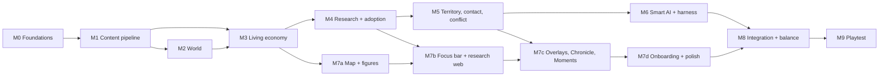

# 17 — Vertical-Slice Definition (WS-N)

> The exact scope of the **first playable**: what is built, what is stubbed, what is left out, the milestones in dependency order, and the single checklist of acceptance tests that says it is done.
> Built on [15](15-architecture-decision.md) (stack) and [16](16-catalog-format-and-tooling.md) (content). Acceptance tests are gathered from [06 §6](06-next-steps.md#6-vertical-slice-acceptance-criteria-draft-for-d4), [11 §6](11-e0-e2-project-specs.md#6-acceptance-checks-for-this-spec), [12 §12](12-world-generation.md#12-validation-tests-for-the-generator), [13 §11](13-contact-and-conflict.md#11-tuning-checks) and [14 §10](14-ai-opponents.md#10-measuring-smart-the-ai-harness).
> Design only. No code.

---

## 1. What the slice must prove

| Question | How the slice answers it |
|----------|--------------------------|
| **Is choosing three projects and watching a world respond fun?** | A human plays a full match from the first fire to the Age of Metal and wants to see what happens next |
| **Do research choices visibly matter?** | Every completed project visibly changes figure behavior within one season, and engaged play beats hands-off play |
| **Is the AI smart?** | The AI meets the targets in [14 §10.3](14-ai-opponents.md#103-acceptance-targets) and a human can read its intent from what they see |
| **Is the architecture sound?** | Bit-identical replays on macOS and Windows; a full match runs headless in about 20 s |
| **Do the numbers hold in the real simulation?** | The checks in [11 §6](11-e0-e2-project-specs.md#6-acceptance-checks-for-this-spec) pass against the real sim, not just the spreadsheet |

## 2. Scope

### 2.1 The match
- **One human against three AI civilizations** ([D14](06-next-steps.md#2-decisions-i-made-that-you-may-want-to-override)) on the 160 × 100 map in neighbour pairs ([12 §9](12-world-generation.md#9-start-placement)). Seed is selectable; a daily seed is a stretch.
- **Standard pace**, about 30 minutes: first Moment at ~0:45, first fission at ~7 min, KEY-1 at ~7.5, KEY-2 at ~17.5, first contact at ~18, KEY-3 at ~29.5 ([07 §6](07-balance-findings.md#6-tuned-run), [07b §9](07b-territory-findings.md#9-re-run-on-the-live-trajectory-07c-follow-up-2026-10-18)). Quick pace is available for testing.
- **The match ends when the first civilization completes KEY-3** (the Age of Metal), or at a 40-minute cap. The **end screen** shows Legacy standings (claimed-land Dominion, Mastery, Firsts), a timeline of each civilization's Keystones, and the AI's own "why" log ([14 §11](14-ai-opponents.md#11-explainability)). Dominion victory is off (it needs E7).

### 2.2 Built (in scope)

| Area | Included |
|------|----------|
| **Content** | All 145 E0–E2 projects plus KEY-1…3 at status `numeric` ([11](11-e0-e2-project-specs.md)); the E0–E2 registries ([10](10-e0-e2-actions-and-goods.md)); E3+ projects present but hidden by era gating |
| **World** | Full generation per [12](12-world-generation.md): continents, elevation, rivers, climate, biomes, deposits, fauna, paired starts, guarantees, the simulated fairness pass |
| **Living world** | Seasons and climate variance, winter, wildfire, flood, drought, herds and predators, figures with needs and jobs, the settlement planner, all E0–E2 actions and ladders, goods, tools, structures, population (cohorts, births, deaths, caps), fission, seasonal camps |
| **Research** | Insight, the 4:2:1 slots, queues, Know-how, Glimpse and Hidden states, adoption, Keystones, Firsts, the Council auto-pick, Leaning |
| **Territory** | Claims, ownership with hysteresis, home-range presence, Dominion scoring ([05 §11](05-simulation-structure.md#11-territory-and-dominion)), Beacons (ART-05) and Posture (GOV-02) |
| **Contact and conflict** | Scouting, awareness, first contact, relations, gifts, barter, raids, defense, combat, settlement capture, Free Folk ([13](13-contact-and-conflict.md)) |
| **AI** | Council baseline; the full smart AI of [14](14-ai-opponents.md): belief state, forecast model, beam-search research planning, Strategist (raid, war, peace, alliance), Civ Mind, 5 archetypes, difficulty levels **Settler, Chieftain (default) and Warlord**; the headless harness with scripted bots and blunder detectors |
| **Infrastructure** | Deterministic sim with checksums, saves and replays, the content validator and pack builder, CI on macOS and Windows ([15](15-architecture-decision.md)) |
| **Presentation** | See §2.3 |
| **Onboarding** | The 10-minute sequence in [08 §12](08-ui-and-world-display.md#12-onboarding-the-first-10-minutes) |

### 2.3 Presentation scope (Godot)

| Surface | In the slice | Cut from the slice |
|---------|--------------|--------------------|
| Camera and zoom | Pan, smooth zoom, Z0–Z2 with level-of-detail rules; a simple Z3 map; 4-step rotation (or fixed, per [15 §5.4](15-architecture-decision.md#54-visual-style-recommendation)) | Z4 world view with global flows |
| Figures and world | Figure kit with tool, outfit and carry layers for E0–E2; ~20 structures; terrain for all biomes; ~10 herd and predator sprites; seasons | Late-era kits |
| HUD | Top bar (calendar, population, Legacy), minimap, alert tiers, Chronicle feed | Digest of "while you were away" |
| **Focus bar** | Three slots, queues, ETAs, progress rings, Council toggle, Leaning ([08 §7](08-ui-and-world-display.md#7-focus-bar)) | — |
| **Research web** | E0–E2 nodes (~145) in lanes × eras, Glimpse fog, states, search, filters, hub emphasis, the "what will this change?" preview ([08 §8](08-ui-and-world-display.md#8-research-web-509-nodes)) | Cross-theme link toggle polish; E3+ columns |
| Overlays | Territory and claim strength, food security, resources, efficiency badges | Know-how heat, cohesion, pollution |
| Moments | Generic Moments by action family (knap, chop, hunt, forage, build, tend fire, teach) with the project's innovator text; bespoke visuals for ~20 headline projects | Bespoke visuals for every project |
| Follow cam and Legends | Click-to-follow with a life card; Legend naming in the Chronicle | Director mode (auto-camera); procedural portraits |
| Controls | Pause and 0.5×/1×/2×/4×; Beacons; Posture; save and load; replay viewer | Settings beyond volume, resolution and key help |
| Art and audio | **Placeholders first** (§6): flat-shaded terrain, silhouette sprites, a simple UI theme; ambient loops and a few stingers if cheap | Final art and audio direction (WS-J, WS-K) |

### 2.4 Out of scope
E3–E9 play, pollution and climate stress, disease beyond endemic and E2 epidemics, Wonders other than the Megalith (a stretch goal), multiplayer, Legend-level AI, player-initiated diplomacy ([D7](06-next-steps.md#2-decisions-i-made-that-you-may-want-to-override)), modding, mobile, localization beyond English, achievements, and Steam integration (a release task).

## 3. Milestones

Ordered by dependency, not by date. Sizes: **S** days · **M** a couple of weeks · **L** several weeks of focused work. Each milestone ends in a **gate**: its exit tests must pass before the next one that depends on it starts.

| M | Milestone | Size | Contents | **Exit gate** |
|---|-----------|:----:|----------|---------------|
| **M0** | **Foundations** | S | Repo and layout ([15 §8](15-architecture-decision.md#8-repository-layout-and-build)); `Fix64`, RNG, tick loop, checksums, replay skeleton; CI on macOS and Windows; a toy sim with a determinism test | A toy sim's replay gives **identical checksums on macOS arm64 and Windows x64** in CI |
| **M1** | **Content pipeline** | M | Loader, schemas, validator V1–V18 ([16 §6](16-catalog-format-and-tooling.md#6-the-validator-civsim-validate)), `import-md`, E0–E2 numeric merge, registries, content pack and hash | The **golden numbers** ([16 §7](16-catalog-format-and-tooling.md#7-migration-plan-markdown-to-yaml)) reproduce; 145 + 3 projects at `numeric`; pack builds with a stable hash |
| **M2** | **World** | M | Generation pipeline, deposits, fauna, starts, guarantees, the fairness pass (port of the territory model, [07b](07b-territory-findings.md)) | All of [12 §12](12-world-generation.md#12-validation-tests-for-the-generator): determinism, land share 40% ± 2%, guarantees in 10,000 worlds, E7 shares within ±15%, 4-player world in < 5 s |
| **M3** | **Living economy** | L | Figures, needs, jobs, planner, the E0–E2 actions and ladders, goods, tools, structures, population and caps, winter, fission | Headless E0–E2 run matches the balance model ([07](07-balance-findings.md), [09](09-population-and-health.md)) within ±15% on population and food; **C1, C2, C3, C4** pass in the real sim ([11 §6](11-e0-e2-project-specs.md#6-acceptance-checks-for-this-spec)) |
| **M4** | **Research and adoption** | M | Insight, 4:2:1 slots, queues, Know-how, Glimpse, adoption, Keystones, Firsts, Council, Leaning | **C5** (KEY-1 ≈ 7.5, KEY-2 ≈ 17.5, KEY-3 ≈ 29 min, ±25%); the 4:2:1 progress test; **C8** (every project has a visible change) checked in the sim's event stream |
| **M5** | **Territory, contact, conflict** | L | Claims, camps, ownership, Dominion, scouting, contact, relations, gifts, barter, raids, defense, combat, capture, Free Folk | [13 §11](13-contact-and-conflict.md#11-tuning-checks) F1–F5; claimed land 12–13% at the end of E2 and first contact at minute ~18 ([07b §9.4](07b-territory-findings.md#94-seasonal-camps-as-claim-sources-adopted-2026-10-18)) |
| **M6** | **Smart AI and harness** | L | Belief state, forecast model, beam-search planning, Strategist, Civ Mind, archetypes, difficulty levels, scripted bots, tournaments, Elo, blunder detectors | The E0–E2 targets of [14 §10.3](14-ai-opponents.md#103-acceptance-targets) and **blunder rates** of [14 §10.4](14-ai-opponents.md#104-blunder-detectors); the fog-fairness fuzz test passes |
| **M7a** | **Map and figures** | M | Godot project; terrain, camera, zoom levels, figure and herd sprites with instancing, seasons, structure placement | 60 fps with 2,400 figures at Z0–Z2 on a mid-range Mac; the snapshot interface is stable |
| **M7b** | **Focus bar and research web** | L | Three slots, queues, Council, Leaning; the web with lanes, fog, states, search | A first-time tester makes a first meaningful choice in ≤ 30 s ([06 §6](06-next-steps.md#6-vertical-slice-acceptance-criteria-draft-for-d4) #1) |
| **M7c** | **Overlays, Chronicle, Moments** | M | Territory and food overlays, efficiency badges, alerts, Chronicle, generic and headline Moments, follow cam | Every E0–E2 project shows a Moment and a visible change |
| **M7d** | **Onboarding and polish** | M | The 10-minute sequence, tips, save and load, replay viewer, end screen | A new player follows the sequence without help |
| **M8** | **Integration and balance** | M | The real UI on the real sim against the real AI; the full acceptance run; tuning | **All tests in §4 green** |
| **M9** | **Playtest** | S | 5–8 first-time players | The UX criteria in §4 met; findings feed the next plan |

**Parallel streams.** After M1, the **sim stream** (M2 → M3 → M4 → M5 → M6) and the **presentation stream** (M7a once M3's snapshots are stable) run side by side, joining at M8. The AI harness (M6) needs M5 but not any UI.

## 4. Acceptance checklist

The slice is done when every row passes in the nightly CI report, except those marked **human**, which need real players.

### 4.1 Player experience

| # | Test | Target | Source |
|---|------|--------|--------|
| P1 | **Human** A first-time player understands the three slots | ≤ 2 min | [06 §6](06-next-steps.md#6-vertical-slice-acceptance-criteria-draft-for-d4) #1 |
| P2 | **Human** First meaningful choice | ≤ 30 s from start | 06 §6 #1 |
| P3 | A completed project visibly changes behavior | within 1 season | 06 §6 #2 |
| P4 | The first winter is a felt threat | harsh first-two-winters in 51% of games; a food alert appears when stores are low | [09 §4.3](09-population-and-health.md#43-winter-hazards) |
| P5 | Fission produces a second camp, and territory visibly grows | minute 7–9; 12–13% claimed at end of E2 | [09 §7.3](09-population-and-health.md#73-results-first-fission), 07b §9.4 |
| P6 | First contact | minute 15–25 on ≥ 90% of maps | [13 §11](13-contact-and-conflict.md#11-tuning-checks) F1 |
| P7 | KEY-1, KEY-2, KEY-3 timing (Standard) | ≈ 7.5, 17.5, 29 min, each ±25% | [11 §6](11-e0-e2-project-specs.md#6-acceptance-checks-for-this-spec) C5 |
| P8 | **Hands-off loses to engaged**: a Council-only player loses to a moderately engaged player | ≥ 65% of paired matches | 06 §6 #7 |
| P9 | **Human** Playtest: testers want to continue after the end screen; can explain at least one AI action they saw | ≥ 5 of 8 | M9 |

### 4.2 Simulation and content

| # | Test | Target | Source |
|---|------|--------|--------|
| S1 | Bit-identical replay, same seed and commands | 100% over 1,000 matches | 06 §6 #8, [15 §6](15-architecture-decision.md#6-determinism-rules-binding-on-civsimsim) |
| S2 | **Cross-platform** checksums | identical on macOS arm64 and Windows x64 | 15 D9 |
| S3 | FoodCap trajectory | 18 → 28 → 42 → 88 (±10%) | 11 §6 C1, [07c §3](07c-e0-e2-checks.md) |
| S4 | Late-winter share reaches the cap-trigger share | ≥ 0.85 by ~E1 0.4 | 11 §6 C2 |
| S5 | Hazards by cause | within ±10% of 09's tables | 11 §6 C3 |
| S6 | First fission | minute 7–9, every archetype | 11 §6 C4 |
| S7 | Efficiency growth on core actions | ×1.5–2 per era | 11 §6 C6 |
| S8 | World generation | all of 12 §12 | [12 §12](12-world-generation.md#12-validation-tests-for-the-generator) |
| S9 | Content validator | 0 errors; golden numbers match | [16 §7](16-catalog-format-and-tooling.md#7-migration-plan-markdown-to-yaml) |
| S10 | Raid and defense table | within ±10 points | 13 §11 F3, F4 |
| S11 | Conquest of a defended village at 1.5× strength | succeeds ≥ 60% in one season | 13 §11 F5 |
| S12 | Headless E0–E2 run | ≤ 20 s; full 1,000-match suite in a night | [15 §7](15-architecture-decision.md#7-performance-budgets-and-how-they-are-met) |
| S13 | Sim tick | ≤ 4 ms average with 4 civs; no GC spike over 16 ms | 15 §7 |
| S14 | Render | 60 fps, 2,400 figures, mid-range Mac | 15 §7 |
| S15 | No crash, desync or invalid state | 0 in 1,000 headless matches (all archetypes and levels) | — |

### 4.3 AI (E0–E2 horizon)

| # | Test | Target | Source |
|---|------|--------|--------|
| A1 | Warlord AI vs. Council bot, mirrored seeds | wins ≥ 85% | [14 §10.3](14-ai-opponents.md#103-acceptance-targets) |
| A2 | Warlord AI vs. each opening script | wins ≥ 70% | 14 §10.3 |
| A3 | Warlord AI vs. Rusher | loses no settlement ≥ 80% of the time; wins ≥ 70% | 14 §10.3 |
| A4 | Chieftain vs. Warlord | wins 25–40% | 14 §10.3 |
| A5 | Archetype balance | no archetype wins > 30% of free-for-alls | 14 §10.3 |
| A6 | Exploit searcher | no fixed policy beats Warlord > 55% | 14 §10.3 |
| A7 | Blunder rates | per [14 §10.4](14-ai-opponents.md#104-blunder-detectors) | 14 §10.4 |
| A8 | Fog fairness fuzz | decisions unchanged when unseen state is randomized | 15 D10 |

(Legend-vs-Warlord and the Dominion-victory frequency in 14 §10.3 need later eras and are deferred.)

## 5. A scripted demo (what a good run shows)

A reviewer can use this 30-minute script to judge a build by eye.

| Time | What to see |
|------|-------------|
| 0:00 | Twelve people around an ember; "You are their curiosity"; the focus bar pre-filled with FOR-01, SOC-01, FIR-01 |
| ~0:45 | First Moment: an innovator tries Plant Lore; adoption dots spread; efficiency badge ticks up |
| 0:45–1:00 | First winter: the palette cools, figures huddle at the fire |
| ~4:00 | The first full-strength winter. With low stores, a food alert and a visible hungry spell |
| ~7:00 | **First fission:** a daughter band walks out; the territory tint and seasonal camps appear; Chronicle names the leader |
| ~7:30 | **KEY-1** banner; Hunters-era nodes emerge from the fog |
| 10–18 | Scouts leave toward the neighbour; the AI sends a gift party or hides, depending on its read |
| ~18 | **First contact:** the stance icon, a Moment, relations shown. The player can see the rival's tools and palisades |
| 18–29 | Fields and herds appear; the frontier race; a raid (yours, theirs, or one you deflect thanks to a palisade) |
| ~17.5 / ~29 | **KEY-2** (Sedentism) and **KEY-3** (Age of Metal) banners |
| End | The end screen: standings, timeline, and each AI's "why" log |

## 6. Placeholders and the art question

The slice needs *readable* visuals, not final art. The plan is to build in this order, so that nothing waits on art:
1. **Gray-box:** flat-shaded hex terrain; each figure a colored capsule with a civ sash; structures as simple primitives; text labels.
2. **Silhouette kit:** one figure silhouette in a few poses, ~12 tool silhouettes with the material tints from [08 §2](08-ui-and-world-display.md#2-how-figures-read), ~20 structure silhouettes, ~10 animal silhouettes.
3. **Style pass** (WS-J) only after M7d proves the camera, zoom and readability.

**Decision needed before M7c: where does final art come from?** Claude can write the code, shaders, UI and placeholder shapes, but not hand-drawn character and environment art. The options are commissioned illustration, a licensed asset pack, AI-assisted generation with human curation, or a deliberately minimal flat-shaded look that needs little art. The slice does not depend on the answer, but the shipped look does. Audio has the same question.

## 7. How the slice is built (working agreements)

- **Sim first, headless.** Every system lands with tests and a headless demonstration before any UI exists for it.
- **Replays are bug reports.** Any odd behavior is captured as a replay file and added to a regression corpus.
- **The acceptance report runs nightly** and lists every §4 row with its current value, so progress is a table of numbers.
- **Balance numbers come from the docs.** A tuning change updates `constants/balance.yaml` and the findings document that justifies it ([16 §8](16-catalog-format-and-tooling.md#8-editing-workflow)).
- **No feature without a test.** A system is done when its exit gate passes, not when it runs.

## 8. Cut list (if time or budget runs short)

In order of what to drop first. **Never cut** the items at the bottom.

1. Director mode (already excluded), procedural portraits, the daily seed.
2. Bespoke Moment visuals beyond the ~20 headline projects.
3. The Z3 continent view and 4-step rotation (fixed camera is acceptable).
4. The Megalith stretch goal.
5. Settler and Warlord difficulty levels (keep Chieftain only).
6. Overlays beyond territory and food security.
7. Legends beyond naming in the Chronicle.
8. **Never cut:** determinism and replays, the AI harness and its targets, the focus bar, the research web, the first-10-minutes onboarding, and the end screen's AI "why" log.

## 9. Risks specific to the slice

| Risk | Impact | Mitigation |
|------|--------|-----------|
| The real sim disagrees with the mean-field models | Pacing and balance drift | M3 and M4 exit gates compare against the spreadsheets; keep the Python models as the oracle ([balance/tools](balance/tools/balance_sim.py)) |
| The AI is smart in the harness but opaque to a human | Players feel cheated or bored | The "why" log, visible cues (palisades, warpaint, gift parties), and the human playtest P9 |
| Presentation lags behind the sim | Late discovery of UX problems | Start M7a as soon as M3's snapshots are stable; test the focus bar with real people at M7b |
| Scope creep from E3+ | The slice never ships | Era gating hides everything past KEY-3; the cut list is the guard |
| Art becomes the critical path | Ugly or blocked build | Placeholders first (§6); decide the art source before M7c |

## 10. Definition of done for the slice

- [ ] M0–M9 gates passed
- [ ] Every row of §4 green (the **human** rows measured in M9)
- [ ] 1,000 headless matches without crash, desync or invalid state
- [ ] A reviewer can follow §5 on a fresh checkout on macOS, and CI is green on Windows
- [ ] The next-plan document lists what E3–E9 will need, informed by the playtest
