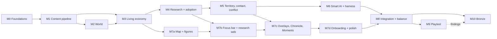

# 17 — Vertical-Slice Definition (WS-N)

> The exact scope of the **first playable**: what is built, what is stubbed, what is left out, the milestones in dependency order, and the single checklist of acceptance tests that says it is done.
> Built on [15](15-architecture-decision.md) (stack) and [16](16-catalog-format-and-tooling.md) (content). Acceptance tests are gathered from [06 §6](06-next-steps.md#6-vertical-slice-acceptance-criteria-draft-for-d4), [11 §6](11-e0-e2-project-specs.md#6-acceptance-checks-for-this-spec), [12 §12](12-world-generation.md#12-validation-tests-for-the-generator), [13 §11](13-contact-and-conflict.md#11-tuning-checks) and [14 §10](14-ai-opponents.md#10-measuring-smart-the-ai-harness).
> Normative scope and acceptance checklist. Implementation status is tracked in §3.1.

---

## 1. What the slice must prove

| Question | How the slice answers it |
|----------|--------------------------|
| **Is choosing three projects and watching a world respond fun?** | A human plays a full match from the first fire to the Age of Metal and wants to see what happens next |
| **Do research choices visibly matter?** | Every completed project visibly changes figure behavior within one season, and engaged play beats hands-off play |
| **Is the AI smart?** | The AI meets the targets in [14 §10.3](14-ai-opponents.md#103-acceptance-targets) and a human can read its intent from what they see |
| **Is the architecture sound?** | Bit-identical replays on macOS and Windows; a full match runs headless in about 20 s |
| **Do the numbers hold in the real simulation?** | The checks in [11 §6](11-e0-e2-project-specs.md#6-acceptance-checks-for-this-spec) pass against the real sim, not just the spreadsheet |

## 2. Scope

### 2.1 The match
- **One human against three AI civilizations** ([D14](06-next-steps.md#2-decisions-i-made-that-you-may-want-to-override)) on the 160 × 100 map in neighbour pairs ([12 §9](12-world-generation.md#9-start-placement)). Seed is selectable; a daily seed is a stretch.
- **Current Standard pace projection:** KEY-1 at ~6.5, KEY-2 at ~20.75, KEY-3 at ~41.5, KEY-4 at ~61.25; E3 takes ~19.75 minutes. Roots and Bronze Primary intervals average about 1.15 and 1.18 minutes in the mean-field model, and later eras rise further ([07c §10.1](07c-e0-e2-checks.md#101-roots-and-bronze-still-finish-too-quickly-2026-10-24)). Fresh live acceptance is pending, including the Year-64 cap headroom check. Quick pace is available for testing.
- **The match ends when the first civilization completes KEY-3** (the Age of Metal), or at a 40-minute cap. The **end screen** shows Legacy standings (claimed-land Dominion, Mastery, Firsts), a timeline of each civilization's Keystones, and the AI's own "why" log ([14 §11](14-ai-opponents.md#11-explainability)). Dominion victory is off (it needs E7).
- **Superseded from M10 (Bronze):** the match runs through E3 and ends when the human completes KEY-4, 3 years after the first rival does, or at Year 64, scored with per-era Legacy units ([22 §3](22-bronze-age.md#3-match-structure)).

### 2.2 Built (in scope)

| Area | Included |
|------|----------|
| **Content** | All 145 E0–E2 projects plus KEY-1…3 at status `numeric` ([11](11-e0-e2-project-specs.md)); the E0–E2 registries ([10](10-e0-e2-actions-and-goods.md)); E3+ projects present but hidden by era gating |
| **World** | Full generation per [12](12-world-generation.md): continents, elevation, rivers, climate, biomes, deposits, fauna, paired starts, guarantees, the simulated fairness pass |
| **Living world** | Seasons and climate variance, winter, wildfire, flood, drought, herds and predators, figures with needs and jobs, the settlement planner, all E0–E2 actions and ladders, goods, tools, structures, population (cohorts, births, deaths, caps), fission, seasonal camps |
| **Research** | Insight, the 4:2:1 slots, queues, Know-how, Glimpse and Hidden states, adoption, Keystones, Firsts, the Council auto-pick, Leaning |
| **Territory** | Claims, ownership with hysteresis, home-range presence, Dominion scoring ([05 §11](05-simulation-structure.md#11-territory-and-dominion)), Beacons (ART-05) and Posture (GOV-02) |
| **Contact and conflict** | Scouting, awareness, first contact, relations, gifts, barter, raids, defense, combat, settlement capture, Free Folk ([13](13-contact-and-conflict.md)) |
| **AI** | Council baseline; the full smart AI of [14](14-ai-opponents.md): belief state, forecast model, beam-search research planning, Strategist (raid, war, peace, alliance), Civ Mind, 5 archetypes, difficulty levels **Settler, Chieftain (default) and Warlord**; the headless harness with scripted bots and blunder detectors |
| **Infrastructure** | Deterministic sim with checksums, saves and replays, the content validator and pack builder, CI on macOS and Windows ([15](15-architecture-decision.md)) |
| **Presentation** | See §2.3 |
| **Onboarding** | The 10-minute sequence in [08 §12](08-ui-and-world-display.md#12-onboarding-the-first-10-minutes) |

### 2.3 Presentation scope (Godot)

| Surface | In the slice | Cut from the slice |
|---------|--------------|--------------------|
| Camera and zoom | Pan, smooth zoom, Z0–Z2 with level-of-detail rules; a simple Z3 map; 4-step rotation (or fixed, per [15 §5.4](15-architecture-decision.md#54-visual-style-recommendation)) | Z4 world view with global flows |
| Figures and world | Figure kit with tool, outfit and carry layers for E0–E2; ~20 structures; terrain for all biomes; ~10 herd and predator sprites; seasons | Late-era kits |
| HUD | Top bar (calendar, population, Legacy), minimap, alert tiers, Chronicle feed | Digest of "while you were away" |
| **Focus bar** | Three slots, queues, ETAs, progress rings, Council toggle, Leaning ([08 §7](08-ui-and-world-display.md#7-focus-bar)) | — |
| **Research web** | E0–E2 nodes (~145) in lanes × eras, Glimpse fog, states, search, filters, hub emphasis, the "what will this change?" preview ([08 §8](08-ui-and-world-display.md#8-research-web-509-nodes)) | Cross-theme link toggle polish; E3+ columns |
| Overlays | Territory and claim strength, food security, resources, efficiency badges | Know-how heat, cohesion, pollution |
| Moments | Generic Moments by action family (knap, chop, hunt, forage, build, tend fire, teach) with the project's innovator text; bespoke visuals for ~20 headline projects | Bespoke visuals for every project |
| Follow cam and Legends | Click-to-follow with a life card; Legend naming in the Chronicle | Director mode (auto-camera); procedural portraits |
| Controls | Pause and 0.5×/1×/2×/4×; Beacons; Posture; save and load; replay viewer | Settings beyond volume, resolution and key help |
| Art and audio | **Placeholders first** (§6): flat-shaded terrain, silhouette sprites, a simple UI theme; ambient loops and a few stingers if cheap | Final art and audio direction (WS-J, WS-K) |

### 2.4 Out of scope
E4–E9 play, pollution and climate stress, disease beyond the classes of [09 §10](09-population-and-health.md#10-disease-model-05-13) that E2–E3 use (Fever, Flux and, from E3, Plague; Pox only imported), Wonders other than the Megalith and the Stepped Pyramid, multiplayer, modding, mobile, localization beyond English, achievements, and Steam integration (a release task). Diplomacy beyond M7a's orders (18 §7) and E3's Compacts, Embargo, pacts and treaties ([22 §6](22-bronze-age.md#6-tin-trade-without-a-diplomacy-ui)): no negotiation screen, no multi-term treaties ([D7](06-next-steps.md#2-decisions-i-made-that-you-may-want-to-override) is retired by 22 §1.3).

**E3 Bronze is in scope from M10** ([22](22-bronze-age.md)): all 65 E3 projects and KEY-4, the metal chain, tin geography and trade, Bronze-age war and walls, live Cohesion and Overreach, Mandate and Decrees, and the Bronze chapter end. Until M10's gates pass, the slice (M0–M9) keeps its KEY-3 ending.

## 3. Milestones

Ordered by dependency, not by date. Sizes: **S** days · **M** a couple of weeks · **L** several weeks of focused work. Each milestone ends in a **gate**: its exit tests must pass before the next one that depends on it starts.

| M | Milestone | Status | Size | Contents | **Exit gate** |
|---|-----------|--------|:----:|----------|---------------|
| **M0** | **Foundations** | ✅ Done | S | Repo and layout ([15 §8](15-architecture-decision.md#8-repository-layout-and-build)); `Fix64`, RNG, tick loop, checksums, replay skeleton; CI on macOS and Windows; a toy sim with a determinism test | A toy sim's replay gives **identical checksums on macOS arm64 and Windows x64** in CI |
| **M1** | **Content pipeline** | ✅ Done | M | Loader, schemas, validator V1–V18 ([16 §6](16-catalog-format-and-tooling.md#6-the-validator-civsim-validate)), `import-md`, E0–E2 numeric merge, registries, content pack and hash | The **golden numbers** ([16 §7](16-catalog-format-and-tooling.md#7-migration-plan-markdown-to-yaml)) reproduce; 145 + 3 projects at `numeric`; pack builds with a stable hash |
| **M2** | **World** | ✅ Done | M | Generation pipeline, deposits, fauna, starts, guarantees, the fairness pass (port of the territory model, [07b](07b-territory-findings.md)) | All of [12 §12](12-world-generation.md#12-validation-tests-for-the-generator): determinism, land share 40% ± 2%, guarantees in 10,000 worlds, E7 shares within ±15%, 4-player world in < 5 s |
| **M3** | **Living economy** | ✅ Done | L | Figures, needs, jobs, planner, the E0–E2 actions and ladders, goods, tools, structures, population and caps, winter, fission | The final 40-seed run passes C1 FoodCap, C3 child/adult ratios and elder e45 sensitivity, C4 median fission timing, and all 12 controlled population means. Results and the reproducible schedule are in [07c](07c-e0-e2-checks.md) and [`run_headless_balance.py`](balance/tools/run_headless_balance.py). |
| **M4** | **Research and adoption** | ✅ Done | M | Insight, 4:2:1 slots, queues, Know-how, Glimpse, adoption, Keystones, Firsts, Council, Leaning | Historical C5 (KEY-1 ≈ 7.5, KEY-2 ≈ 17.5, KEY-3 ≈ 29 min); current KEY-3 projection is 41.5 and needs fresh acceptance. The 4:2:1 progress test and **C8** remain structural checks |
| **M5** | **Territory, contact, conflict** | ✅ Done | L | Claims, camps, ownership, Dominion, scouting, contact, relations, gifts, barter, raids, defense, combat, capture, Free Folk | [13 §11](13-contact-and-conflict.md#11-tuning-checks) F1–F5; claimed land 12–13% at the end of E2 and first contact at minute ~18 ([07b §9.4](07b-territory-findings.md#94-seasonal-camps-as-claim-sources-adopted-2026-10-18)) |
| **M6** | **Smart AI and harness** | ✅ Done | L | Belief state, forecast model, beam-search planning, Strategist, Civ Mind, archetypes, difficulty levels, scripted bots, tournaments, Elo, blunder detectors | The E0–E2 targets of [14 §10.3](14-ai-opponents.md#103-acceptance-targets) and **blunder rates** of [14 §10.4](14-ai-opponents.md#104-blunder-detectors); the fog-fairness fuzz test passes |
| **M7a** | **Map and figures** | Complete (Godot renderer and performance gate) | M | Godot 4.7 .NET project; terraced terrain and water, viewer fog and territory, seasons, instanced figures/herds/structures, Z0–Z3 camera, speed/pause, Beacon command, known-resource overlay | 60 fps with 2,400 figures at Z0–Z2 on a mid-range Mac; the snapshot interface is stable |
| **M7b** | **Focus bar and research web** | ✅ Complete 2026-10-20 (human first-choice gate) | L | Three slots, queues, Council, Leaning; the web with lanes, fog, states, search | A first-time tester makes a first meaningful choice in ≤ 30 s ([06 §6](06-next-steps.md#6-vertical-slice-acceptance-criteria-draft-for-d4) #1) |
| **M7c** | **Overlays, Chronicle, Moments** | Complete (E0–E2 coverage and renderer gate) | M | Claim-strength, settlement food-security and method-rung overlays; frame-event alerts and Chronicle; generic project Moments and keystone headline cards | Every E0–E2 project shows a Moment and a visible change |
| **M7d** | **Onboarding and polish** | 10-minute uncoached run completed 2026-10-21; full UI redesign implemented 2026-10-21 ([20](20-ui-design-spec.md)); retest pending | M | Trigger-based 10-minute tips, Gentle start, versioned quick-save/load, replay playback with checksum reporting, Legacy and AI-why end screen | A new player follows the 10-minute sequence without help; confirm the clarified research and control UI in a fresh run |
| **M8** | **Integration and balance** | In progress (audit 2026-10-21) | M | The real UI on the real sim against the real AI; the full acceptance run; tuning | All automated §4 gates and P1/P2 pass; P9 is completed in M9 |
| **M9** | **Playtest** | Pilot started: one player reached 10:00; P9 remains unmeasured | S | 5–8 first-time players | P9: at least 5 of 8 want to continue and can explain one AI action; findings feed the next plan ([moderator protocol](m9-playtest-protocol.md)) |
| **M10** | **Bronze (E3)** | In progress; WP1–WP10 implementation work is in the tree, WP11–WP12 acceptance remains | L (the largest yet; staged 10a–10f) | **10a** E3 content spec (doc 23) and YAML for all 65 E3 projects and KEY-4, tin and arsenic world generation; **10b** economy: mining and mining camps, charcoal, smelting, alloying, casting, tool tiers T8–T10 and Chop rungs 5–6, forest depletion, dormancy, plough, irrigation, dairying, game-scale Towns and Cities, roles by structure, live Cohesion, Admin span, Overreach and secession; **10c** politics: E3 weapons, shields, chariots, hillforts, stone walls and investment, soft-target raids, goods barter, caravans, Compacts and Embargo, pacts and treaties, Tin Folk, Mandate and the six Decrees (commands 18–19); **10d** research and AI: `MaxEra` 3, Legacy units, the chapter end rule, the E3 forecast, the bronze fork, *Secure tin*, sieges, Decrees by EV, new blunders; **10e** view: E3 frame fields and events, figure kits, ~16 structures, four overlays, the E3 research column, Decrees UI and forecast cards, the countdown and end screen; **10f** balance pass and playtest. Work packages and dependencies: [22 §20](22-bronze-age.md#20-work-breakdown) | B4 passed locally (66/66 event coverage); B23 S12/S13/S14 passed; B4, B5–B7, B11, B14–B15, B18, B20–B21, B22 S1, B23, B24, and B25 have passing evidence; B9 has two live means in band but one civilization below band, and B12/B13/B16 have bounded fixture or oracle evidence only. B10 passes under the finalized expected-share measure. B8, B22 S2, B26–B31, and human B1–B3 remain open |

**Parallel streams.** After M1, the **sim stream** (M2 → M3 → M4 → M5 → M6) and the **presentation stream** (M7a once M3's snapshots are stable) run side by side, joining at M8. The AI harness (M6) needs M5 but not any UI.

### 3.1 Progress

| M | Status | Notes |
|---|--------|-------|
| **M0** Foundations | ✅ 2026-10-18 | `CivSim.Sim` (`Fix64`, `Hash64`, `Pcg32`, `StateHasher`, `SimRunner`, replays, toy canary), `CivSim.Harness`, 66 tests (numerics against independent Python references, RNG against the published PCG32 vectors, source rules, replay tamper detection, snapshot resume), CI workflow for macOS and Windows against `tests/golden/toy-v1.txt`. **Gate met:** the first CI run ([run 39138154161](https://github.com/juchheim/civsim/actions/runs/39138154161)) passed build, tests, the golden check and the replay round trip on both **macOS arm64 and Windows x64**, reproducing the same checksums |
| **M1** Content pipeline | ✅ 2026-10-18 | `CivSim.Content` (strict YAML loader, schemas, validator V1 to V14, V17, V18, graph analysis, pack compiler), `CivSim.Cli` (`civsim`), `content/` (519 catalog nodes, 14 registries, constants), canonical JSON content pack with SHA-256, 133 tests. Deviations and the validator's first findings are in [16 §11](16-catalog-format-and-tooling.md#11-m1-as-built-2026-10-18). Gate: golden numbers reproduce, 145 + 3 projects `numeric`, stable pack hash; **gate met:** the first CI run with M1 ([run 39139787405](https://github.com/juchheim/civsim/actions/runs/39139787405)) passed strict validation and the pack-hash golden check on both macOS arm64 and Windows x64 |
| **M2** World | ✅ 2026-10-18 | Four-player world generation and fairness checks are implemented. Release build and 138/138 tests pass. Seed 42's fingerprint remains unchanged and its golden test passed on macOS and Windows in [CI run 39156059788](https://github.com/juchheim/civsim/actions/runs/39156059788). After correcting the rare Wetland start biome and making the harness check each 1,000-seed window independently, the seeds 1–10,000 audit accepted every world with no failures in 29m 25.0s; all ten windows contained all six required start biomes. The slowest world took 4,644 ms. All 40,000 starts had nearby rivers and coast access; 154 starts were Wetlands. **M2 acceptance gates met locally.** |
| **M3** Living economy | ✅ 2026-10-19 | The seasonal economy, content-driven project completion, figures, stocks, FoodCap and winter forecasts, hazards, population/fission, per-figure care, E2 agriculture and building chains, fisheries, herds, tools, ecological events, snapshots, and economy replay are implemented. The harness reports age-band person-seasons/person-years, expected hazards and deaths, and exact-age hazards split by baseline starvation and winter-shortfall surcharge. The final 40-seed run passes C1 FoodCap, C3 child/adult ratios and elder tail sensitivity, C4 median first fission (9/8.5/9/7 years), and all 12 controlled population means; 68/160 runs founded in years 7–9 and 148/160 by year 30. The neutral nine-field E2 fixture measures 90.21 vs 88, and C2 reaches its 0.85 target by E1 ≈0.4. See [07c](07c-e0-e2-checks.md) and [`run_headless_balance.py`](balance/tools/run_headless_balance.py). Some ecological stocks and event placement remain deterministic approximations. |
| **M4** Research and adoption | ✅ 2026-10-19 | `CivSim.Sim.Research`: the catalog compiled from the pack, Insight (Commons, roles, structures), the 4:2:1 slot split with empty-slot redistribution, queues, the slot cascade and overflow, Know-how (practice to lineages, 50% cost cap), project states with Glimpse, Hidden and Dormant, `[Seen]`, `[Has]` and `[Climate]` gates, Diffusion and EraLag costs, adoption (logistic spread, p_teach modifiers, fission inheritance), Keystones with era breadth and the Era Boon, Firsts with Pioneer and Legacy, the Council of Elders and Leaning, and an event stream (`MatchModel` drives M3's economy with the completions; replays via `MatchReplay`). 202 tests; research golden `tests/golden/research-v1.txt`. **Historical gates met locally:** C5 median 6.3 / 19.3 / 32.6 min on seed 20261019 and 6.6 / 20.5 / 34.4 on seed 777. The current E2+ cadence is updated in 07c §10.1 and needs fresh live acceptance; the 4:2:1 progress test and C8 catalog coverage remain structural checks. |
| **M5** Territory, contact, conflict | ✅ 2026-10-19 | `CivSim.Sim.Politics`: the claim field, seasonal camps, ownership with hysteresis and Dominion (`Territory`); contact by reach, the first-contact roll, Relations, reputation, alliances, truces (`Diplomacy`); combat rounds, raids and assaults (`Combat`, `Raids`); and `PoliticsSystem`: gifts, barter, raids, wars, occupation, capture, Free Folk, Beacons and Posture, with a rule-based Civ Mind v0. M3's economy gained a small controlled mutation surface (loot, casualties, burning, capture, fission-site advice). **Gates met locally:** F1 24/24 seeds in minutes 18–24; F2 25/45/30; F3 all twelve table cells within ±10 points; F4 raiding pays +16 undefended and −13 against a palisade; F5 100% at 1.5× strength; claimed land 13.2% at the end of E2 (six seeds, 10.6–15.5%). C5 still passes with politics in the match. **Match speed (S12):** a 30-minute headless match of four civilizations took 190 s before; a profile found research reading `Settlement(i)`, which rebuilds food, housing and group caps (7 ms a call), thousands of times a season, plus linear string lookups of projects and modifiers in the economy. With a cheap settlement accessor, hoisted invariants and bisected project and cached modifier lookups it takes **3.1 s** (40 minutes: 4.7 s) with identical checksums, against the 20 s budget. Details, readings and stand-ins in [13 §12](13-contact-and-conflict.md#12-m5-as-built-2026-10-19). |
| **M6** Smart AI and harness | ✅ 2026-10-20 | `CivSim.Sim.Ai`: seats with a fog boundary (the belief builder is the only part that reads true state, and only through sight), the forecast model and Spark (beam-searched research plans), the Strategist (grand plan, raids, wars, peace, diplomacy, Posture, Beacons), difficulty as thinking budget, a decision log, and the scripted bots; `civsim-harness ai` runs mirrored duels, free-for-alls, an Elo ladder, the exploit searcher and the gate check. **Gates met locally:** A1 94%, A2 88/100/100%, A3 94% wins with no settlement lost, A4 31%, A5 21.9–28.1% per archetype over 120 free-for-alls, A6 best fixed policy 17%, A7 no keystone stalls or dithering, A8 fog-fairness fuzz test passes. Deferred to later eras: Legend vs Warlord and the Dominion-victory rate. The fog test found a real coupling in the economy (job rotation keyed on a global index) and a snapshot gap; both fixed, research and politics goldens refreshed. Details in [14 §16–18](14-ai-opponents.md#16-m6-belief-state-as-built-2026-10-19). |
| **M7a** Map and figures | ✅ complete 2026-10-20 | The renderer's contract is built and tested ([18](18-view-layer.md)): `CivSim.Sim.View` with the static `WorldView`, `HexLayout` (odd-r geometry in integer map units), `MatchFrame` (structure-of-arrays snapshot: tiles with visibility, owner and claim; figures with activity, age, health, tool rung, carry and flags; herds, predators, settlements with structures and bands, fields, camps, Beacons, parties on the road, occupations, civilizations, the focus bar and every project's state), `FrameBuilder` (viewer fog by the belief builder's sight rules with explored memory and remembered settlements, or omniscient; figure layout as a pure function of id, job, season and tick, since the economy has no positions; the event stream with text keys and Moment hooks; its own save state), `FrameStore` (lock-free four-frame hand-off with id matching for interpolation) and politics orders as appended `CommandKind`s 10–17. **Measured:** 0.23 ms per omniscient frame with 2,670 figures (minute 70; matches reach 2,400 people near minute 68, not 40), 0.1 ms per viewer frame, 0 bytes allocated per frame after warm-up; all goldens unchanged with frames every 10 ticks; resumed saves give identical frames. 326 tests. The Apple M4 Godot render gate passed with 2,731–2,833 figures across all 12 Claims, Food, Methods and Resources overlay cases at Z0–Z2; minimum one-second FPS was 115.6 (see [game/README.md](../../game/README.md)). |
| **M7b** Focus bar and research web | ✅ 2026-10-20; usability follow-up in progress | The HUD has a persistent 4:2:1 focus bar with progress, live sampled ETA, queue peek, Insight/year and Auto-fill toggle; Leaning is edited in a normalized three-theme slider panel. The T research web groups visible E0–E2 projects into theme/lineage lanes and a Keystone spine; W1 summarizes known project states by lineage/era without counting Hidden projects, while W2 shows individual nodes with optional known-dependent hub sizing. Search, theme/type/state filters, formatted effects, current-figure/method-rung previews, flavor, readable project names, prerequisite status and routes, slot-state cues, click assignment, and queue edits are present. Debug captures: `godot-mono --path game -- --research-web --screenshot=/tmp/civsim-m7b-web.png` and `godot-mono --path game -- --research-overview --screenshot=/tmp/civsim-m7b-overview.png`. Fresh Godot matches start with Council off and open this web with the 4:2:1 labels explained. In the human trial, the tester estimated 5–8 seconds to the first assignment, set it as Primary, and correctly described the slot priority order. At 10:00, the player reported that empty slots were hard to spot, prerequisites were unclear, repeat assignment decisions were tiring, Pause was hard to discover, project IDs crowded out names, drag instructions were unhelpful, and Escape did not close the web. **2026-10-21 redesign:** the HUD, focus bar, research web, Chronicle, notifications, diplomacy, camera and input were rebuilt to [20-ui-design-spec.md](20-ui-design-spec.md) (Choose/Map views, plain-English names and prerequisites, click-to-start into the first open slot, pending state while paused, Space works everywhere, Esc closes the top layer). The W1/W2 views and drag assignment are gone. The redesign is verified by scripted screenshots and input checks, not yet by a human run; the focused retest is still needed. |
| **M7c** Overlays, Chronicle, Moments | ✅ complete 2026-10-20 | Added claim-strength, per-settlement food security/seasonal forecast, and worker method-rung overlays to the low-poly terrain shader. Overlay values are derived only from the viewer-filtered frame; remembered settlements are omitted. The Chronicle formats the frame event stream into dated, clickable entries, raises Critical and refused-order alerts, and offers a dismissible [C] panel. In-era project Moments display the content pack's Moment and Flavor; keystones get a headline treatment. Live Godot screenshots confirm the Food and Methods overlays render. Audited every numeric E0–E2 project for Moment and VisibleChange coverage, with tests checking effect-level coverage. Tile hover cards expose visibility-safe owner, claims, known deposits, and workers; worker badges explain higher-rung fallback and efficiency. All 12 live M4 render cases across Claims, Food, Methods and Resources at Z0–Z2 passed the 60 fps target with at least 2,731 figures (see [game/README.md](../../game/README.md)). Bespoke headline art remains later polish. |
| **M8** Integration and balance | In progress 2026-10-21 | Release solution and Godot builds pass; 328/328 tests; strict content validation has zero errors or warnings; toy, research and politics goldens match; C5 passes on the default and 777 seeds; M5 passes (F1 24/24, combat tables, 100% F5 and 13.8% mean claimed land); the repeated M6 run passes A1–A7 (A1 94%, A2 88/100/100%, A3 94% wins and 100% without settlement loss, A4 31%, A5 21.9–28.1%, A6 exploit 17%, A7 no stalls/dithering; A8 passed in the suite). P8 passes with the Settler (learning) proxy at 83% (53/64 mirrored matches); the narrower Grower script scored 61%. A fresh 40-minute frame reproduces the demography reference exactly: 374/572 children (65.4%). P1/P2 have a human first-choice result (about 5–8 seconds, slot priorities understood), and the direct Set as Primary action was confirmed clear enough after the UI fix. **S1/S13/S15 pass:** 1,000 ten-minute replays reproduced all checksums and final states; with four Warlord AIs and 2,624–3,451 figures, the 6,000-tick mean was 2.816 ms/tick and the largest observed GC pause was 1 ms. One season-boundary tick took 490 ms wall time without a GC pause. The 1,000 ten-minute AI soak passed snapshot-restore checksum validation every five seasons across all six economy archetypes and all four difficulty levels, with no crashes, mismatches, or invalid snapshots. The repeatable command is `dotnet run --project src/CivSim.Harness -c Release -- acceptance --pack civsim.pack --s1 --s13 --s15`. **Human gates:** One uncoached player has reached 10:00; M7d polish retest remains, and M9 still needs 4–7 additional first-time players plus end-screen questions. P4 now distinguishes the three protected onboarding winters from the first two full-strength winters. |
| **M10** Bronze | In progress; long AI diagnostics stopped for shorter testing 2026-10-24 | The design is [22](22-bronze-age.md). Earlier multi-seed `research --check-m10` passed (KEY-4 median 45.8, E3 12.0, chapter end 47.2); a later one-seed diagnostic also passed B5 timing bands (KEY-4 median 44.2, E3 11.8, chapter end 45.2), but neither validates the newer cadence. Those live measurements are historical: the current E2/E3 EraBase is 150/400 and live-mode projects KEY-3 at 41.5, KEY-4 at 61.25 and E3 at ≈19.75 min. The refreshed exact B5 sample passes (KEY-4 median 58.4, E3 median 18.6, all eight civilizations in band); B6 passes its exact 32-seed check: median chapter end 60.5, 1/32 Year-Cap endings (3.1%), and identical replays. Exact B7 passes at 71.9% against its 65% target. Exact B8 remains open at 53.1% against 60%. The newer live map and combat findings are in [07d](07d-e3-balance-findings.md); rerun downstream population, territory and combat checks at the slower pace. The combat oracle and selftest passed corrected T21 values. After the latest changes, the Release build passed with 0 warnings/errors; the broader WP9-focused set passed 91/91, and the combined focused set passed 98/98 in 12 s (including short-sample acceptance-status tests). Chapter-end/B27 harness regressions passed 5/5; after adding the M10 short-sample guard, focused AI/harness telemetry and acceptance-status tests passed 61/61 in 4 s. Short `ai --check-m10` samples now label every gate diagnostic-only below 8 seeds or a 64-minute horizon. The 3/3 source determinism tests and 3/3 view-determinism tests passed. Strict validation and toy, research, politics, and content-pack goldens pass; research and politics expected checksums were refreshed for WP9 and checksummed herd-attribution changes. A full-suite run was capped at 2 minutes before the refresh and has not been rerun. The latest A8 fog-fairness run passed 2/2, including unseen Bronze compact/caravan/Mandate perturbations. The long A1–A5/A7 and B27–B31 runs were interrupted at the user's request; one later AI run stopped after a tiny A1 sample and is not acceptance evidence. A6 passed the exact 10,009-policy screen and 16-finalist mirrored validation; B26 remains open on the remaining AI gates. B22's S1 chapter replay requirement completed 1,000/1,000 64-minute matches with matching checksums; S2 cross-platform macOS/Windows verification remains open. Bounded command-driven binary `MatchReplay` round-trips cover KEY-3/Tin Folk emergence, queued refusals for commands 18–19, and a successful Tin embargo toggle; the replay does not exercise the contact-based relation penalty. Siege, secession, and Tin Folk capture scenarios remain open. B23 S12 passed at 23.952 s, S13 passed the exact 10-minute tick sample (1.244 ms mean, 4 ms maximum GC pause), and S14 passed all 24 Bronze zoom/overlay cases at 1,600 figures (minimum 92.8 fps). B16 now has a bounded 1,000-seed C# helper sweep across the 2.0/2.5/3.0 store cases matching T22's 3–6-season rates; live-match supply, sally, desertion and casualty interactions remain unmeasured. The exact B17–B20 politics sample now passes on seeds 20261019–20261042 at an 80-minute cap: 10.9 settlements/civ, 41.4% claimed land, 72/96 own-KEY-4 borders, 96/96 KEY-4 completions, 90.6% Towns, 26.0% Cities; B18 54.0/31.8/14.2/0.0%; B19 cohesion 64.6, 0.07 secessions/civ/E3 and 0/24 cascades; B20 7.1 raids, 91.7% war and 33.3% capture. WP12 B1–B3 playtests remain; B10 passes under finalized expected-share acceptance, while realized mortality ledgers and epidemic share remain diagnostics. See [07d §18–§20](07d-e3-balance-findings.md#18-wp9-ai-telemetry-checkpoint). |

**Current AI status (2026-10-27):** the exact B26 core cohort completed in about 15 minutes and failed A1, A2 Grower, A3 win, A4, A5 Builder/Grower, A7 starvation/herd/idle signals, B29, B30 overflow and B31. A2 Builder/Wanderer and A3 survival passed. B27 now passes its exact eight-seed, 64-minute cohort at 23/28 tin-poor recoveries (82.1%) and 0/16 dormant-route blunders after raising `SecureTinCompactDecreeBonus` to 180. B31 remains open: the exact eight-seed duel with this tuning produced 7/16 Legend wins (44%) against ≥60%; a single mirrored winter-surcharge counterfactual is diagnostic only. B28's follow-up defense policy passed focused tests, but the minimum 8-seed rerun had 0/0 qualifying believed-bronze raids, so the unchanged gate remains unsampled. The exact B30 cohort remains 21/16 overflow episodes (1.312 per match); a belief-safe cooldown for repeated Expedition and Levy `OutOfReach` refusals reduced the bounded seed-20261019 trace to 0/2, diagnostic only. B30 remains open pending the exact cohort rerun. The other B30 signals were zero. The tempo-30 and Found-threshold probes did not improve A1 and were rejected. A6's documented 10,009-candidate search and A8's 2/2 fog-fairness run are separate passes; B26 remains open. See [07d §18](07d-e3-balance-findings.md#18-wp9-ai-telemetry-checkpoint).

## 4. Acceptance checklist

The slice is done when every automated row passes in the nightly CI report and the human rows pass with real players. M8 runs the integration and automated gates; M9 completes P9 with 5–8 first-time players.

### 4.1 Player experience

| # | Test | Target | Source |
|---|------|--------|--------|
| P1 | **Human** A first-time player understands the three slots | ≤ 2 min | [06 §6](06-next-steps.md#6-vertical-slice-acceptance-criteria-draft-for-d4) #1 |
| P2 | **Human** First meaningful choice | ≤ 30 s from start | 06 §6 #1 |
| P3 | A completed project visibly changes behavior | within 1 season | 06 §6 #2 |
| P4 | Winter becomes a felt threat after Gentle start | at least one harsh result in the first two full-strength winters in 51% of games; a Critical food alert appears when the forecast is in the famine band | [09 §4.3](09-population-and-health.md#43-winter-hazards) |
| P5 | Fission produces a second camp, and territory visibly grows | minute 7–9; 12–13% claimed at end of E2 | [09 §7.3](09-population-and-health.md#73-results-first-fission), 07b §9.4 |
| P6 | First contact | minute 15–25 on ≥ 90% of maps | [13 §11](13-contact-and-conflict.md#11-tuning-checks) F1 |
| P7 | KEY-1, KEY-2, KEY-3 timing (Standard) | ≈ 7.5, 17.5, 41.5 min projection; fresh C5 acceptance pending | [11 §6](11-e0-e2-project-specs.md#6-acceptance-checks-for-this-spec) C5 |
| P8 | **Hands-off loses to engaged**: a Council-only player loses to a moderate-engagement proxy (Settler/learning AI) | ≥ 65% Legacy wins in paired matches | 06 §6 #7 |
| P9 | **Human** Playtest: testers want to continue after the end screen; can explain at least one AI action they saw | ≥ 5 of 8 | M9 |

### 4.2 Simulation and content

| # | Test | Target | Source |
|---|------|--------|--------|
| S1 | Bit-identical replay, same seed and commands | 100% over 1,000 matches | 06 §6 #8, [15 §6](15-architecture-decision.md#6-determinism-rules-binding-on-civsimsim) |
| S2 | **Cross-platform** checksums | identical on macOS arm64 and Windows x64 | 15 D9 |
| S3 | FoodCap trajectory | 18 → 28 → 42 → 88 (±10%) | 11 §6 C1, [07c §3](07c-e0-e2-checks.md) |
| S4 | Late-winter share reaches the cap-trigger share | ≥ 0.85 by ~E1 0.4 | 11 §6 C2 |
| S5 | Hazards by cause | within ±10% of 09's tables | 11 §6 C3 |
| S6 | First fission | minute 7–9, every archetype | 11 §6 C4 |
| S7 | Efficiency growth on core actions | ×1.5–2 per era | 11 §6 C6 |
| S8 | World generation | all of 12 §12 | [12 §12](12-world-generation.md#12-validation-tests-for-the-generator) |
| S9 | Content validator | 0 errors; golden numbers match | [16 §7](16-catalog-format-and-tooling.md#7-migration-plan-markdown-to-yaml) |
| S10 | Raid and defense table | within ±10 points | 13 §11 F3, F4 |
| S11 | Conquest of a defended village at 1.5× strength | succeeds ≥ 60% in one season | 13 §11 F5 |
| S12 | Headless E0–E2 run; Bronze chapter extension | E0–E2 ≤ 20 s; Bronze chapter ≤ 30 s | [15 §7](15-architecture-decision.md#7-performance-budgets-and-how-they-are-met), [22 §16](22-bronze-age.md#16-acceptance-gates-milestone-m10) |
| S13 | Sim tick | ≤ 4 ms average with 4 civs; no GC spike over 16 ms; 10-minute measurement window (shorter samples are diagnostic only) | 15 §7 |
| S14 | Render | 60 fps, 2,400 figures, mid-range Mac | 15 §7 |
| S15 | No crash, desync or invalid state | 0 in 1,000 headless matches (all archetypes and levels) | — |

### 4.3 AI (E0–E2 horizon)

| # | Test | Target | Source |
|---|------|--------|--------|
| A1 | Warlord AI vs. Council bot, mirrored seeds | wins ≥ 85% | [14 §10.3](14-ai-opponents.md#103-acceptance-targets) |
| A2 | Warlord AI vs. each opening script | wins ≥ 70% | 14 §10.3 |
| A3 | Warlord AI vs. Rusher | loses no settlement ≥ 80% of the time; wins ≥ 70% | 14 §10.3 |
| A4 | Chieftain vs. Warlord | wins 25–40% | 14 §10.3 |
| A5 | Archetype balance | no archetype wins > 30% of free-for-alls | 14 §10.3 |
| A6 | Exploit searcher | no fixed policy beats Warlord > 55% | 14 §10.3 |
| A7 | Blunder rates | per [14 §10.4](14-ai-opponents.md#104-blunder-detectors) | 14 §10.4 |
| A8 | Fog fairness fuzz | decisions unchanged when unseen state is randomized | 15 D10 |

(Legend-vs-Warlord and the Dominion-victory frequency in 14 §10.3 need later eras and are deferred.)

### 4.4 Bronze (M10)

The milestone gates of the Bronze chapter. How each row is measured, and the target values it checks, are in [22 §16](22-bronze-age.md#16-acceptance-gates-milestone-m10) and [22 §15](22-bronze-age.md#15-balance-targets). The §4.1–4.3 rows stay green throughout (re-measured at the new horizon where B rows say so).

| # | Test | Target | Source |
|---|------|--------|--------|
| B1 | **Human** Agency: testers use Decrees and name a decision of *where* or *when* | ≥ 5 of 8 use ≥ 2 Decree kinds unprompted | 22 §4 |
| B2 | **Human** Bronze is legible: testers can say why their tools are or are not bronze | ≥ 5 of 8 | 22 §5.7 |
| B3 | **Human** Want to continue after the Bronze end screen and explain one AI action | ≥ 5 of 8 | P9 |
| B4 | Every E3 project and KEY-4 shows a visible change | 66/66 | C8 |
| B5 | KEY-4 timing; E3 duration | Updated projection: KEY-4 ≈ 61.25; E3 ≈ 19.75 min; live M10 rerun pending, KEY-4 must complete before Year 64 | 22 §3.2 |
| B6 | Chapter end | median 44–48 min; ≤ 10% of Balanced matches reach Year 64 | 22 §3.1 |
| B7 | Hands-off loses to engaged at the chapter end | ≥ 65% | P8 |
| B8 | Decrees pay: Decree bot vs the same bot without Decrees | ≥ 60% | 22 §4 |
| B9 | FoodCap E3 (C1-E3) | 88 → 190 ±10% | 22 §9 |
| B10 | Hazards E3 (C3-E3) | ratios and e45 ±10%; epidemic share 7–13% | 22 §10 |
| B11 | Efficiency (C6-E3) | chop ×1.5, mining ×1.5–2, field labor −40% | 22 §5.4 |
| B12 | Metal chain and dormancy | ≥ 70% on rung 6 within 12 seasons of access; fallback within 12 seasons of losing it | 22 §5 |
| B13 | Fuel pressure | standing wood −30–50% without WOD-04, < 15% with it | 22 §5.5 |
| B14 | Tin geography | §5.1 rules in 100% of 10,000 worlds; < 5 s | 22 §5.1 |
| B15 | E3 raid table | every cell ±10 points | 22 §7.5 |
| B16 | Capture and investment | 1.5× takes a palisaded village ≥ 60%; a supplied investment takes a walled town in 3–6 seasons ≥ 50%; walls never assaulted | 22 §7.3–7.4 |
| B17 | Territory | T11/T14/T15 at each civ's own KEY-4; at chapter end, Town in ≥ 75% and City (tier ≥ 90) in ≥ 25% of civs | 22 §16; 07d §2 F4 |
| B18 | Legacy split at the chapter end | Dominion 45–55%, Mastery 25–35%, Firsts 12–20%, Wonders 0–8% | 22 §3.3 |
| B19 | Cohesion and secession | cohesion 60–80; 0.03–0.08 secessions per civ per E3; cascades < 2% of matches | 22 §16; 07d §9 |
| B20 | Conflict exists (Chieftain, 4 AI) | 3–12 raids; ≥ 1 war in ≥ 50%; ≥ 1 capture in 20–50% | 22 §7 |
| B21 | Tin Folk and compacts | 3–6 Tin Folk villages; ≥ 1 compact with them in ≥ 50% | 22 §6.4 |
| B22 | Bit-identical chapter replays, cross-platform | 100% over 1,000; `bronze-v1` golden on macOS and Windows | S1, S2 |
| B23 | Performance | headless chapter ≤ 30 s; tick ≤ 4 ms, GC ≤ 16 ms; 60 fps with 1,600 figures | S12–S14 |
| B24 | No crash, desync or invalid state | 0 in 1,000 chapter matches | S15 |
| B25 | Content | 66 E3 nodes `numeric`; 0 validator errors | S9 |
| B26 | AI gates at the chapter end | A1–A8 of 14 §10.3 | A1–A8 |
| B27 | Tin intelligence | a tin-poor AI gets tin or bronzes by arsenic in ≥ 80% | 22 §13 |
| B28 | Defense timing | walls or palisade before the first bronze raid in ≥ 80% | 22 §13 |
| B29 | Forecast fidelity | KEY-4 within 15%, median ≤ 6% | 14 §18 |
| B30 | New blunders | Mandate overflow < 0.3, siege without supply 0, suicide raid 0 per match | 22 §13.5 |
| B31 | Legend vs Warlord | ≥ 60% | 14 §10.3 |

## 5. A scripted demo (what a good run shows)

A reviewer can use this 30-minute script to judge a build by eye.

| Time | What to see |
|------|-------------|
| 0:00 | Twelve people around an ember; "You are their curiosity"; the focus bar pre-filled with FOR-01, SOC-01, FIR-01 |
| ~0:45 | First Moment: an innovator tries Plant Lore; adoption dots spread; efficiency badge ticks up |
| 0:45–1:00 | First winter: the palette cools, figures huddle at the fire |
| ~4:00 | The first full-strength winter. With low stores, a food alert and a visible hungry spell |
| ~7:00 | **First fission:** a daughter band walks out; the territory tint and seasonal camps appear; Chronicle names the leader |
| ~7:30 | **KEY-1** banner; Hunters-era nodes emerge from the fog |
| 10–18 | Scouts leave toward the neighbour; the AI sends a gift party or hides, depending on its read |
| ~18 | **First contact:** the stance icon, a Moment, relations shown. The player can see the rival's tools and palisades |
| 18–29 | Fields and herds appear; the frontier race; a raid (yours, theirs, or one you deflect thanks to a palisade) |
| ~17.5 / ~29 | **KEY-2** (Sedentism) and **KEY-3** (Age of Metal) banners |
| End | The end screen: standings, timeline, and each AI's "why" log |

## 6. Placeholders and the art question

The slice needs *readable* visuals, not final art. The plan is to build in this order, so that nothing waits on art:
1. **Gray-box:** flat-shaded hex terrain; each figure a colored capsule with a civ sash; structures as simple primitives; text labels.
2. **Silhouette kit:** one figure silhouette in a few poses, ~12 tool silhouettes with the material tints from [08 §2](08-ui-and-world-display.md#2-how-figures-read), ~20 structure silhouettes, ~10 animal silhouettes.
3. **Style pass** (WS-J) only after M7d proves the camera, zoom and readability.

**Decision needed before M7c: where does final art come from?** Claude can write the code, shaders, UI and placeholder shapes, but not hand-drawn character and environment art. The options are commissioned illustration, a licensed asset pack, AI-assisted generation with human curation, or a deliberately minimal flat-shaded look that needs little art. The slice does not depend on the answer, but the shipped look does. Audio has the same question.

## 7. How the slice is built (working agreements)

- **Sim first, headless.** Every system lands with tests and a headless demonstration before any UI exists for it.
- **Replays are bug reports.** Any odd behavior is captured as a replay file and added to a regression corpus.
- **The acceptance report runs nightly** and lists every §4 row with its current value, so progress is a table of numbers.
- **Balance numbers come from the docs.** A tuning change updates `constants/balance.yaml` and the findings document that justifies it ([16 §8](16-catalog-format-and-tooling.md#8-editing-workflow)).
- **No feature without a test.** A system is done when its exit gate passes, not when it runs.

## 8. Cut list (if time or budget runs short)

In order of what to drop first. **Never cut** the items at the bottom.

1. Director mode (already excluded), procedural portraits, the daily seed.
2. Bespoke Moment visuals beyond the ~20 headline projects.
3. The Z3 continent view and 4-step rotation (fixed camera is acceptable).
4. The Megalith stretch goal.
5. Settler and Warlord difficulty levels (keep Chieftain only).
6. Overlays beyond territory and food security.
7. Legends beyond naming in the Chronicle.
8. **Never cut:** determinism and replays, the AI harness and its targets, the focus bar, the research web, the first-10-minutes onboarding, and the end screen's AI "why" log.

## 9. Risks specific to the slice

| Risk | Impact | Mitigation |
|------|--------|-----------|
| The real sim disagrees with the mean-field models | Pacing and balance drift | M3 and M4 exit gates compare against the spreadsheets; keep the Python models as the oracle ([balance/tools](balance/tools/balance_sim.py)) |
| The AI is smart in the harness but opaque to a human | Players feel cheated or bored | The "why" log, visible cues (palisades, warpaint, gift parties), and the human playtest P9 |
| Presentation lags behind the sim | Late discovery of UX problems | Start M7a as soon as M3's snapshots are stable; test the focus bar with real people at M7b |
| Scope creep from E3+ | The slice never ships | Era gating hides everything past KEY-3 (past KEY-4 from M10); the cut lists of §8 and [22 §17](22-bronze-age.md#17-risks) are the guard |
| Firsts Legacy does not scale past E2 | Under the former `EraBase × 0.5` rule, the former E9 base of 5.5 million would have made a First worth 2.75 million, overwhelming Dominion and Mastery | **Resolved for M10:** per-era Legacy units, Mastery `2 × (era + 1)`, Firsts `3 × (era + 1)` (×4 Keystones and Wonders), checked by B18 ([22 §3.3](22-bronze-age.md#33-legacy-units-per-era), [14 §18.1](14-ai-opponents.md#181-follow-up-analysis-firsts-against-the-15-target-2026-10-20)) |
| Art becomes the critical path | Ugly or blocked build | Placeholders first (§6); decide the art source before M7c |

## 10. Definition of done for the slice

- [ ] M0–M9 gates passed
- [ ] Every row of §4 green (the **human** rows measured in M9)
- [ ] 1,000 headless matches without crash, desync or invalid state
- [ ] A reviewer can follow §5 on a fresh checkout on macOS, and CI is green on Windows
- [ ] The next-plan document lists what E3–E9 will need, informed by the playtest
