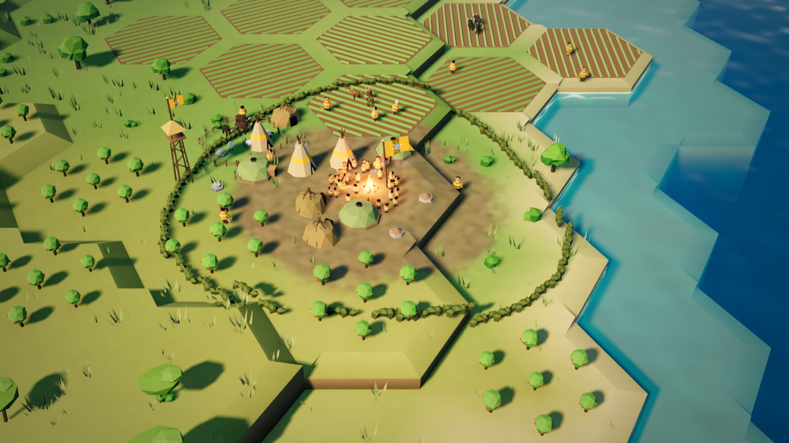

# Low-poly 3D diorama prototype

A Godot 4.7 project, all GDScript, that draws a real CivSim match frame (`data/frame40.json`, minute 40:
20 settlements, 572 figures, 267 herds; `frame20.json` too) as a stylised low-poly diorama. Every
mesh, colour and effect is generated in code. There are no textures, bitmaps or downloaded assets.



## Run

```bash
godot-mono --path game/prototypes/lowpoly3d --resolution 1600x900                 # interactive
godot-mono --path game/prototypes/lowpoly3d --resolution 1600x900 -- --shot       # renders shots/ and quits
#   options after --:  --only=map_scale,settlement_close   --frame=frame20
#   extra inspection shots (not in the default set): --only=hearth_zoom,coast_zoom
```

On a fresh checkout, run `godot-mono --path game/prototypes/lowpoly3d --headless --import` once so
Godot registers the `class_name` scripts. Headless mode does not render, so the shot mode opens a window.

| Input | Action |
|-------|--------|
| Drag (any mouse button) | Orbit (yaw, pitch) |
| Wheel | Zoom (2 to 260 tiles) |
| WASD or arrows | Pan |
| Q / E | Rotate |
| 1 2 3 4 | Spring, summer, autumn, winter |
| 5 / 6 | Load frame20 / frame40 |
| T | Golden hour on or off |
| B | Territory borders on or off |
| F | Frame the capital |

## What is built

| Part | How |
|------|-----|
| Terrain | One ArrayMesh per 20x20-tile chunk (16,000 hex prisms in total). Heights come from the elevation byte, stepped in 0.1 terraces. A one-step drop between land tiles becomes a soft ramp; bigger drops get a bevel and a cliff wall with strata. Corner colours blend with same-height neighbours, so biomes fade into each other. Land next to the sea sits low and gets sandy corners (beaches). The fragment shader adds two-tone mottling, the seasonal grade, snow, trampled earth around villages, territory tint and drifting cloud shadows. |
| Water | One plane. It reads the depth buffer for absorption (turquoise shallows over the sand shelf, deep blue offshore), a shore foam lip and breathing foam bands, procedural ripple normals and winter shore ice. |
| Rivers | The river tiles are walked into chains, ordered downstream, Chaikin-smoothed and given a gentle meander, then drawn as a water ribbon over a darker bank ribbon. They step down terraces as small rapids. Gaps in the sim's river flags are bridged. |
| Territory | Tint strength follows claim strength and camera distance: none up close, strong at region scale. Borders are a dark casing, a bright patterned line in the civ's Okabe-Ito colour and an inner glow. Each civ has its own pattern from 08 §4.3 (solid, long dash, dot, dash-dot, double, zigzag, short dash, chain). A 3.2x wider border mesh takes over when zoomed out. |
| Vegetation | MultiMesh batches per 20x20 chunk: 3 conifers, 3 broadleaves, 2 acacias, 2 jungle trees, bushes, shrubs, tall grass, tufts, reeds and rocks, about 110k instances in all. Groves come from low-frequency noise, so the savanna has clumps and clearings. Wind sway runs in the vertex shader. Close-range detail grass fades out beyond about 26 units. |
| Mountains | Six multi-peak faceted meshes with scree, rock and snow bands, offset, scaled and sometimes paired per tile so the ridge does not read as a grid. |
| Settlements | The sim does not give building positions, so the layout is procedural and deterministic. The hearth sits at the tile centre, moved off a river if needed. Dwellings and stores sit on a sunflower spiral, avoiding rivers, fields and other terraces, with doors facing the fire. Dwelling kinds come from the structure counts; the number of households is max(count, population / 5). There is also a thorn hedge ring with a gate, a lookout tower, a weir, a fenced pasture with sheep, fields with furrows and crops that change by season, orchards, a civ banner with its emblem, firelight (OmniLight), particle smoke and trampled earth. Seasonal camps get small shelters, a fire and a banner. Structures are drawn 1.45x larger than life so they read. |
| Figures | Peg people with a civ-coloured mantle and sash, a hide tunic toned per person, skin, hair and a tool by activity (spear, basket, axe, hoe, fishing pole, hammer, bundle). Children are smaller; elders stoop with a stick; convalescents lie on a mat. People at home gather round the hearth (sim position, radially compressed and kept out of the river). A soft contact shadow sits under each figure. Figures scale up with camera distance (1.25x up close, up to 2.6x) so they stay visible at map scale. |
| Herds | 1,352 animals from 267 herds. There are four body types (heavy, slender, woolly, small game), with colour and scale per species, grazing in loose clusters with a shared heading. |
| Banners | One flag mesh per civ emblem (sun, wave, leaf, star, mountain, flame, moon, antler), built from 2D polygons. Flags turn to face the camera and grow when zoomed out, so a settlement's civ reads by shape as well as colour. |
| Seasons | Climate-aware global shader parameters. Spring brings a green flush to grass and savanna. Summer is rich and golden. Autumn turns deciduous trees orange, red and yellow and the grass ochre. In winter, snow covers land beyond a latitude line, deciduous trees go bare, rivers freeze and the coasts ice up; warm latitudes get a dusty dry season instead. |
| Light and post | A warm sun that keeps its angle to the view (light from behind left), cool sky ambient, soft PCF shadows (4 splits near, 2 far), SSAO, glow, depth fog with aerial perspective, ACES tone mapping, tilt-shift depth of field (far band plus a little near), a vignette and a split-tone grade. Golden hour sets a low orange sun, warm ambient, brighter firelight and dimmer borders. |

Code layout: `scripts/world_data.gd` (frame loading, hex maths, heights), `terrain_builder.gd`
(terrain, borders, rivers), `mesh_kit.gd` + `mesh_builder.gd` + `emblems.gd` (every procedural mesh),
`world_builder.gd` (scatter, settlement layout, figures, herds), `batcher.gd` (MultiMesh batching),
`main.gd` (environment, camera, input, seasons, shot mode). Shaders are in `shaders/`.

## Shots (1600x900)

`shots/map_scale.jpg`, `settlement_close.png`, `region_overview.png`, `season_spring.png`,
`season_summer.png`, `season_autumn.png`, `season_winter.png` and `dawn_dusk.png`, plus the inspection
shots `hearth_zoom.png` (about 2 tiles across) and `coast_zoom.png`. "Capital" means the largest civ-0
settlement, which sits on the coast. The map-scale and season shots centre on civ 0's first settlement.

## Performance

These numbers come from `shots/perf.txt`, measured on an Apple M4 at 1600x900 with everything on and
vsync off. Two quiet runs agreed to within 0.2 ms. Runs while other heavy jobs shared the machine were
up to 50% slower.

| View | Frame time | Primitives (incl. shadow passes) | Draw calls |
|------|------------|----------------------------------|------------|
| settlement_close (6 tiles) | 11.8 ms (84 fps) | 2.4 M | 195 |
| map_scale (40 tiles) | 19.0 ms (53 fps) | 4.0 M | 467 |
| region_overview (160x100) | 26.2 ms (38 fps) | 4.4 M | 700 |

Building the world takes about 1.3 s of GDScript: terrain 0.38 s, vegetation 0.8 s, everything else under
0.2 s. Turning shadows off saves about a third of the map-view frame; the directional shadow passes are the main
cost; switching from PCSS to PCF already saved several ms. The next cheap wins would be far-LOD meshes for
trees (an impostor or a single blob), merging grass into the terrain shader, culling shadows per chunk and
a lower shadow resolution at region zoom.

## Known weaknesses (honest)

- **Big flat plains stay plain.** This world's savanna is gently sloping, so at 20 to 40 tiles a lot of
  the frame is one ground colour broken only by terrace ramps, tufts and cloud shadows. Smooth sub-tile
  height variation or painted-looking ground strokes would help.
- **The hex grid still shows** in terrace ramps and in fields that fill whole hexes. That is good for a
  Civ-style read and less good for the "continuous land" in 08 §1.
- **People at map scale are specks.** Below about Z1 they become coloured dots merged with the fire glow,
  and civ 0's orange is close to firelight. Z2 crowd glyphs (08 §2.3) are not built.
- **Village layout is generic.** Every settlement is one spiral round one fire. There are no paths, no
  work sites matching activities, and nobody walks.
- Mountains are still somewhat uniform. Pit houses read as smooth green domes. Lean-tos are brush domes.
- **Water is stylised, not reflective.** There is no screen-space reflection. The shelf steps between coast
  and ocean tiles show as hard hex terraces under water.
- **Borders over a golden ground.** Civ 0 (orange) and civ 3 (yellow) borders have the weakest contrast on
  savanna and autumn grass; the patterns help, but a dark casing on the outside would help more.
- The sun follows the camera yaw. That flatters every view, but some players would expect a fixed sun.
- Region view runs at about 38 fps and needs tree LODs before it ships on weaker GPUs.
